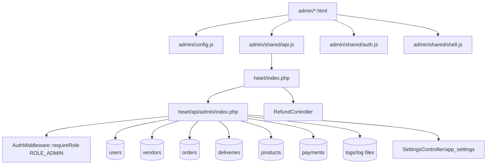

# Phase 05 — Admin Operations Map

Generated: 2026-05-12T08:15:00Z  
Scope: active project only, `wtg  live/`.  
Continuation: extends Phase 01 foundation, Phase 02 auth/roles, Phase 03 customer flow, and Phase 04 commerce/fulfillment findings.

---

## 1. Executive Operational Reality

WorkToGo admin operations are implemented as a browser admin panel under `admin/` calling a monolithic admin API under `heart/api/admin/index.php`. The backend enforces `ROLE_ADMIN` once at the top of the admin router, then route blocks perform direct SQL reads/writes across users, vendors, orders, deliveries, products, payments, logs, system config, and settings.

Evidence: `wtg  live/admin/shared/shell.js:7`, `wtg  live/admin/config.js:20`, `wtg  live/admin/shared/api.js:22`, `wtg  live/heart/index.php:195`, `wtg  live/heart/api/admin/index.php:12`.

Connected systems: admin browser pages, Heart gateway, admin API router, AuthMiddleware, DB tables, Logger, SettingsController, RefundController.

Runtime dependency: valid admin JWT stored in admin localStorage, Heart route normalization, global `$method`, `$uri`, `$db`, and ROLE_ADMIN middleware.

Operational impact: one role can perform broad manual intervention across most operational surfaces.

Scale implication: the single admin router becomes an operational monolith and bottleneck as control surfaces grow.

Maintainability impact: route behavior is distributed between frontend endpoint constants, page-specific ad hoc fetch wrappers, Heart dispatch ordering, and one large PHP file.

Confidence: High.

---

## 2. Admin Runtime Architecture

Evidence: `wtg  live/admin/config.js:8`, `wtg  live/admin/shared/api.js:43`, `wtg  live/admin/shared/auth.js:17`, `wtg  live/admin/shared/shell.js:40`, `wtg  live/heart/index.php:195`, `wtg  live/heart/api/admin/index.php:12`, `wtg  live/heart/index.php:237`.

---

## 3. Admin Dashboard and Navigation Surface

The shared shell exposes these operational groups:

| Group | Pages | Operational purpose | Evidence | Confidence |
|---|---|---|---|---|
| Overview | Dashboard | Health, finance, stuck orders, alerts | `wtg  live/admin/shared/shell.js:8`, `wtg  live/admin/dashboard.html:223` | High |
| People | Users, Vendors | User blocking/unblocking, vendor approval/rejection/deactivation | `wtg  live/admin/shared/shell.js:10`, `wtg  live/admin/users.html:95`, `wtg  live/admin/vendors.html:119` | High |
| Catalogue | Products, Services | Product/service visibility and moderation UI | `wtg  live/admin/shared/shell.js:13`, `wtg  live/admin/products.html:142`, `wtg  live/admin/services.html:122` | Medium-high |
| Operations | Orders, Delivery, Payments | Order status/cancel, delivery assignment, payment visibility | `wtg  live/admin/shared/shell.js:16`, `wtg  live/admin/orders.html:119`, `wtg  live/admin/delivery.html:99`, `wtg  live/admin/payments.html:106` | High |
| System | System Control, Logs | Settings, toggles, emergency UI, logs/activity | `wtg  live/admin/shared/shell.js:20`, `wtg  live/admin/system.html:131`, `wtg  live/admin/logs.html:105` | Medium |

Important: `refunds.html`, `analytics.html`, `settings.html`, and other admin files exist but are not in Shell navigation. They are operationally present but not first-class in the shared shell.

Evidence: `wtg  live/admin/refunds.html:510`, `wtg  live/admin/analytics.html:308`, `wtg  live/admin/settings.html:263`, `wtg  live/admin/shared/shell.js:7`.

---

## 4. Admin Operational Authority Model

Admin authority is binary at the backend admin router boundary. Once a request passes `AuthMiddleware::requireRole(ROLE_ADMIN)`, most route blocks perform direct writes without finer-grained permission checks, maker/checker approval, scoped permissions, or policy objects.

Evidence: `wtg  live/heart/api/admin/index.php:12`, `wtg  live/heart/api/admin/index.php:441`, `wtg  live/heart/api/admin/index.php:480`, `wtg  live/heart/api/admin/index.php:607`, `wtg  live/heart/api/admin/index.php:634`.

Connected systems: AuthMiddleware, users, vendors, orders, deliveries, products, logs, app/system settings.

Runtime dependency: admin JWT role claim and token validation.

Operational impact: any admin token holder can alter roles/statuses, approve vendors, cancel orders, assign delivery, purge logs, and update settings where endpoints exist.

Scale implication: lack of scoped permissions increases blast radius as admin team grows.

Maintainability impact: adding safer authority requires refactoring route-local direct SQL into policy-controlled actions.

Confidence: High.

---

## 5. Admin Dashboard Intelligence

Dashboard aggregates operational signals directly from DB:

| Signal | Source | Use | Evidence | Confidence |
|---|---|---|---|---|
| Today orders | `orders` counts by status | Daily order health | `wtg  live/heart/api/admin/index.php:23` | High |
| Pending orders | `orders` active statuses | Backlog | `wtg  live/heart/api/admin/index.php:34` | High |
| Finance today | `orders`, `wallet_transactions`, `vendor_wallets` | Revenue/refund/payout view | `wtg  live/heart/api/admin/index.php:46`, `wtg  live/heart/api/admin/index.php:56`, `wtg  live/heart/api/admin/index.php:64` | High |
| Driver cash state | `users`, `driver_wallets` | Cash-in-hand and blocked driver warning | `wtg  live/heart/api/admin/index.php:77` | High |
| Stuck orders | `orders.updated_at` older than 60 minutes | Operational exception queue | `wtg  live/heart/api/admin/index.php:93` | High |
| Failed payments | `transactions` failed today | Payment exception signal | `wtg  live/heart/api/admin/index.php:107` | High |
| Refund pending | `wallet_transactions` + `orders` refund status | Refund exception signal | `wtg  live/heart/api/admin/index.php:115`, `wtg  live/heart/api/admin/index.php:123` | Medium-high |
| Top vendors | `vendors` joined to `orders` | Performance insight | `wtg  live/heart/api/admin/index.php:140` | High |

Operational risk: dashboard query vocabulary includes columns/tables whose schema alignment is uncertain in the current dump (`vendor_wallets`, `driver_wallets`, `failed` order status, `orders.vendor_id` sales aggregation). Missing tables are only guarded for some optional queries.

Evidence: `wtg  live/heart/api/admin/index.php:27`, `wtg  live/heart/api/admin/index.php:64`, `wtg  live/heart/api/admin/index.php:77`, `wtg  live/heart/api/admin/index.php:105`.

---

## 6. Admin Intervention Boundaries

| Intervention | Backend action | Business validation level | Operational risk | Evidence |
|---|---|---|---|---|
| Update user role/status | Direct `users` update | Validates enum only | Admin can promote users to admin/vendor roles | `wtg  live/heart/api/admin/index.php:441` |
| Block/unblock user | Direct status update | No reason/audit entity | Suspension is reversible but reason not persisted structurally | `wtg  live/heart/api/admin/index.php:607` |
| Approve vendor | Sets vendor active and user role based on vendor type | No review fields/checklist | Vendor role changes require relogin; no structured approval record | `wtg  live/heart/api/admin/index.php:480` |
| Reject vendor | Sets vendor rejected | Reason only in Logger context | Rejection reason may not be visible to applicant later | `wtg  live/heart/api/admin/index.php:503` |
| Activate/deactivate vendor | Maps enabled/disabled/active/inactive to vendor status | Status only | Vendor user role remains vendor after deactivation | `wtg  live/heart/api/admin/index.php:513` |
| Order status update | Direct `orders.status` update | Only checks status exists | Can bypass vendor/order transition rules and inventory effects | `wtg  live/heart/api/admin/index.php:634` |
| Order cancel | Direct status set cancelled | No inventory release/payment logic traced | Can diverge from OrderService cancellation | `wtg  live/heart/api/admin/index.php:648` |
| Delivery assign | Inserts delivery, updates order processing | Checks driver cash block only | Can duplicate delivery rows; payload mismatch with UI | `wtg  live/heart/api/admin/index.php:552` |
| Product delete | Marks product archived and deleted_at | No ownership/vendor notification | Endpoint exists; product status toggle endpoint absent | `wtg  live/heart/api/admin/index.php:625` |
| Logs purge | Deletes old files | File age only | Audit trail can be erased by admin | `wtg  live/heart/api/admin/index.php:588` |
| Config write | Upsert system_config | Key/value only | Arbitrary config keys can be created | `wtg  live/heart/api/admin/index.php:857` |

---

## 7. Operational Failure Handling and Recovery

Admin recovery tools are partial:

- Dashboard identifies stuck orders and failed payments but does not trace a dedicated recovery action from dashboard.
- Orders page allows manual status changes/cancellation.
- Delivery page allows manual assignment.
- Refund page allows approve/reject but uses a separate auth token key and fallback stub data.
- Logs page displays logs/activity and supports log purge through admin API, but full log listing endpoint appears incomplete versus frontend expectations.

Evidence: `wtg  live/heart/api/admin/index.php:93`, `wtg  live/admin/orders.html:200`, `wtg  live/admin/delivery.html:153`, `wtg  live/admin/refunds.html:367`, `wtg  live/admin/refunds.html:370`, `wtg  live/admin/logs.html:105`, `wtg  live/heart/api/admin/index.php:577`, `wtg  live/heart/api/admin/index.php:588`.

Confidence: High for traced controls, Medium for total recovery capability.

