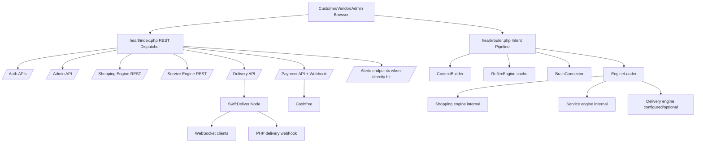

# Phase 09 — API Architecture Map

Scope: documentation-only intelligence extraction for WorkToGo API, runtime, and event orchestration. No APIs, runtime behavior, request handling, events, queues, websockets, or architecture were modified.

## Executive API Reality

WorkToGo has three coexisting API architectures:

1. **Heart REST dispatcher**: direct URI dispatch from `heart/index.php` into auth, admin, shopping, service, delivery, payment, refund, feed, settings, content, and search handlers.
2. **Heart intent pipeline**: a JSON `POST` pipeline in `heart/router.php` that resolves an `intent`, optionally calls Brain, dispatches engines, resolves a winner, and caches some responses.
3. **External delivery runtime**: SwiftDeliver Node/Railway with its own REST/WebSocket API and SQLite state, integrated via webhooks and dispatch calls.

Evidence:
- REST dispatcher route boundaries are in `heart/index.php` (`wtg  live/heart/index.php:179`, `wtg  live/heart/index.php:189`, `wtg  live/heart/index.php:195`, `wtg  live/heart/index.php:201`, `wtg  live/heart/index.php:207`, `wtg  live/heart/index.php:225`).
- Intent pipeline lifecycle is in `heart/router.php` (`wtg  live/heart/router.php:9`, `wtg  live/heart/router.php:96`, `wtg  live/heart/router.php:131`, `wtg  live/heart/router.php:144`, `wtg  live/heart/router.php:153`, `wtg  live/heart/router.php:156`, `wtg  live/heart/router.php:159`).
- SwiftDeliver API/WebSocket runtime is in `swiftdeliver-main/server.ts` (`swiftdeliver-main/server.ts:218`, `swiftdeliver-main/server.ts:910`, `swiftdeliver-main/server.ts:1125`).

Connected systems: customer SPA, vendor panel, admin panel, Heart pipeline, Brain, body engines, payment webhooks, alert polling, SwiftDeliver.

Runtime dependency: `APP_URL`, engine config, auth middleware, database connection, cURL, APCu/Redis/file cache, external Node service, browser localStorage tokens.

Operational impact: multiple API models create contract drift risk and split debugging paths.

Scale implications: direct REST, intent calls, polling, webhook callbacks, and external Node events scale independently and can overload different resources.

Maintainability impact: adding/changing one API must consider both direct REST and intent registry paths.

Confidence: High.

## API Boundary Map

## Direct REST Dispatcher Boundaries

| Boundary | Dispatcher condition | Handler | Evidence | Confidence |
|---|---|---|---|---|
| Payment | `str_starts_with($uri, '/api/payment')` | `api/payment/*.php` | `wtg  live/heart/index.php:179` | High |
| Auth | `/api/auth` | `heart/api/auth/router.php` | `wtg  live/heart/index.php:189` | High |
| Admin | `/api/admin` | `heart/api/admin/index.php` | `wtg  live/heart/index.php:195` | High |
| Delivery | `/api/delivery` | `heart/api/delivery/index.php` | `wtg  live/heart/index.php:201` | High |
| Orders | `/api/orders`, `/api/order/create`, `/api/vendor/orders` | shopping orders index | `wtg  live/heart/index.php:207` | High |
| Products | `/api/products`, `/api/vendor/products` | shopping products index | `wtg  live/heart/index.php:213` | High |
| Cart | `/api/cart` | shopping cart index | `wtg  live/heart/index.php:219` | High |
| Services/bookings/jobs | `/api/services`, `/api/service/request`, `/api/service/bookings`, `/api/jobs/` | service API | `wtg  live/heart/index.php:225` | High |
| Vendors/jobs | `/api/vendors`, `/api/vendor/jobs` | service vendor API | `wtg  live/heart/index.php:231` | High |
| Refunds | `/api/user/refund`, `/api/admin/refund` | `RefundController` | `wtg  live/heart/index.php:237` | High |
| Feed | `/api/feed` | `BrainCore::buildUserFeed()` | `wtg  live/heart/index.php:309` | High |
| Search | `/api/search` | Heart search API | `wtg  live/heart/index.php:339` | High |
| Settings | `/api/settings` | `SettingsController` | `wtg  live/heart/index.php:345` | High |
| Stories | `/api/vendor/story`, `/api/feed/stories`, `/api/story/` | `StoryController` | `wtg  live/heart/index.php:353` | High |

## Intent Pipeline Boundary

The fallback after all direct REST dispatch is `heart/router.php`, but only for `POST`; non-POST unmatched requests fail.

Evidence: fallback requires POST and includes router (`wtg  live/heart/index.php:374`, `wtg  live/heart/index.php:379`).

Intent request shape from customer API: `POST CONFIG.BASE_URL` with `{ intent, data }`.
Evidence: customer API `_intent()` (`wtg  live/app/js/api.js:81`).

Intent registry maps intent/app pairs to engine list, Brain usage, and cache TTL.
Evidence: registry (`wtg  live/heart/router.php:185`, `wtg  live/heart/router.php:195`).

Operational impact: the same business domain may be reachable by direct REST and intent pipeline with different contracts.
Scale implications: intent pipeline can call multiple engines per request, including parallel HTTP/internal calls.
Maintainability impact: route additions must be coordinated across frontend clients, `heart/index.php`, `AppRouter`, and engine internal dispatchers.
Confidence: High.

## Frontend API Client Boundaries

| Client | Runtime style | Evidence | Key behavior |
|---|---|---|---|
| Customer SPA API | central `_request()` and `_intent()` | `wtg  live/app/js/api.js:28`, `wtg  live/app/js/api.js:81` | 10s timeout, bearer token from localStorage, 401 logout |
| Customer router | hash SPA + polling | `wtg  live/app/js/router.js:20`, `wtg  live/app/js/router.js:108` | orders/bookings poll every configured interval and refresh on visibility return |
| Vendor API | direct fetch wrapper | `wtg  live/vendor/shared/api.js:17` | direct REST endpoints |
| Vendor realtime | polling-based detection | `wtg  live/vendor/shared/realtime.js:219` | 7s default poll, local known-ID set, sounds/popups |
| Admin API | direct fetch wrapper | `wtg  live/admin/shared/api.js:52` | direct admin endpoints, localStorage token |
| Alerts frontend | polling endpoint | `wtg  live/assets/js/alerts.js:57`, `wtg  live/assets/js/alerts.js:204` | 3s vendor / 7s user default polling |

## Major API Architecture Findings

### Finding 1 — Two active API models create contract drift

WHERE: direct REST dispatcher and intent pipeline coexist.
WHY: browser clients use both direct REST and intent calls; backend routes are split between `heart/index.php` and `heart/router.php`.
ROOT CAUSE: Heart pipeline was added alongside direct APIs rather than replacing or canonicalizing them.
CONNECTED SYSTEMS: customer SPA, vendor panel, admin panel, shopping/service/delivery engines, Brain.
OPERATIONAL IMPACT: a route can work in direct REST while failing through intent, or vice versa.
SCALE IMPACT: duplicate paths multiply cache/polling/load and incident debugging complexity.
MAINTAINABILITY IMPACT: API changes require checking all frontend clients and two server routing layers.
FUTURE RISK: future AI/code changes can patch the wrong route path.
Confidence: High.

### Finding 2 — Intent registry has route/engine drift risk

WHERE: `AppRouter` maps intents to engines, but internal engine dispatchers do not always implement matching intent names.
WHY: intent names live in frontend and Heart registry separately from engine switch statements.
ROOT CAUSE: no generated API contract or shared enum was traced.
CONNECTED SYSTEMS: customer `API`, vendor realtime/pages, service engine, shopping engine.
OPERATIONAL IMPACT: users can receive generic engine errors or default/fallback pipeline responses.
SCALE IMPACT: more apps/intents increase drift probability.
MAINTAINABILITY IMPACT: every new intent requires manual updates in multiple files.
FUTURE RISK: API evolution becomes unsafe without contract validation.
Confidence: High based on prior traced drift and current registry.

