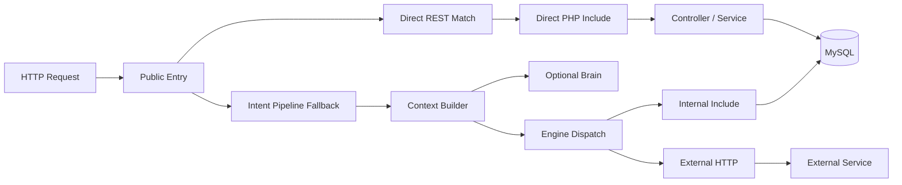

# Phase 12 — Architecture DNA Map

Generated: 2026-05-14T06:36:00Z

---

## 1. DNA Summary

WorkToGo's architecture DNA is a layered monolith with orchestration ambitions. It has clear conceptual subsystem names, but production behavior is governed by route ordering, direct file includes, shared database tables, global/static helpers, local filesystem state, and synchronous request side effects.

---

## 2. Canonical Subsystem Map

| Subsystem | Canonical Responsibility | Actual Coupling |
|---|---|---|
| Heart | Entry, routing, auth boundary, orchestration | Also constructs controllers, dispatches admin, mutates globals, handles payment/delivery route paths |
| Body shopping | Products, cart, checkout, orders | Coupled to inventory, vendors, payment, delivery, alerts, admin |
| Body service | Services, bookings, jobs, slots | Coupled to vendors, auto assignment, payments, alerts, admin |
| Brain | Decisions, events, ranking | Optional from Heart; separate event model from operations |
| Core | Shared primitives | Critical cross-module blast radius |
| Admin | Operations panel | Not bounded; direct operational table control |
| Vendor | Provider/merchant panel | Depends on role, vendor status, frontend intent contract, polling realtime |
| SwiftDeliver | Delivery/rider runtime | Separate SQLite/WebSocket truth; partial PHP mirror |

---

## 3. Runtime Orchestration Reality

Key implications:

- Direct REST and pipeline execution do not share the same middleware, cache, response, or Brain behavior.
- Internal engine includes use invisible contracts through globals and server mutation.
- Pipeline intent naming must align across frontend clients, Heart router, AppRouter, and body engine switches.
- Runtime is synchronous; downstream slowness propagates upward to PHP workers.

---

## 4. Coupling DNA

| Coupling Type | Where It Appears | Operational Consequence |
|---|---|---|
| Database coupling | users, vendors, orders, bookings, jobs, transactions, deliveries, alerts | Schema changes ripple across modules |
| Contract coupling | intent strings, status values, token keys, response envelopes | Feature additions break silently when strings drift |
| Auth coupling | JWT claims, token blacklist, users.role, vendors.status | DB health affects every protected request; stale claims persist |
| Event coupling | alerts, webhooks, cron, Brain, WebSockets | No canonical replay/idempotency layer |
| Infrastructure coupling | local logs/cache/uploads/cron lock | Horizontal scaling unsafe without substrate change |
| Admin coupling | monolithic admin API reaches all domains | Admin changes can bypass domain side effects |

---

## 5. Emerging Architecture Patterns

1. Gateway-monolith pattern: Heart is the main runtime gateway.
2. Engine-dispatch pattern: Body engines are invoked by route/intent mapping.
3. Direct-SQL domain pattern: controllers/services use SQL directly as domain API.
4. Polling-realtime pattern: many frontends simulate realtime with repeated list/fetch calls.
5. Best-effort side-effect pattern: dispatches, alerts, and some integrations log failures rather than guarantee replay.
6. Shared-helper pattern: static helpers simplify development but widen blast radius.
7. Admin-superuser pattern: admin is operationally powerful but not strongly scoped.

---

## 6. Architecture Invariants

These invariants define safe reasoning boundaries:

- MySQL is the operational source for most WorkToGo state.
- Browser localStorage is the practical frontend session store.
- JWT role claims are trusted until expiry/blacklist unless refreshed.
- Vendor approval requires users-role and vendors-status alignment.
- Product checkout is inventory/order/payment/delivery coupled.
- Service booking is booking/job/provider/assignment coupled.
- Delivery truth is split between WorkToGo and SwiftDeliver.
- Admin can directly override state and must be treated as a high-risk operator layer.

---

## 7. Future Architecture Evolution Direction

The future architecture should evolve toward domain ownership, not immediate rewrite. Safe evolution means turning implicit contracts into explicit contracts before extracting modules.

Target direction:

1. Canonical API/status schema registry.
2. Domain-owned services for finance, service scheduling, delivery synchronization, and admin operations.
3. Durable event/outbox mechanism for payment, delivery, assignment, and notification side effects.
4. Centralized observability and operational audit trails.
5. City/zone scoping and read-model separation before multi-city growth.
6. Object storage, central logs, distributed locks, and shared cache before horizontal scaling.

