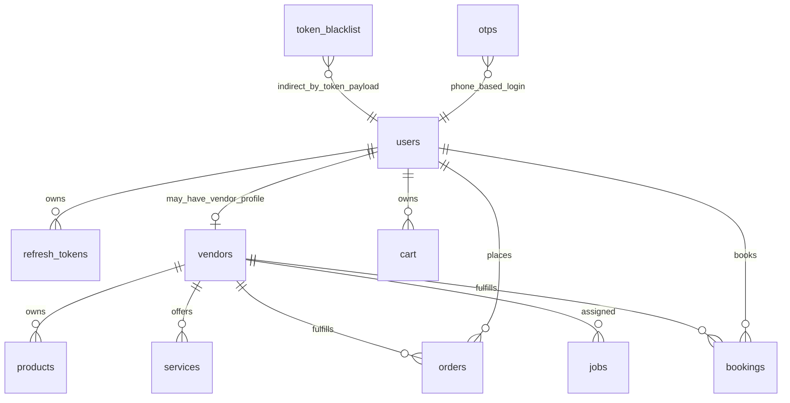

# Auth DB Relations

Generated: 2026-05-12T04:40:00Z

---

## 1. Core Auth Tables

| Table | Auth purpose | Important fields | Evidence |
|---|---|---|---|
| `users` | Main identity/role/status table | `id`, `phone`, `email`, `password`, `role`, `status`, `google_id`, `auth_type`, `is_guest`, `guest_expires_at` | `wtg  live/database-structure.sql:779` |
| `refresh_tokens` | Server-side refresh token registry | `user_id`, `token_hash`, `expires_at` | `wtg  live/database-structure.sql:695` |
| `token_blacklist` | Revoked access-token hashes | `token_hash`, `expires_at` | `wtg  live/database-structure.sql:742` |
| `otps` | Phone OTP verification | `phone`, `otp_hash`, `attempts`, `used`, `expires_at` | `wtg  live/database-structure.sql:595` |
| `vendors` | Vendor operational profile linked to user identity | `user_id`, `business_name`, `vendor_type`/`type`, `status` | `wtg  live/database-structure.sql:813` |

---

## 2. Auth Relationship Map

Evidence: `wtg  live/database-structure.sql:1543`, `wtg  live/database-structure.sql:1648`, `wtg  live/database-structure.sql:1673`.

Confidence: High for declared FKs; OTP and blacklist relations are logical, not FK-backed.

---

## 3. Indexes and Constraints Relevant to Auth

| Table | Constraint/index | Operational impact | Evidence |
|---|---|---|---|
| `users` | unique `phone`, unique `email`, key `role` | supports login lookup and role filtering | `wtg  live/database-structure.sql:1218` |
| `vendors` | unique `user_id`, unique `slug`, keys `vendor_type`, `status` | supports one vendor profile per user and vendor status lookup | `wtg  live/database-structure.sql:1229` |
| `refresh_tokens` | key `user_id`, key `token_hash` | supports refresh lookup and logout deletion | `wtg  live/database-structure.sql:1180` |
| `token_blacklist` | unique `token_hash` | supports revocation lookup and duplicate logout handling | `wtg  live/database-structure.sql:1204` |
| `otps` | key `phone` | supports OTP lookup by phone | `wtg  live/database-structure.sql:1135` |

---

## 4. Schema Drift Concern

Several PHP files query `vendors.type`, while the base schema shown defines `vendor_type`. Migrations later appear to standardize vendor type, but operational reality depends on applied migrations.

Evidence: `wtg  live/database-structure.sql:818`, `wtg  live/migrations/2026_05_01_003_standardize_vendor_type.sql`, `wtg  live/body/service-engine/api/vendors/index.php:66`.

Confidence: Medium.

Future risk: auth/vendor role mapping can fail if schema drift exists between `type` and `vendor_type`.

---

## 5. DB-Coupled Auth Operations

| Operation | Tables touched | Evidence | Confidence |
|---|---|---|---|
| Email login | `users`, `refresh_tokens` | `wtg  live/heart/api/auth/AuthController.php:90`, `wtg  live/heart/api/auth/AuthController.php:128` | High |
| Email register | `users`, `refresh_tokens` | `wtg  live/heart/api/auth/AuthController.php:39`, `wtg  live/heart/api/auth/AuthController.php:61` | High |
| OTP send | `otps` | `wtg  live/heart/api/auth/send-otp.php:32`, `wtg  live/heart/api/auth/send-otp.php:41` | High |
| OTP verify | `otps`, `users`, `refresh_tokens` | `wtg  live/heart/api/auth/verify-otp.php:21`, `wtg  live/heart/api/auth/verify-otp.php:102` | High |
| Logout | `token_blacklist`, `refresh_tokens` | `wtg  live/heart/api/auth/logout.php:18`, `wtg  live/heart/api/auth/logout.php:25` | High |
| Refresh | `refresh_tokens`, `users` | `wtg  live/heart/api/auth/refresh.php:38`, `wtg  live/heart/api/auth/refresh.php:52` | High |
| Vendor approval | `vendors`, `users` | `wtg  live/heart/api/admin/index.php:480` | High |

