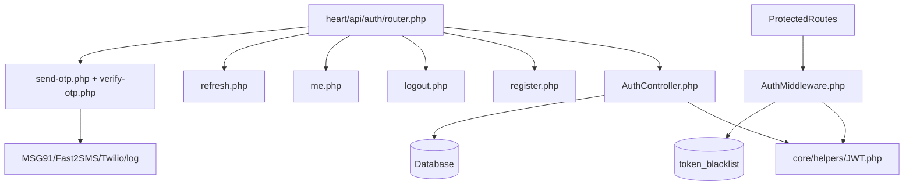

# Auth Dependency Map

Generated: 2026-05-12T04:40:00Z

---

## 1. Backend Auth Dependencies

Evidence: `wtg  live/heart/api/auth/router.php:15`, `wtg  live/heart/bootstrap.php:87`, `wtg  live/heart/bootstrap.php:93`.

---

## 2. Frontend Auth Dependencies

| Surface | Auth module | API module | Config | Evidence |
|---|---|---|---|---|
| Customer app | `app/js/auth.js` | `app/js/api.js` | `app/js/config.js` | `wtg  live/app/index.php:44`, `wtg  live/app/js/auth.js:5` |
| Vendor panel | `vendor/shared/auth.js` | `vendor/shared/api.js` | `vendor/config.js` | `wtg  live/vendor/index.php:11`, `wtg  live/vendor/shared/auth.js:6` |
| Admin panel | `admin/shared/auth.js` | `admin/shared/api.js` | `admin/config.js` | `wtg  live/admin/shared/auth.js:5`, `wtg  live/admin/shared/api.js:6` |

---

## 3. Cross-Module Coupling

### Auth to shopping
Shopping cart/orders/products depend on `AuthMiddleware` or shopping helper wrappers.

Evidence: `wtg  live/body/shopping-engine/helpers/shopping.helpers.php:72`, `wtg  live/body/shopping-engine/api/orders/OrderController.php:27`, `wtg  live/body/shopping-engine/api/products/ProductController.php:53`.

### Auth to service
Service booking/jobs/vendors resolve vendor profile from authenticated user and enforce ownership.

Evidence: `wtg  live/body/service-engine/api/services/index.php:35`, `wtg  live/body/service-engine/api/vendors/index.php:29`.

### Auth to admin
Admin routes are protected globally at file start by admin role.

Evidence: `wtg  live/heart/api/admin/index.php:12`.

### Auth to payment
Payment create/status require any authenticated user; webhook intentionally does not use auth middleware.

Evidence: `wtg  live/api/payment/create-order.php:31`, `wtg  live/api/payment/status.php:12`, `wtg  live/api/payment/webhook.php:10`.

### Auth to content/feed
Stories support optional JWT and public fallback.

Evidence: `wtg  live/body/content-engine/api/StoryController.php:85`.

---

## 4. Runtime Environment Dependencies

| Env/config | Used for | Evidence |
|---|---|---|
| `JWT_SECRET` | JWT signing/verification | `wtg  live/config/app.php:7`, `wtg  live/config/app.php:23` |
| `JWT_EXPIRY` | Some access token durations | `wtg  live/config/app.php:30` |
| `JWT_REFRESH_EXP` | Configured but not consistently used by insert SQL | `wtg  live/config/app.php:33` |
| `GOOGLE_CLIENT_IDS` / `GOOGLE_CLIENT_ID` | Google login audience validation | `wtg  live/heart/api/auth/AuthController.php:251` |
| `SMS_PROVIDER` and provider keys | OTP sending | `wtg  live/heart/api/auth/send-otp.php:71` |
| `APP_URL` | CORS origin | `wtg  live/heart/index.php:130` |

---

## 5. Scale Failure Points

1. Blacklist DB lookup on every protected request.
2. Refresh token table growth without traced rotation/cleanup.
3. Guest user row growth if guest login is used heavily.
4. Role changes do not propagate to existing JWTs.
5. Distributed permission checks increase chance of divergent behavior.
6. Heart intent registry does not declare auth requirements centrally.

Confidence: High except guest growth, which is Medium because UI exposure was not traced.

---

## 6. Mandatory Uncertainty Register

| Area | Uncertainty | Evidence boundary | Confidence |
|---|---|---|---|
| Delivery auth | Delivery endpoint internals were not deeply mapped | Route exists at `wtg  live/heart/index.php:201` | Medium |
| Brain admin/API-key auth | Brain routes were not included in deep Phase 02 auth trace | Brain routes referenced in previous foundation map | Medium |
| Guest runtime | Server route exists, but customer UI usage not found | `wtg  live/heart/api/auth/router.php:26` | Medium |
| OTP provider behavior | Depends on env and external SMS services | `wtg  live/heart/api/auth/send-otp.php:71` | Medium |
| Token cleanup | No cleanup located in traced auth files | blacklist/refresh schema and logout traced | Medium |
| Legacy vendor dashboards | HTML files using `vendor_token` may represent old/parallel auth flow | `wtg  live/vendor/dashboard-service.html:821` | Medium |

