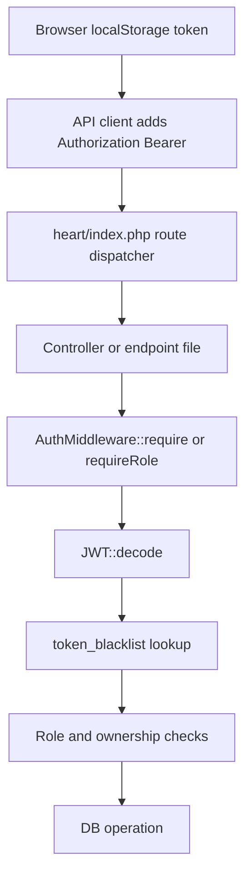

# Auth Runtime Flow

Generated: 2026-05-12T04:40:00Z

---

## 1. Runtime Entrypoints

### REST dispatcher
`heart/index.php` is the dominant API entrypoint. It loads environment/config/bootstrap, then dispatches direct REST routes before falling back to the Heart intent pipeline.

Evidence: `wtg  live/heart/index.php:62`, `wtg  live/heart/index.php:129`, `wtg  live/heart/index.php:374`.

### Auth routing
`/api/auth/*` is dispatched before admin, shopping, service, vendor, feed, and story routes.

Evidence: `wtg  live/heart/index.php:189`.

Confidence: High.

---

## 2. Runtime Auth Dependency Chain

Evidence: `wtg  live/app/js/api.js:14`, `wtg  live/vendor/shared/api.js:9`, `wtg  live/admin/shared/api.js:13`, `wtg  live/heart/middleware/AuthMiddleware.php:57`.

Runtime dependencies:

- `JWT_SECRET`
- `users`
- `token_blacklist`
- `vendors`
- `refresh_tokens`
- Browser `localStorage`
- Apache/PHP propagation of `Authorization` headers

---

## 3. Customer Runtime Flow

### Storage
Customer token storage keys:

- `wtg_token`
- `wtg_refresh_token`
- `wtg_user`
- `wtg_session`

Evidence: `wtg  live/app/js/config.js:30`, `wtg  live/app/js/auth.js:7`.

### Route protection
The customer SPA uses hash routing. Public pages include `login`, `home`, `register`, `services`, `products`, and `search`. Non-public pages require only local token+user presence.

Evidence: `wtg  live/app/js/router.js:30`, `wtg  live/app/js/router.js:64`.

### API behavior
Customer API requests add bearer token if present. On `401`, the client logs out locally and routes to login.

Evidence: `wtg  live/app/js/api.js:14`, `wtg  live/app/js/api.js:44`.

Confidence: High.

Operational implication: client route protection is convenience-only; real protection lives in backend middleware.

---

## 4. Admin Runtime Flow

### Storage
Admin uses a separate localStorage namespace:

- `wtg_admin_token`
- `wtg_admin_refresh`
- `wtg_admin_expiry`
- `wtg_admin_role`
- `wtg_admin_user`

Evidence: `wtg  live/admin/config.js:11`, `wtg  live/admin/shared/auth.js:41`.

### Login separation
Admin panel uses the same `/auth/email/login` endpoint but rejects responses unless `data.role === 'admin'`.

Evidence: `wtg  live/admin/shared/auth.js:17`, `wtg  live/admin/shared/auth.js:37`.

### Server separation
All `/api/admin/*` routes call `AuthMiddleware::requireRole(ROLE_ADMIN)` at file load before route logic.

Evidence: `wtg  live/heart/api/admin/index.php:12`.

Confidence: High.

Runtime dependency: admin client local expiry is independent of JWT `exp`; mismatch is possible.

---

## 5. Vendor Runtime Flow

### Storage
Vendor panel uses separate keys:

- `wtg_vendor_token`
- `wtg_vendor_user`

Evidence: `wtg  live/vendor/config.js:11`, `wtg  live/vendor/shared/auth.js:8`.

### Login separation
Vendor panel also uses `/api/auth/email/login`, accepts token/user, then redirects based on user role.

Evidence: `wtg  live/vendor/index.php:80`, `wtg  live/vendor/index.php:91`.

### Guard behavior
Vendor guard checks only local token and locally stored role, not token expiry or server `/me`. It rejects `customer`, `non-vendor`, and missing role.

Evidence: `wtg  live/vendor/shared/auth.js:28`, `wtg  live/vendor/shared/auth.js:61`.

Confidence: High.

Runtime implication: if local user role is stale after admin approval, vendor panel forces logout/relogin.

---

## 6. Heart Intent Pipeline Auth Coupling

Frontend customer/vendor API wrappers call the Heart pipeline with `{ intent, data }`. The pipeline itself builds context from payload and rate-limits by payload `user_id`; it does not centrally authenticate every intent.

Evidence: `wtg  live/app/js/api.js:81`, `wtg  live/vendor/shared/api.js:51`, `wtg  live/heart/router.php:117`.

Important finding: auth is not centrally enforced in the Heart pipeline. Protection depends on the downstream body engine route/controller invoked by the engine loader. Some intent routes map to public list endpoints, while write endpoints rely on engine-side `AuthMiddleware`/helper calls.

Confidence: Medium because `EngineLoader` dispatch internals were not deeply inspected in this phase.

Future scale implication: intent-to-engine auth can become difficult to reason about when new intents are added, because protection is distributed rather than declared in the intent registry.

---

## 7. Unauthorized Runtime Handling

| Runtime | `401` behavior | Evidence | Confidence |
|---|---|---|---|
| Customer app | Calls `AUTH.logout()` and routes to login | `wtg  live/app/js/api.js:44` | High |
| Vendor panel | Calls `Auth.logout()` and redirects to `index.php` | `wtg  live/vendor/shared/api.js:20` | High |
| Admin panel | Clears session and redirects unless login page | `wtg  live/admin/shared/api.js:62` | High |
| Backend | `Response::unauthorized()` or explicit JSON/HTTP response | `wtg  live/heart/middleware/AuthMiddleware.php:17` | High |

---

## 8. Runtime Fragility Notes

1. Blacklist lookup makes protected routes DB-dependent even for otherwise stateless JWT validation.
2. Customer and vendor logout do not call backend logout, so runtime revocation depends on admin behavior or explicit API use.
3. Client refresh-token storage exists, but automatic refresh on `401` was not traced.
4. Admin local expiry uses an 8-hour timer while server tokens may last 30 days for email login or `JWT_EXPIRY` for other flows.

