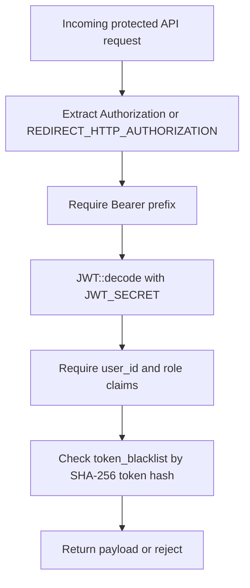
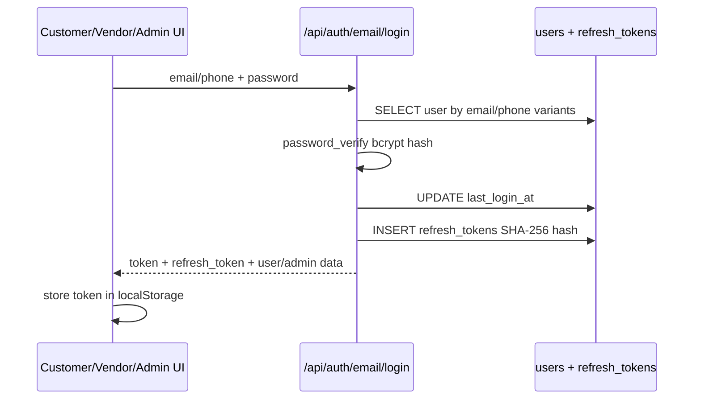
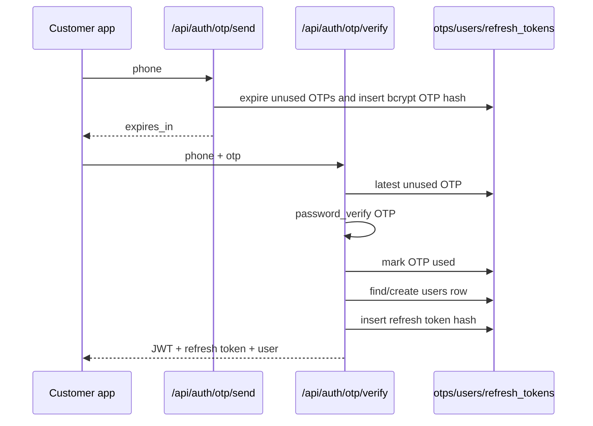

# Phase 02 — Auth System Map

Generated: 2026-05-12T04:40:00Z  
Scope: active project only, `wtg  live/`.

---

## 1. Executive Auth Reality

WorkToGo authentication is a JWT-centered system with multiple login surfaces and no server-side PHP session usage for normal users. Access tokens are passed as `Authorization: Bearer <token>` and decoded by the shared middleware. Refresh tokens exist in the database for some flows, but client-side refresh/revalidation is inconsistent.

### Main auth mechanisms traced

| Method | Entry route | Runtime behavior | Evidence | Confidence |
|---|---|---|---|---|
| Email/password login | `/api/auth/email/login` | Looks up `users` by email/phone, verifies bcrypt password, issues JWT and refresh token | `wtg  live/heart/api/auth/AuthController.php:75` | High |
| Email registration | `/api/auth/email/register` | Creates customer user with bcrypt password, returns JWT and refresh token | `wtg  live/heart/api/auth/AuthController.php:11` | High |
| Legacy phone registration | `/api/auth/register` | Creates customer/vendor user, optionally creates pending vendor profile, returns JWT using `JWT_EXPIRY` | `wtg  live/heart/api/auth/register.php:7` | High |
| OTP login | `/api/auth/otp/send` + `/api/auth/otp/verify` | Stores hashed OTP, verifies OTP, creates user if absent, issues JWT and refresh token | `wtg  live/heart/api/auth/send-otp.php:8`, `wtg  live/heart/api/auth/verify-otp.php:7` | High |
| Google login | `/api/auth/google` | Verifies Google ID token against allowed client IDs and creates/links user | `wtg  live/heart/api/auth/AuthController.php:144` | High |
| Guest login | `/api/auth/guest` | Creates guest user row and 24-hour JWT | `wtg  live/heart/api/auth/AuthController.php:260` | High |

---

## 2. Identity Model

### Primary identity table

`users` is the identity source. It stores phone, email, password hash, role, status, auth type, guest flags, Google ID, and timestamps.

Evidence: `wtg  live/database-structure.sql:779`.

### Role values

Role enum values:

- `customer`
- `vendor_service`
- `vendor_shopping`
- `admin`
- `delivery`

Evidence: `wtg  live/database-structure.sql:786`, `wtg  live/config/app.php:15`.

### Vendor identity relation

Vendor identity is split:

- `users.role` controls authorization.
- `vendors.user_id` maps a user to the operational vendor profile.
- Vendor-facing resources usually resolve `vendors.id` from `users.id` before applying ownership.

Evidence: `wtg  live/database-structure.sql:813`, `wtg  live/body/shopping-engine/api/products/ProductController.php:523`, `wtg  live/body/service-engine/api/vendors/index.php:24`.

Confidence: High.

Scale implication: every vendor protected endpoint performs DB lookup from `users.id` to `vendors.id`; at scale this requires stable indexing on `vendors.user_id`, which exists as a unique key.

---

## 3. Auth Control Plane

### Router path

`heart/index.php` routes `/api/auth/*` into `heart/api/auth/router.php`.

Evidence: `wtg  live/heart/index.php:189`, `wtg  live/heart/api/auth/router.php:15`.

### Middleware path

Protected routes use `AuthMiddleware::require()` or `AuthMiddleware::requireRole()`.

Evidence: `wtg  live/heart/middleware/AuthMiddleware.php:13`, `wtg  live/heart/middleware/AuthMiddleware.php:28`.

### Middleware validation sequence

Evidence: `wtg  live/heart/middleware/AuthMiddleware.php:57`, `wtg  live/core/helpers/JWT.php:30`.

Confidence: High.

Runtime dependency: `JWT_SECRET`, database availability for blacklist lookup, `token_blacklist` table.

Scale implication: every protected request performs a token blacklist DB query. This is secure for logout revocation but can become a hot-path bottleneck without caching or cleanup.

---

## 4. Login Flow

### Email/password flow

Evidence: `wtg  live/heart/api/auth/AuthController.php:75`, `wtg  live/app/js/auth.js:89`, `wtg  live/vendor/index.php:80`, `wtg  live/admin/shared/auth.js:17`.

Confidence: High.

Connected modules: customer app, vendor panel, admin panel, `users`, `refresh_tokens`, JWT helper.

Runtime dependency: `JWT_SECRET`, DB, browser `localStorage`.

Future scale implication: phone normalization in SQL is ad hoc and may be inefficient for large user tables.

### OTP flow

Evidence: `wtg  live/heart/api/auth/send-otp.php:20`, `wtg  live/heart/api/auth/verify-otp.php:21`, `wtg  live/app/pages/login.js:346`.

Confidence: High.

Important uncertainty: OTP provider behavior depends on environment (`SMS_PROVIDER`, provider keys); actual delivery success cannot be proven statically.

---

## 5. Registration Flow

Two registration paths coexist:

1. `/api/auth/email/register` creates only customer accounts via email/password.
2. `/api/auth/register` supports phone/password registration and accepts role `customer`, `vendor_service`, or `vendor_shopping`; vendor roles create pending vendor profiles.

Evidence: `wtg  live/heart/api/auth/AuthController.php:11`, `wtg  live/heart/api/auth/register.php:13`.

Risk: direct vendor-role registration is permitted at the API layer in `/api/auth/register`; although vendor profile status starts as pending, the JWT role is issued immediately as vendor role. This can interact dangerously with endpoints that check only role and not vendor active status.

Confidence: High.

Connected systems: vendor onboarding, service/shopping vendor endpoints, admin vendor approval.

---

## 6. Logout Flow

Logout calls `/api/auth/logout`, requires current JWT, hashes token into `token_blacklist`, and deletes all refresh tokens for that user.

Evidence: `wtg  live/heart/api/auth/logout.php:7`.

Client behavior differs:

- Customer `AUTH.logout()` only clears localStorage and routes to login; it does not call backend logout.
- Vendor `Auth.logout()` only clears localStorage and redirects.
- Admin `Auth.logout()` attempts backend logout, then clears local session.

Evidence: `wtg  live/app/js/auth.js:26`, `wtg  live/vendor/shared/auth.js:49`, `wtg  live/admin/shared/auth.js:53`.

Confidence: High.

Security implication: non-admin logout does not revoke JWT server-side; tokens remain valid until expiration unless backend logout is called elsewhere.

---

## 7. Guest Behavior

Guest login exists server-side and creates a `users` row with `is_guest=1`, `role=customer`, and 24-hour token. No traced customer UI calls `/api/auth/guest`.

Evidence: `wtg  live/heart/api/auth/AuthController.php:260`, `wtg  live/heart/api/auth/router.php:26`.

Confidence: Medium.

Uncertainty: guest behavior at runtime is partially unverified because the visible customer login page did not expose a guest login call.

Scale implication: each guest login creates a permanent DB user row unless cleanup exists elsewhere; no cleanup was traced in auth files.

---

## 8. Recovery / Reset Flow

No password reset or account recovery API was found in auth route tracing. Vendor profile UI tells users to contact administrator for email/password changes.

Evidence: search for reset/recovery only found password creation/verification and vendor profile text; `wtg  live/vendor/profile.php:100`.

Confidence: High for absence in traced files, Medium globally.

Future risk: operational support burden and insecure manual recovery practices may emerge if admins directly mutate accounts without auditable reset flow.

