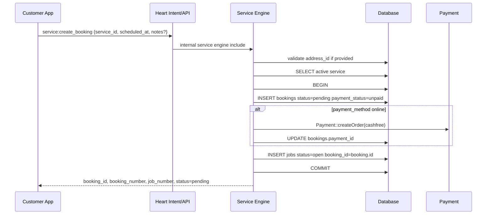

# Phase 07 — Booking Lifecycle Map

Generated: 2026-05-12T16:40:00Z

## Main Customer Booking Flow

Runtime facts:

- Customer UI sends `service_id`, `scheduled_at`, and optional notes through `service:create_booking`.
- Backend requires only `service_id` and `scheduled_at`.
- Backend optionally validates `address_id` only if provided.
- Backend creates booking and job in one transaction.
- Main flow does not check `vendor_availability_slots` and does not insert `booking_slot_reservations`.

## State Contracts

| State Area | Values Traced | Notes | Confidence |
|---|---|---|---|
| Booking | `pending`, `confirmed`, `in_progress`, `completed`, `cancelled` | Insert starts pending; job status route mirrors selected states. | High |
| Job | `open`, `assigned`, `in_progress`, `completed`, `cancelled` | Insert starts open; assignment accept jumps to in_progress. | High |
| Vendor UI | `pending`, `accepted`, `in_progress`, `completed`, `rejected` | Does not fully match backend state contract. | High |

## Booking-to-Job Divergence Risks

### Assignment accept skips booking mirror

- WHERE: `api/assignments/accept.php` updates `jobs.status='in_progress'` for job assignments.
- WHY: accept endpoint mutates jobs directly rather than calling job status mirror logic.
- ROOT CAUSE: separate assignment lifecycle from job lifecycle.
- CONNECTED SYSTEMS: auto assignment, vendor acceptance, customer booking status, alerts, vendor job list.
- OPERATIONAL IMPACT: job can become `in_progress` while booking remains `pending`.
- SCALE IMPACT: customers see stale status; support load grows.
- MAINTAINABILITY IMPACT: two state transition paths must remain synchronized manually.
- FUTURE RISK: ETA/SLA/refund/review triggers can fire from wrong state.
- Confidence: High.

### Auto-assignment cancellation cancels job but not booking

- WHERE: `cron/auto_assign.php` sets `jobs.status='cancelled'` when no vendor is available.
- WHY: cron only targets entity table and alerts user.
- ROOT CAUSE: assignment engine is polymorphic and does not call booking mirror logic.
- CONNECTED SYSTEMS: jobs, bookings, alerts, customer bookings page.
- OPERATIONAL IMPACT: customer booking can remain pending while operational job is cancelled.
- SCALE IMPACT: no-provider failures become invisible/inconsistent.
- MAINTAINABILITY IMPACT: every assignment failure needs entity-specific reconciliation.
- FUTURE RISK: refunds/cancellations/SLA compensation may target wrong state.
- Confidence: High.

## Alternate Slot-Reservation Booking Flow

`BookingController::createBooking()` requires `vendor_id`, `date`, `time`, and `user_id`, inserts a simplified booking row, locks matching availability, counts reservations, and inserts `booking_slot_reservations` if capacity remains. Route registration for this controller was not traced, and its insert omits fields required by the main service contract such as `service_id`, `total`, payment fields, and linked job.

## Cancellation and Refund Lifecycle

Traced cancellation is job-driven through `/api/jobs/{id}/status` and assignment no-vendor cancellation. No customer cancellation endpoint, reschedule endpoint, automatic refund trigger, or main-flow slot release was traced. Service online payment initiation exists, but full booking transaction/refund completion was not traced.

## Uncertainty Reporting

- Whether `BookingController::createBooking()` is active is uncertain.
- Whether payment webhooks update bookings is uncertain.
- Whether frontend/vendor intent `vendor:update_job_status` is routed correctly is uncertain.
