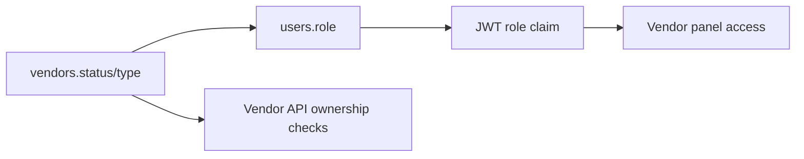
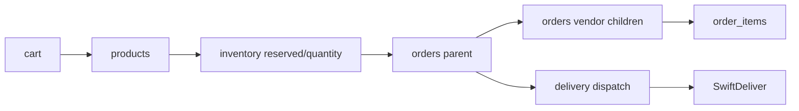
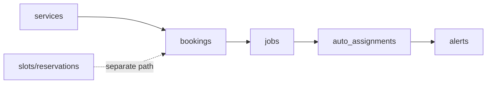
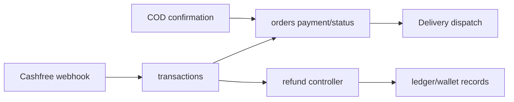
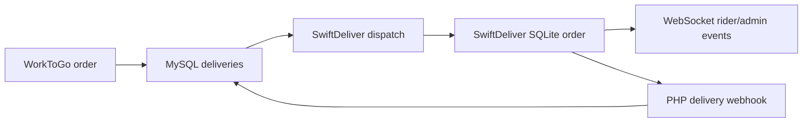

# Phase 12 — Canonical State Map

Generated: 2026-05-14T06:36:00Z

---

## 1. State Truth Summary

WorkToGo does not have one universal state machine. It has multiple local state machines whose outputs are stored in shared tables, frontend local storage, external payment/delivery systems, and polling/WebSocket views. The safest future stabilization begins by defining canonical state ownership per domain.

---

## 2. Canonical State Ownership Matrix

| Domain | Current Primary Truth | Competing Mirrors | Canonical Future Owner |
|---|---|---|---|
| Identity/session | users table plus JWT claims | localStorage user object, token blacklist | Auth domain |
| Vendor eligibility | vendors.status/type plus users.role | JWT role, vendor panel guard | Vendor identity domain |
| Product inventory | inventory counters | products/variations, order_items | Commerce inventory domain |
| Product orders | orders parent/child rows | deliveries, SwiftDeliver, vendor UI | Commerce order domain |
| Service requests | bookings plus jobs | slots/reservations, auto_assignments | Service scheduling domain |
| Payments | transactions plus orders.payment_status | Cashfree, COD internal state, refunds, ledger | Finance domain |
| Delivery | deliveries plus SwiftDeliver order | WebSocket state, webhook mirror, admin overrides | Delivery synchronization domain |
| Alerts | alerts table | vendor polling popups, Brain alerts | Notification/event domain |
| Brain/user intelligence | brain_events/profiles | operational DB events | Brain domain, fed by canonical events |

---

## 3. Critical State Chains

### 3.1 Vendor Approval Chain

Failure mode: vendor deactivation or status change may not revoke existing JWT/localStorage access immediately.

Hardening priority: High.

Future strategy: make vendor eligibility a live policy check or introduce revocation/token refresh guarantees.

### 3.2 Commerce Checkout Chain

Failure mode: inventory/order/delivery side effects can diverge after partial success or admin override.

Hardening priority: Very High.

Future strategy: explicit order state machine plus durable side-effect outbox.

### 3.3 Service Booking Chain

Failure mode: booking/job/slot states diverge because main booking path and slot reservation path are separate.

Hardening priority: High.

Future strategy: canonical service scheduling aggregate with one lifecycle definition.

### 3.4 Payment Chain

Failure mode: online/COD/refund/ledger rules are fragmented and hard to reconcile.

Hardening priority: Very High.

Future strategy: finance-owned transaction ledger, idempotency ledger, and reconciliation report.

### 3.5 Delivery Chain

Failure mode: out-of-order webhook or local SwiftDeliver state can overwrite or diverge from WorkToGo state.

Hardening priority: High.

Future strategy: monotonic transition guard plus delivery event ledger.

---

## 4. Synchronization Weakness Register

| Weakness | Root Cause | Connected Systems | Propagation | Impact | Priority |
|---|---|---|---|---|---|
| Stale JWT role/status | Claims trusted without live role/status re-read | Auth, vendor, admin, customer APIs | Old token continues access | Security and moderation delay | High |
| Parent/child order drift | Same table stores aggregate and vendor-specific states | Orders, vendors, delivery, admin | Vendor child changes may not update parent | Customer/admin mismatch | High |
| Booking/job drift | Status mirror only in some paths | Services, jobs, bookings, assignment | Job cancellation/completion not reflected everywhere | Operational confusion | High |
| Payment/dispatch duplicate risk | Multiple dispatch triggers | Payment, order, delivery | Repeated external calls or missing tracking | Delivery/reconciliation incidents | High |
| Delivery out-of-order updates | No event timestamp/transition guard traced | SwiftDeliver, deliveries, orders | Stale callback overwrites newer state | Tracking/status corruption | High |
| Alert missed delta | Timestamp polling condition and client advancement | Alerts, browser clients | Event inserted near boundary can be skipped | Missed operational popup | Medium |
| WebSocket non-durability | In-memory broadcast | SwiftDeliver, rider/admin UI | Disconnected clients miss events | Requires polling/manual recovery | High at scale |

---

## 5. Canonical State Future Rules

1. Every domain must have exactly one owner for state transitions.
2. External callbacks must be recorded as events before mutating canonical state.
3. Status updates must be monotonic or explicitly reversible by authorized transition.
4. Admin overrides must invoke domain lifecycle side effects or record compensating actions.
5. Frontend local state must never be treated as authority.
6. Polling views must be read models, not hidden state machines.

