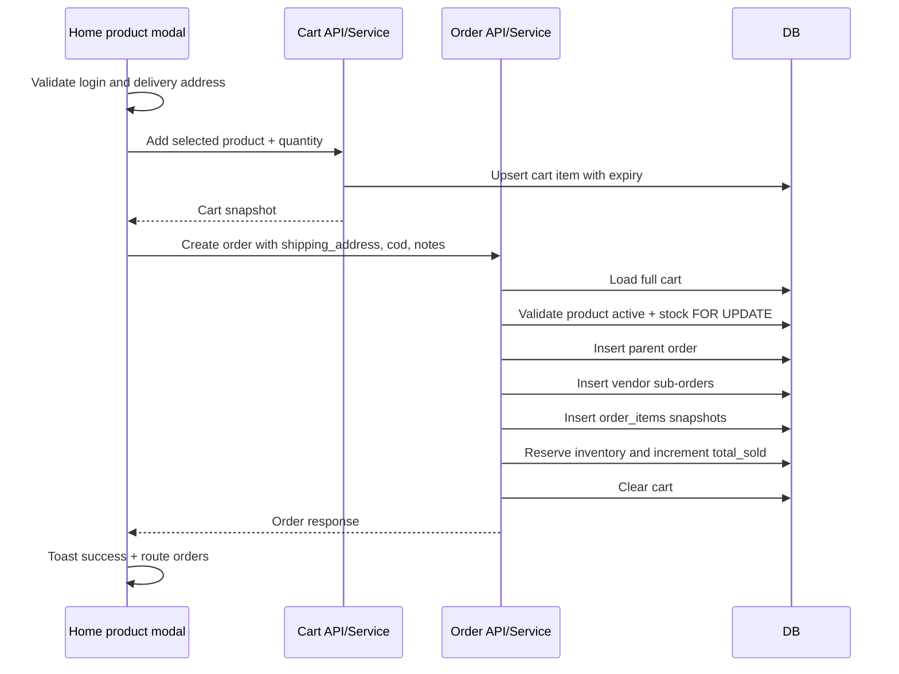

# Checkout Lifecycle

Generated: 2026-05-12T04:54:00Z

---

## 1. Current Customer Checkout Reality

The customer UI does not expose a traditional cart page. Product order flow is immediate: product card opens modal, customer enters quantity/address/notes, the app adds the product to cart, then creates an order using the entire server cart.

Evidence: `wtg  live/app/pages/home.js:108`, `wtg  live/app/pages/home.js:164`, `wtg  live/app/pages/home.js:174`.

Confidence: High.

---

## 2. Checkout Sequence

Evidence: `wtg  live/app/pages/home.js:148`, `wtg  live/body/shopping-engine/api/cart/CartService.php:140`, `wtg  live/body/shopping-engine/api/orders/OrderService.php:67`.

---

## 3. Cart Lifecycle

Cart rows are stored in `cart` and may be associated with `user_id` or `session_id` in schema, but traced CartController requires authenticated user ID for all cart operations.

Evidence: `wtg  live/database-structure.sql:363`, `wtg  live/body/shopping-engine/api/cart/CartController.php:18`.

Cart properties:

- Max 20 items.
- Max quantity 50 per item.
- 30-day expiry.
- Atomic insert/upsert for `(user_id, product_id)`.

Evidence: `wtg  live/body/shopping-engine/api/cart/CartService.php:22`, `wtg  live/body/shopping-engine/api/cart/CartService.php:184`.

User impact: cart persists server-side for logged-in users, but there is no visible customer cart UI in the traced SPA.

Mobile impact: quick checkout avoids cart complexity, but users cannot easily review existing cart contents.

Scale implication: abandoned carts persist up to 30 days unless cleaned.

Confidence: High.

---

## 4. Order Placement Lifecycle

Order creation validates address, locks payment method to COD, loads cart, blocks unavailable items, groups cart by vendor, creates parent order and vendor sub-orders, inserts order item snapshots, reserves stock, increments `total_sold`, clears cart, emits event hook, and dispatches to delivery.

Evidence: `wtg  live/body/shopping-engine/api/orders/OrderService.php:67`, `wtg  live/body/shopping-engine/api/orders/OrderService.php:135`, `wtg  live/body/shopping-engine/api/orders/OrderService.php:165`, `wtg  live/body/shopping-engine/api/orders/OrderService.php:215`, `wtg  live/body/shopping-engine/api/orders/OrderService.php:300`.

Runtime dependency: authenticated customer/admin role, cart state, inventory locks, orders/order_items tables, delivery dispatch integration.

User impact: the order may include all current cart items, not necessarily only the modal product.

Mobile impact: simple flow but hidden cart behavior can confuse mobile users.

Confidence: High.

---

## 5. Payment Lifecycle

Customer UI currently sends `payment_method: 'cod'` when creating orders. OrderService only permits `cod` in its allowed methods.

Evidence: `wtg  live/app/pages/home.js:174`, `wtg  live/body/shopping-engine/api/orders/OrderService.php:44`, `wtg  live/body/shopping-engine/api/orders/OrderService.php:97`.

Separate payment API supports `/api/payment/create-order` for `online` and `cod`, but no customer frontend call to it was traced.

Evidence: `wtg  live/api/payment/create-order.php:3`, `wtg  live/app/js/api.js:85`.

Confidence: High.

Uncertainty: whether external pages or older clients use payment API could not be confirmed from customer SPA trace.

---

## 6. Address Handling

Customer order modal collects a free-text delivery address and sends it as `shipping_address`. Backend accepts either structured object or string. String is stored as JSON `{ "address": "..." }` in `orders.shipping_address`.

Evidence: `wtg  live/app/pages/home.js:133`, `wtg  live/app/pages/home.js:158`, `wtg  live/body/shopping-engine/api/orders/OrderService.php:72`, `wtg  live/body/shopping-engine/api/orders/OrderService.php:89`.

DB has an `addresses` table, but traced customer checkout does not use it.

Evidence: `wtg  live/database-structure.sql:30`, `wtg  live/app/pages/home.js:174`.

User impact: customers must retype address each order; no saved/default address UX was traced.

Mobile impact: free-text address entry on mobile is friction-prone and error-prone.

Scale implication: unstructured shipping address limits delivery automation and validation.

Confidence: High.

---

## 7. Order Confirmation and Status

Frontend confirms success with toast and routes to orders page after 800ms. Backend returns order ID, order number, status `pending`, totals, vendor sub-orders, and payment data.

Evidence: `wtg  live/app/pages/home.js:182`, `wtg  live/body/shopping-engine/api/orders/OrderService.php:311`.

Orders page loads and filters local list into All/Active/Completed.

Evidence: `wtg  live/app/pages/orders.js:19`, `wtg  live/app/pages/orders.js:70`.

Important mismatch: orders page active statuses include `accepted`, while backend order statuses include `confirmed`, `processing`, `shipped`, and `delivered`; UI status mapping handles aliases but filter logic may omit some active orders.

Evidence: `wtg  live/app/pages/orders.js:44`, `wtg  live/database-structure.sql:544`, `wtg  live/app/js/ui.js:31`.

Confidence: High.

