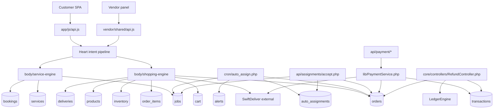

# Commerce + Fulfillment Dependency Map

Generated: 2026-05-12T05:36:00Z

---

## 1. Fulfillment Dependency Graph

Evidence: `wtg  live/app/js/api.js:109`, `wtg  live/vendor/shared/api.js:51`, `wtg  live/heart/router.php:195`, `wtg  live/body/shopping-engine/index.php:20`, `wtg  live/body/service-engine/index.php:29`, `wtg  live/cron/auto_assign.php:61`, `wtg  live/api/assignments/accept.php:29`, `wtg  live/api/payment/create-order.php:75`, `wtg  live/core/controllers/RefundController.php:19`.

---

## 2. Route / Intent Fulfillment Map

| Surface | Call/route | Backend mapping | Primary DB tables | Auth | Notes |
|---|---|---|---|---|---|
| Customer product order | `shopping:create_order` | Heart → shopping engine → `OrderController::create()` → `OrderService::create()` | `cart`, `orders`, `order_items`, `inventory`, `products`, `deliveries` | JWT required in controller path | Creates parent order and vendor sub-orders |
| Customer order list | `shopping:list_orders` | Heart → shopping engine route mapping exists; controller list path previously traced in Phase 03 | `orders` | JWT required | Parent orders only from service list method |
| Vendor order list intended by AppRouter | `vendor:list_orders` | AppRouter sends to shopping engine, but shopping engine switch does not handle this exact intent | none if default response | JWT likely provided by frontend | Intent drift; shopping switch expects `shopping:vendor_orders` |
| Vendor order update intended by AppRouter | `vendor:update_order_status` | AppRouter does not list this exact route; shopping switch expects `shopping:vendor_update_order` | none if unresolved | JWT likely provided by frontend | High risk of 422/unmapped intent |
| Service booking | `service:create_booking` | Heart → service engine → `/api/service/request` | `bookings`, `jobs`, `services`, `addresses` | JWT required | Creates job automatically |
| Vendor service bookings intended | `vendor:list_jobs` | AppRouter sends to service engine, but service engine switch does not handle `vendor:list_jobs` | none if default response | JWT likely provided | Service switch expects `service:vendor_bookings` |
| Vendor job update intended | `vendor:update_job_status` | AppRouter does not list exact route; service switch expects `service:vendor_update_booking` | none if unresolved | JWT likely provided | High risk of unmapped vendor panel actions |
| Assignment accept direct API | `/api/assignments/accept.php` | Direct file endpoint | `auto_assignments`, `orders`, `jobs`, `alerts`, `vendors` | `vendor_service` or `vendor_shopping` | Lock-safe accept flow |
| Payment create order | `/api/payment/create-order` | Direct payment API → `PaymentService` | `orders`, possibly Cashfree | JWT required | Product online payment path exists but not used by traced customer SPA |
| Payment webhook | `/api/payment/webhook` | Direct payment API → `PaymentService::processWebhook()` | `orders`, `transactions`, `deliveries` | Webhook verification expected in endpoint | Inserts successful transactions for paid orders |
| Refund request/admin | `/api/user/refund/*`, `/api/admin/refund/*` | Core `RefundController` via admin/core routing | `transactions`, `orders` | user/admin JWT | Refunds require transaction row |

Evidence: `wtg  live/heart/router.php:204`, `wtg  live/body/shopping-engine/index.php:40`, `wtg  live/body/shopping-engine/api/orders/OrderService.php:67`, `wtg  live/vendor/shared/api.js:82`, `wtg  live/heart/router.php:218`, `wtg  live/body/shopping-engine/index.php:46`, `wtg  live/body/service-engine/index.php:46`, `wtg  live/body/service-engine/api/services/index.php:204`, `wtg  live/api/assignments/accept.php:1`, `wtg  live/api/payment/create-order.php:3`, `wtg  live/lib/PaymentService.php:169`, `wtg  live/core/controllers/RefundController.php:15`.

---

## 3. Data Coupling Map

| Coupling | Direction | Meaning | Evidence | Risk |
|---|---|---|---|---|
| Cart → Orders | Cart is source for order creation | Order payload does not carry line items directly; cart is loaded server-side | `wtg  live/body/shopping-engine/api/orders/OrderService.php:111` | Cart corruption affects checkout |
| Orders → OrderItems | Vendor sub-orders own item snapshots | Items inserted against child order IDs | `wtg  live/body/shopping-engine/api/orders/OrderService.php:243` | Parent order has no direct item rows |
| Orders → Inventory | Checkout reserves; delivery/cancel releases/deducts | Reserved stock is central to availability | `wtg  live/body/shopping-engine/api/orders/OrderService.php:265`, `wtg  live/body/shopping-engine/api/orders/OrderService.php:501` | Stock drift if status updates fail midway |
| Orders → Deliveries | OrderService creates/fetches delivery records | Delivery row may be inserted after transaction commit | `wtg  live/body/shopping-engine/api/orders/OrderService.php:977` | Dispatch can fail without rolling order back |
| Bookings → Jobs | Service booking auto-creates operational job | Every booking should have a job number | `wtg  live/body/service-engine/api/services/index.php:290` | Booking/job status can diverge outside mirrored update path |
| Jobs → Bookings | Job status mirrors to booking status | Vendor/admin job update maps status back to booking | `wtg  live/body/service-engine/api/services/index.php:448` | Only PATCH path mirrors; assignment accept sets job in_progress directly |
| AutoAssignments → Orders/Jobs | Assignment records dispatch attempts | Accept mutates entity vendor/status | `wtg  live/api/assignments/accept.php:96`, `wtg  live/api/assignments/accept.php:102` | Assignment can conflict with existing vendor ownership |
| Transactions → Refunds | Refund metadata lives on transaction row | RefundController updates transaction status fields | `wtg  live/core/controllers/RefundController.php:78` | No transaction means no refund flow |

---

## 4. Continuity Notes from Earlier Phases

- Phase 01 identified weak payment boundaries and external SwiftDeliver dependency. Phase 04 confirms both issues are operationally central to fulfillment.
- Phase 02 identified distributed permissions. Phase 04 confirms ownership checks exist in service/job paths, vendor order paths, assignment accept, payment order ownership, and refund ownership, but are not centralized.
- Phase 03 identified COD-only customer product checkout and no visible cart page. Phase 04 confirms the backend order service is hard-locked to COD for direct product checkout.

Evidence: `WTG-SYSTEM-BRAIN/architecture-overview.md:77`, `WTG-SYSTEM-BRAIN/auth-system-map.md`, `WTG-SYSTEM-BRAIN/customer-flow-map.md:136`, `wtg  live/body/shopping-engine/api/orders/OrderService.php:44`.

