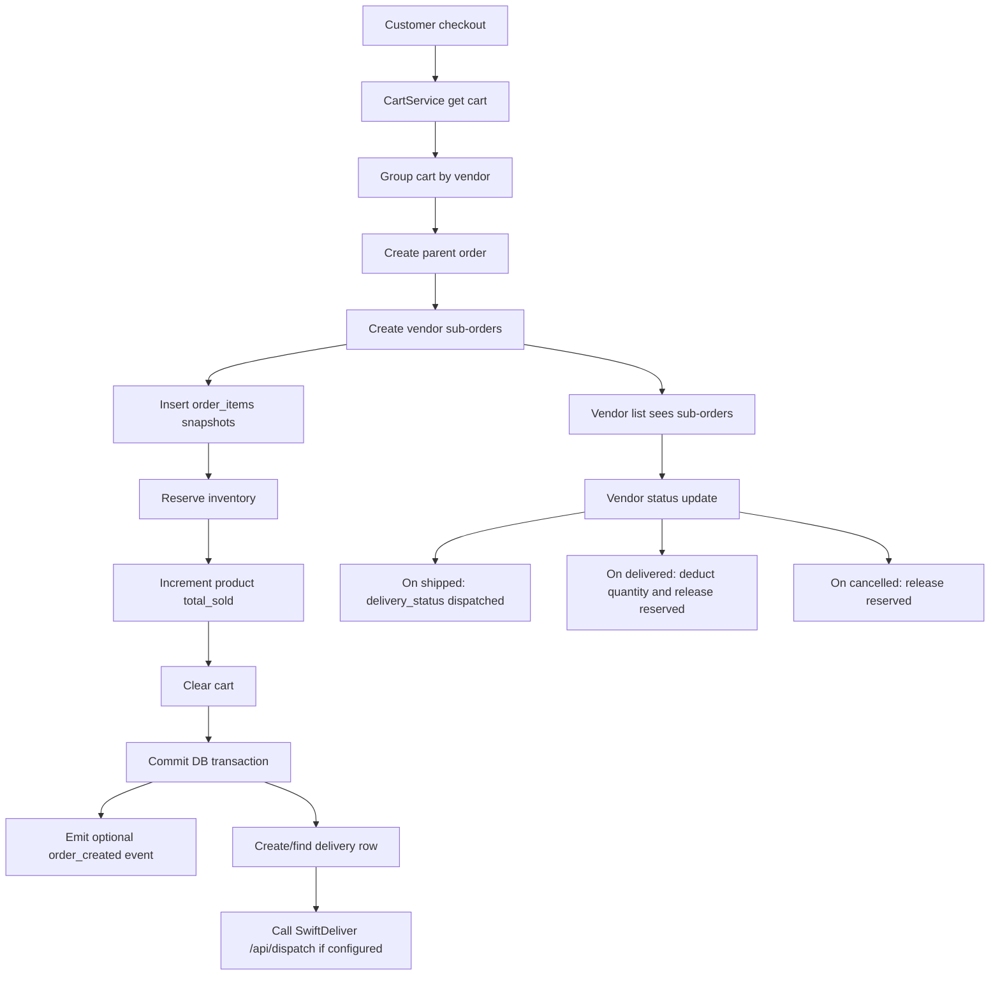
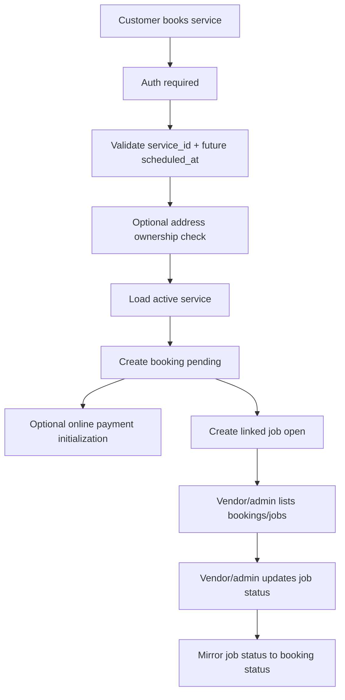
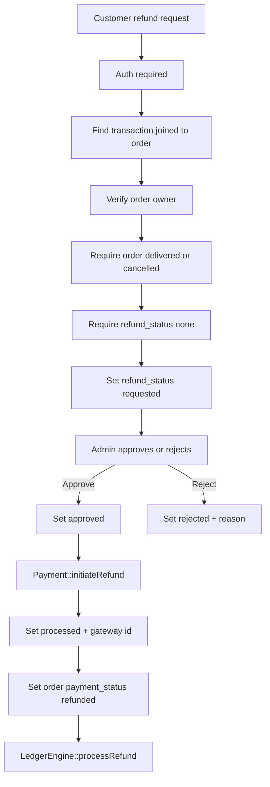

# Phase 04 — Commerce + Fulfillment Intelligence Map

Generated: 2026-05-12T05:36:00Z  
Scope: active project only, `wtg  live/`.  
Continuation: builds on Phase 01 Core Foundation, Phase 02 Auth + User System, and Phase 03 Customer Flow. This file does not restart assumptions; it extends the customer checkout, auth, route, and dependency traces already recorded.

---

## 1. Executive Fulfillment Reality

WorkToGo currently has two fulfillment tracks:

1. Product commerce fulfillment: cart → parent order → vendor sub-orders → inventory reservation → optional vendor status changes → optional external delivery dispatch.
2. Service fulfillment: service request → booking → linked job → vendor/admin job status updates → mirrored booking status.

The implementation is DB-centered and transaction-heavy. Order creation is handled by the shopping engine, service booking by the service engine, delivery dispatch is partly externalized to SwiftDeliver, and refunds/ledger processing live in core controllers/helpers.

Evidence: `wtg  live/body/shopping-engine/api/orders/OrderService.php:67`, `wtg  live/body/service-engine/api/services/index.php:204`, `wtg  live/body/service-engine/api/services/index.php:409`, `wtg  live/lib/PaymentService.php:169`, `wtg  live/core/controllers/RefundController.php:176`.

Confidence: High for traced PHP paths. Medium for external SwiftDeliver behavior because only integration calls were traced, not remote runtime internals.

---

## 2. Commerce Fulfillment Flow

Evidence: `wtg  live/body/shopping-engine/api/orders/OrderService.php:111`, `wtg  live/body/shopping-engine/api/orders/OrderService.php:135`, `wtg  live/body/shopping-engine/api/orders/OrderService.php:165`, `wtg  live/body/shopping-engine/api/orders/OrderService.php:215`, `wtg  live/body/shopping-engine/api/orders/OrderService.php:243`, `wtg  live/body/shopping-engine/api/orders/OrderService.php:265`, `wtg  live/body/shopping-engine/api/orders/OrderService.php:300`, `wtg  live/body/shopping-engine/api/orders/OrderService.php:305`, `wtg  live/body/shopping-engine/api/orders/OrderService.php:308`, `wtg  live/body/shopping-engine/api/orders/OrderService.php:429`.

---

## 3. Service Fulfillment Flow

Evidence: `wtg  live/body/service-engine/api/services/index.php:204`, `wtg  live/body/service-engine/api/services/index.php:206`, `wtg  live/body/service-engine/api/services/index.php:216`, `wtg  live/body/service-engine/api/services/index.php:228`, `wtg  live/body/service-engine/api/services/index.php:239`, `wtg  live/body/service-engine/api/services/index.php:256`, `wtg  live/body/service-engine/api/services/index.php:282`, `wtg  live/body/service-engine/api/services/index.php:290`, `wtg  live/body/service-engine/api/services/index.php:327`, `wtg  live/body/service-engine/api/services/index.php:409`, `wtg  live/body/service-engine/api/services/index.php:448`.

Important distinction from Phase 03: customer booking flow was already traced from the SPA perspective; this phase focuses on operational lifecycle after the booking/order exists.

---

## 4. Product Order Lifecycle Detail

| Stage | Runtime action | DB writes/reads | Operational impact | Evidence | Confidence |
|---|---|---|---|---|---|
| Rate gate | Counts parent orders by user within 60 seconds | `orders` read | Max 5 parent orders per minute; failure message is RuntimeException, controller mapping may not return true 429 | `wtg  live/body/shopping-engine/api/orders/OrderService.php:69`, `wtg  live/body/shopping-engine/api/orders/OrderService.php:763` | High |
| Address capture | Accepts structured or free-text shipping address | `orders.shipping_address` JSON | Customer address table is not required for product order fulfillment | `wtg  live/body/shopping-engine/api/orders/OrderService.php:72`, `wtg  live/body/shopping-engine/api/orders/OrderService.php:88` | High |
| Payment gate | `ALLOWED_PAYMENT_METHODS` only allows `cod` in OrderService | `orders.payment_method` | Product checkout path is COD-locked despite separate payment API existing | `wtg  live/body/shopping-engine/api/orders/OrderService.php:44`, `wtg  live/body/shopping-engine/api/orders/OrderService.php:97` | High |
| Cart load | Loads cart through CartService | `cart`, product/inventory joins via CartService | Cart is the source of order truth, not direct payload item list | `wtg  live/body/shopping-engine/api/orders/OrderService.php:111` | High |
| Availability recheck | Locks inventory and joins active product | `inventory`, `products` | Prevents checkout for inactive/deleted products after cart add | `wtg  live/body/shopping-engine/api/orders/OrderService.php:144`, `wtg  live/body/shopping-engine/api/orders/OrderService.php:799` | High |
| Multi-vendor split | Parent order plus vendor sub-orders | `orders.parent_order_id`, `orders.vendor_id` | Customer sees parent; vendors operate on sub-orders | `wtg  live/body/shopping-engine/api/orders/OrderService.php:165`, `wtg  live/body/shopping-engine/api/orders/OrderService.php:215` | High |
| Item snapshot | Copies name/SKU/price at order time | `order_items` | Fulfillment is stable even if product later changes | `wtg  live/body/shopping-engine/api/orders/OrderService.php:243` | High |
| Stock reservation | Increments `inventory.reserved`; does not decrement physical quantity | `inventory.reserved`, `products.total_sold` | Available stock falls immediately; physical stock changes only at delivery | `wtg  live/body/shopping-engine/api/orders/OrderService.php:265`, `wtg  live/body/shopping-engine/api/orders/OrderService.php:278` | High |
| Cart clear | Clears cart after successful DB writes | `cart` | User cannot retry same cart after successful order | `wtg  live/body/shopping-engine/api/orders/OrderService.php:300` | High |
| Delivery dispatch | Creates/fetches delivery row and calls SwiftDeliver | `deliveries`; external HTTP | Non-fatal; order can exist even when dispatch fails | `wtg  live/body/shopping-engine/api/orders/OrderService.php:965` | High |

---

## 5. Vendor Order Fulfillment

Vendor product fulfillment is scoped to vendor sub-orders, not parent orders.

| Vendor action | Allowed transition | Side effects | Evidence | Confidence |
|---|---|---|---|---|
| Confirm | `pending` → `confirmed` | Sets `confirmed_at` | `wtg  live/body/shopping-engine/api/orders/OrderService.php:463`, `wtg  live/body/shopping-engine/api/orders/OrderService.php:485` | High |
| Start processing | `confirmed` → `processing` | No stock movement | `wtg  live/body/shopping-engine/api/orders/OrderService.php:466` | High |
| Ship | `processing` → `shipped` | Sets `shipped_at`; sets `delivery_status = dispatched` | `wtg  live/body/shopping-engine/api/orders/OrderService.php:487` | High |
| Deliver | `shipped` → `delivered` | Sets `delivered_at`; sets `delivery_status = delivered`; decrements physical stock; releases reserved stock | `wtg  live/body/shopping-engine/api/orders/OrderService.php:490`, `wtg  live/body/shopping-engine/api/orders/OrderService.php:501` | High |
| Cancel/reject | `pending/confirmed/processing` → `cancelled` based on transition map | Sets `cancelled_at`; releases reserved stock for that vendor order | `wtg  live/body/shopping-engine/api/orders/OrderService.php:438`, `wtg  live/body/shopping-engine/api/orders/OrderService.php:514` | High |

Vendor order list excludes cancelled/failed/refunded by default and requires either COD or paid online payment.

Evidence: `wtg  live/body/shopping-engine/api/orders/OrderService.php:645`, `wtg  live/body/shopping-engine/api/orders/OrderService.php:652`, `wtg  live/body/shopping-engine/api/orders/OrderService.php:665`.

Important lifecycle gap: vendor sub-order status changes do not visibly reconcile the parent order status. Parent order may remain `pending` while vendor sub-orders move through `confirmed`, `processing`, `shipped`, or `delivered` unless another untraced reconciler exists.

Evidence boundary: `wtg  live/body/shopping-engine/api/orders/OrderService.php:537` updates the vendor order row by ID/vendor only; no parent aggregation update was traced in this service.

---

## 6. Auto Assignment Engine

The cron assignment engine attempts to assign open jobs and unassigned parent orders to online active vendors.

### Runtime behavior

1. Uses a filesystem lock to avoid overlapping cron execution.
2. Loads assignment settings from `platform_settings`.
3. Marks stale pending assignments as `timeout` and clears lock times.
4. Recovers old entity locks older than 2 minutes.
5. Selects eligible jobs and parent orders with `FOR UPDATE SKIP LOCKED`.
6. Creates `auto_assignments` rows for the nearest online vendor not already attempted.
7. Inserts user/vendor alerts.
8. Cancels entities when no vendors are available.

Evidence: `wtg  live/cron/auto_assign.php:11`, `wtg  live/cron/auto_assign.php:18`, `wtg  live/cron/auto_assign.php:34`, `wtg  live/cron/auto_assign.php:57`, `wtg  live/cron/auto_assign.php:61`, `wtg  live/cron/auto_assign.php:134`, `wtg  live/cron/auto_assign.php:151`, `wtg  live/cron/auto_assign.php:163`.

### Assignment accept flow

Vendor acceptance validates role, vendor profile, pending assignment ownership, entity status, and absence of another accepted assignment. It then marks the assignment accepted, updates job/order status/vendor, and writes alerts.

Evidence: `wtg  live/api/assignments/accept.php:12`, `wtg  live/api/assignments/accept.php:32`, `wtg  live/api/assignments/accept.php:44`, `wtg  live/api/assignments/accept.php:63`, `wtg  live/api/assignments/accept.php:85`, `wtg  live/api/assignments/accept.php:96`, `wtg  live/api/assignments/accept.php:102`, `wtg  live/api/assignments/accept.php:127`.

### Assignment model risk

Product orders created by `OrderService` already split into vendor sub-orders. Cron assignment selects parent orders where `parent_order_id IS NULL AND vendor_id IS NULL`, then accepting an order sets the parent `vendor_id` and status to `processing`. This can conflict conceptually with vendor sub-orders, because product fulfillment ownership is otherwise represented on child orders.

Evidence: `wtg  live/body/shopping-engine/api/orders/OrderService.php:215`, `wtg  live/cron/auto_assign.php:71`, `wtg  live/api/assignments/accept.php:115`.

Confidence: High that both mechanisms exist; Medium on intended business meaning.

---

## 7. Payment + Settlement Reality

There are two payment implementations in active paths:

| Payment path | Where | Applies to | Behavior | Evidence | Confidence |
|---|---|---|---|---|---|
| OrderService inline lock | Shopping order creation | Product orders | Hard-rejects non-COD despite retaining unreachable online branch | `wtg  live/body/shopping-engine/api/orders/OrderService.php:44`, `wtg  live/body/shopping-engine/api/orders/OrderService.php:189` | High |
| Payment API + PaymentService | `/api/payment/create-order`, webhooks | Existing product orders | Can create Cashfree sessions, confirm COD, process webhook, insert transactions, dispatch delivery after paid | `wtg  live/api/payment/create-order.php:3`, `wtg  live/lib/PaymentService.php:39`, `wtg  live/lib/PaymentService.php:134`, `wtg  live/lib/PaymentService.php:169` | High |
| Core Payment helper | Service booking and refunds | Service bookings/refunds | `Payment::createOrder` for service booking online, `Payment::initiateRefund` for admin refunds | `wtg  live/body/service-engine/api/services/index.php:282`, `wtg  live/core/controllers/RefundController.php:231` | Medium-high |

Important continuation from Phase 03: customer product checkout currently uses COD and does not visibly call the payment API. Phase 04 confirms that backend online payment infrastructure exists but is not aligned with the traced product order creation path.

---

## 8. Refund Lifecycle

Refunds operate against `transactions`, not directly against orders. The flow requires a successful transaction row already linked to an order.

Evidence: `wtg  live/core/controllers/RefundController.php:19`, `wtg  live/core/controllers/RefundController.php:44`, `wtg  live/core/controllers/RefundController.php:60`, `wtg  live/core/controllers/RefundController.php:66`, `wtg  live/core/controllers/RefundController.php:72`, `wtg  live/core/controllers/RefundController.php:78`, `wtg  live/core/controllers/RefundController.php:176`, `wtg  live/core/controllers/RefundController.php:226`, `wtg  live/core/controllers/RefundController.php:230`, `wtg  live/core/controllers/RefundController.php:243`, `wtg  live/core/controllers/RefundController.php:256`, `wtg  live/core/controllers/RefundController.php:260`, `wtg  live/core/controllers/RefundController.php:314`, `wtg  live/core/controllers/RefundController.php:357`.

Risk note: COD orders do not create successful `transactions` in the traced product order flow. RefundController therefore mainly supports online-payment orders with transaction records unless other transaction writers exist outside this trace.

Evidence boundary: `wtg  live/lib/PaymentService.php:244` creates transactions only after paid online webhook success.

---

## 9. Operational State Map

| Entity | Main statuses | Who changes it | Fulfillment meaning | Evidence |
|---|---|---|---|---|
| `orders` parent | `pending`, `confirmed`, `processing`, `shipped`, `delivered`, `cancelled`, `refunded` | customer cancel, payment service, auto assignment, maybe admin | Customer-facing order container; also auto-assignment target | `wtg  live/database-structure.sql:535`, `wtg  live/body/shopping-engine/api/orders/OrderService.php:165`, `wtg  live/lib/PaymentService.php:145`, `wtg  live/api/assignments/accept.php:115` |
| `orders` child/vendor | same order enum | vendor update | Vendor fulfillment unit | `wtg  live/body/shopping-engine/api/orders/OrderService.php:215`, `wtg  live/body/shopping-engine/api/orders/OrderService.php:429` |
| `inventory` | quantity/reserved counts | checkout, cancel, vendor delivered/cancelled | Availability and physical stock control | `wtg  live/database-structure.sql:480`, `wtg  live/body/shopping-engine/api/orders/OrderService.php:265`, `wtg  live/body/shopping-engine/api/orders/OrderService.php:501` |
| `bookings` | `pending`, `confirmed`, `in_progress`, `completed`, `cancelled` | service request, job status mirror | Customer service request status | `wtg  live/database-structure.sql:118`, `wtg  live/body/service-engine/api/services/index.php:256`, `wtg  live/body/service-engine/api/services/index.php:448` |
| `jobs` | `open`, `assigned`, `in_progress`, `completed`, `cancelled` | service request, vendor/admin status, auto assignment accept | Vendor operational task | `wtg  live/database-structure.sql:498`, `wtg  live/body/service-engine/api/services/index.php:290`, `wtg  live/body/service-engine/api/services/index.php:435`, `wtg  live/api/assignments/accept.php:102` |
| `auto_assignments` | `pending`, `accepted`, `rejected`, `timeout` | cron, vendor accept | Dispatch queue/attempt ledger | `wtg  live/database-structure.sql:102`, `wtg  live/cron/auto_assign.php:151`, `wtg  live/api/assignments/accept.php:96` |
| `deliveries` | `pending`, `assigned`, `picked`, `delivered`, `cancelled` | OrderService/PaymentService/external SwiftDeliver | Last-mile delivery record | `wtg  live/database-structure.sql:420`, `wtg  live/body/shopping-engine/api/orders/OrderService.php:977`, `wtg  live/lib/PaymentService.php:301` |
| `transactions` | payment `pending/success/failed`, refund `none/requested/approved/rejected/processed` | payment webhook, refund controller | Settlement/refund source of truth | `wtg  live/database-structure.sql:755`, `wtg  live/lib/PaymentService.php:244`, `wtg  live/core/controllers/RefundController.php:78` |

---

## 10. Mandatory Risk Register

| Risk | Severity | Where | Why it exists | Connected systems | User/vendor/admin impact | Scale/future impact |
|---|---:|---|---|---|---|---|
| Parent/child order status divergence | High | Shopping fulfillment | Vendor updates mutate child order only; parent aggregation not traced | Orders, customer tracking, vendor panel, admin ops | Customer may see stale parent status while vendor has progressed sub-orders | Multi-vendor fulfillment will become hard to reconcile |
| Dual assignment model for product orders | High | Cron assignment vs vendor sub-orders | Auto assignment targets parent orders, while checkout creates vendor-owned children | Orders, auto_assignments, vendors, alerts | Wrong vendor may accept parent order that has separate child vendors | Operational confusion grows with marketplace volume |
| Payment implementation split | High | OrderService, PaymentService, core Payment | Product checkout COD lock coexists with online payment APIs and service booking online payment path | Orders, bookings, transactions, refunds, Cashfree | Online payment behavior differs by product vs service | Payment bugs and refund gaps likely unless unified |
| Delivery dispatch duplication/inconsistency | Medium-high | OrderService and PaymentService | COD dispatch and paid webhook dispatch use different headers/secrets and delivery-row assumptions | Deliveries, SwiftDeliver, orders | Dispatch may be skipped or fail silently after order success | Hard to monitor and retry at scale |
| Refunds depend on transactions only | Medium-high | RefundController | COD/order paths do not necessarily create transactions | Transactions, orders, admin refunds | Refund button may fail for COD or non-transaction orders | Refund process incomplete for mixed payment models |
| Service booking online payment not transaction-aligned in traced path | Medium | Service engine | Creates Cashfree order via core Payment, but transaction insertion path was not traced here | Bookings, Payment helper, transactions, refunds | Service refunds/settlement uncertain | Settlement reporting may be incomplete |
| Assignment geolocation defaults to zero | Medium | Auto assignment | Missing address lat/lng falls back to `0,0` | Addresses, vendors, jobs/orders | Nearest vendor selection may be invalid | Bad dispatch routing at scale |
| Cron-only assignment latency | Medium | Auto assign engine | Assignment depends on scheduled execution and DB locks | auto_assignments, alerts, vendors | Delayed vendor assignment if cron stops | Needs monitoring/queue semantics for growth |

---

## 11. Phase 04 Uncertainty Register

| Area | Uncertainty | Evidence boundary | Confidence |
|---|---|---|---|
| Parent order reconciliation | No traced code aggregates child sub-order status back to parent | `wtg  live/body/shopping-engine/api/orders/OrderService.php:537` | Medium-high |
| SwiftDeliver behavior | Only local dispatch calls were traced; remote dispatch assignment/tracking not audited | `wtg  live/body/shopping-engine/api/orders/OrderService.php:993`, `wtg  live/lib/PaymentService.php:317` | Medium |
| Core Payment helper details | Payment helper opened in tabs but not deeply traced in this phase beyond call sites | `wtg  live/core/helpers/Payment.php` | Medium |
| Ledger settlement beyond refunds | LedgerEngine called on refund, but full settlement lifecycle not traced | `wtg  live/core/controllers/RefundController.php:260` | Medium |
| Admin operational controls | Admin pages/controllers were not exhaustively remapped in Phase 04 | `wtg  live/admin/orders.html`, `wtg  live/admin/refunds.html` | Medium |
| Vendor frontend intent drift | Vendor API calls include intents not listed in AppRouter and engine switches | `wtg  live/vendor/shared/api.js:83`, `wtg  live/heart/router.php:218`, `wtg  live/body/shopping-engine/index.php:46` | High for mismatch presence |

