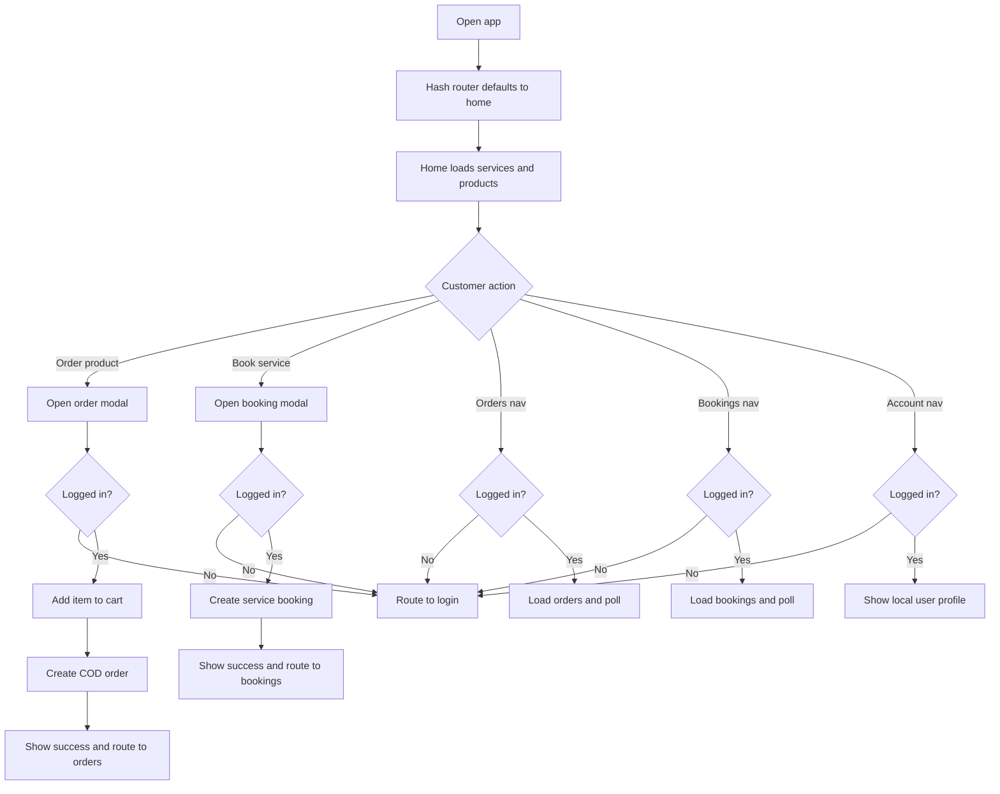

# Phase 03 — Customer Flow Map

Generated: 2026-05-12T04:54:00Z  
Scope: active project only, `wtg  live/`.

---

## 1. Executive Customer Reality

The current customer experience is a lightweight mobile-style SPA under `app/`. It exposes a small customer lifecycle:

1. Guest browsing on Home.
2. Login or registration through OTP/email/Google UI.
3. Product browsing from Home cards.
4. Service browsing from Home cards.
5. Product order through modal → cart add → order creation.
6. Service booking through modal → booking creation.
7. Order and booking tracking pages with polling.
8. Account page with profile display, vendor application entry, and local logout.

Evidence: `wtg  live/app/js/router.js:20`, `wtg  live/app/pages/home.js:7`, `wtg  live/app/pages/login.js:6`, `wtg  live/app/pages/orders.js:6`, `wtg  live/app/pages/bookings.js:6`, `wtg  live/app/pages/account.js:11`.

Confidence: High.

---

## 2. Customer Journey Map

Evidence: `wtg  live/app/js/router.js:49`, `wtg  live/app/js/router.js:64`, `wtg  live/app/pages/home.js:148`, `wtg  live/app/pages/home.js:216`, `wtg  live/app/pages/orders.js:49`, `wtg  live/app/pages/bookings.js:49`.

---

## 3. Customer Onboarding Flow

### Traced onboarding mechanisms

| Onboarding path | UI entry | Backend route | Customer state created | Evidence | Confidence |
|---|---|---|---|---|---|
| Mobile OTP | Login tab `Mobile OTP` | `/api/auth/otp/send`, `/api/auth/otp/verify` | Creates user if phone not found; stores token/user | `wtg  live/app/pages/login.js:33`, `wtg  live/app/pages/login.js:346`, `wtg  live/heart/api/auth/verify-otp.php:68` | High |
| Email login | Login tab `Email` | `/api/auth/email/login` | Stores token/user | `wtg  live/app/pages/login.js:54`, `wtg  live/app/js/auth.js:89` | High |
| Email registration | Login page register step | `/api/auth/email/register` | Creates customer; stores token/user | `wtg  live/app/pages/login.js:79`, `wtg  live/app/js/auth.js:94` | High |
| Google login | Email tab button | `/api/auth/google` | Finds/creates Google user; stores token/user | `wtg  live/app/pages/login.js:73`, `wtg  live/app/js/auth.js:99`, `wtg  live/heart/api/auth/AuthController.php:144` | High |

Runtime dependency: `CONFIG.BASE_URL`, auth APIs, browser `localStorage`, UI toast system.

User impact: customer can browse before onboarding, but ordering/booking/history/account require login.

Mobile impact: onboarding is modal/card based and phone-first; input fields use mobile-friendly types for OTP/phone.

Scale implication: OTP onboarding creates rows automatically and depends on SMS provider capacity.

---

## 4. Guest Browsing Flow

Home is public. `PUBLIC_PAGES` includes `home`, so unauthenticated customers can load products and services.

Evidence: `wtg  live/app/js/router.js:30`, `wtg  live/app/pages/home.js:98`.

Guest browsing is not the same as server guest auth. Server-side `/api/auth/guest` exists from Phase 02, but customer UI does not call it in traced files.

Evidence: `wtg  live/heart/api/auth/router.php:26`, `wtg  live/app/js/api.js:85`.

Confidence: High for public browsing; Medium for guest-token nonuse.

Connected systems: products API, services API, intent pipeline, Heart router.

User impact: browsing works before login, but action conversion redirects to login.

Mobile impact: public Home allows low-friction mobile entry.

Future scale implication: public product/service listing endpoints will receive anonymous traffic and need caching/rate controls.

---

## 5. Login-Required Flow Behavior

The customer SPA blocks non-public pages at router level and action level:

- Router blocks `orders`, `bookings`, and `account` unless `AUTH.isLoggedIn()`.
- Ordering and booking modals also check `AUTH.isLoggedIn()` before calling APIs.

Evidence: `wtg  live/app/js/router.js:64`, `wtg  live/app/pages/home.js:148`, `wtg  live/app/pages/home.js:216`, `wtg  live/app/js/auth.js:22`.

Confidence: High.

Runtime dependency: localStorage token + user object.

Important operational note: client auth gate only checks local token/user presence. Backend APIs enforce real auth for cart/order/booking calls.

---

## 6. Product Browsing Flow

Customer Home calls `API.getProducts()`, which calls the Heart intent pipeline with `shopping:list_products`. Backend direct product listing supports `/api/products` and query filters, but the customer frontend traced here uses the intent wrapper without filter parameters.

Evidence: `wtg  live/app/pages/home.js:275`, `wtg  live/app/js/api.js:109`, `wtg  live/heart/router.php:198`, `wtg  live/body/shopping-engine/api/products/ProductController.php:24`.

Connected systems: Heart pipeline, shopping engine, `products`, `inventory`, `vendors`.

Runtime dependency: product service requires active product, not deleted, and positive available inventory.

Evidence: `wtg  live/body/shopping-engine/api/products/ProductService.php:36`.

User impact: customers only see active in-stock products from the list flow.

Mobile impact: cards use image lazy loading and grid display; no dedicated detail page was traced.

Confidence: High for Home listing; Medium for Heart-to-engine internals because `EngineLoader` was not re-traced deeply in this phase.

---

## 7. Service Browsing Flow

Customer Home calls `API.getServices()`, which calls Heart intent `service:list_services`. Direct service API supports `GET /api/services`, returning active services with vendor names.

Evidence: `wtg  live/app/pages/home.js:270`, `wtg  live/app/js/api.js:114`, `wtg  live/heart/router.php:214`, `wtg  live/body/service-engine/api/services/index.php:48`.

Connected systems: service engine, `services`, `vendors`, `categories`.

User impact: service cards are immediately actionable through booking modal.

Mobile impact: service cards are horizontally scrollable on Home.

Confidence: High for frontend behavior and direct service API.

---

## 8. Search / Filtering / Sorting Flow

Backend product listing supports:

- `category_id`
- `vendor_id`
- `featured`
- `search`
- `sort` values: `price_asc`, `price_desc`, `rating`, `newest`, `popular`, default

Evidence: `wtg  live/body/shopping-engine/api/products/ProductService.php:27`, `wtg  live/body/shopping-engine/api/products/ProductService.php:67`.

Backend vendor listing supports `type`, `search`, `page`, and `limit`.

Evidence: `wtg  live/body/service-engine/api/vendors/index.php:114`.

Customer frontend traced in `app/` does not expose search, filter, sort, product detail, service detail, wishlist, or favorites pages.

Evidence: `wtg  live/app/js/router.js:20`, `wtg  live/app/pages/home.js:282`.

Confidence: High.

Uncertainty: Heart search route exists (`/api/search` and product search intent patterns), but no visible customer SPA search page was traced.

Evidence: `wtg  live/heart/index.php:339`, `wtg  live/heart/router.php:198`.

---

## 9. Product Detail and Service Detail Flow

Backend detail APIs exist for products and services:

- `GET /api/products/{id}`
- `GET /api/services/{id}`

Evidence: `wtg  live/body/shopping-engine/api/products/ProductController.php:35`, `wtg  live/body/service-engine/api/services/index.php:114`.

Customer frontend does not route to detail pages; product/service cards open action modals directly.

Evidence: `wtg  live/app/pages/home.js:298`, `wtg  live/app/pages/home.js:325`.

Confidence: High.

User impact: customers cannot inspect rich detail screens in the traced SPA before buying/booking.

Mobile impact: quick-action modal is fast but may reduce decision confidence.

