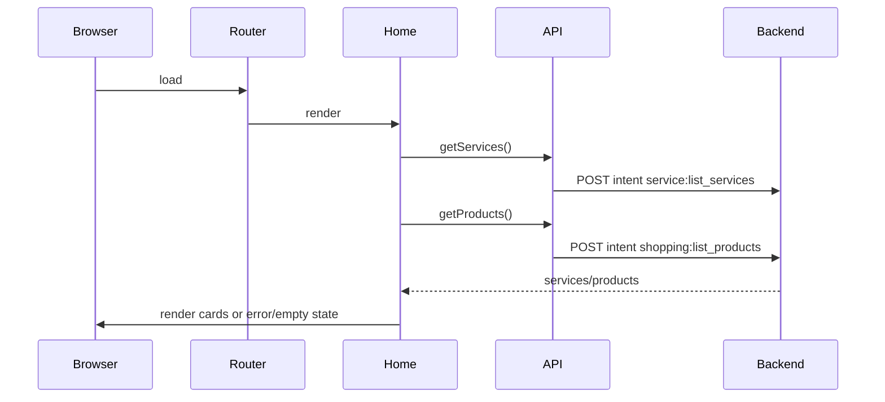
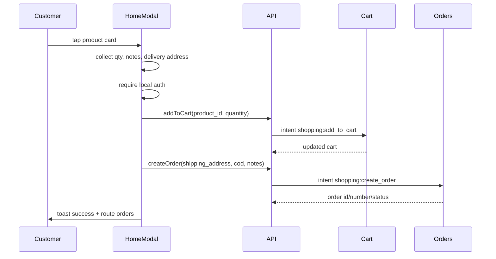
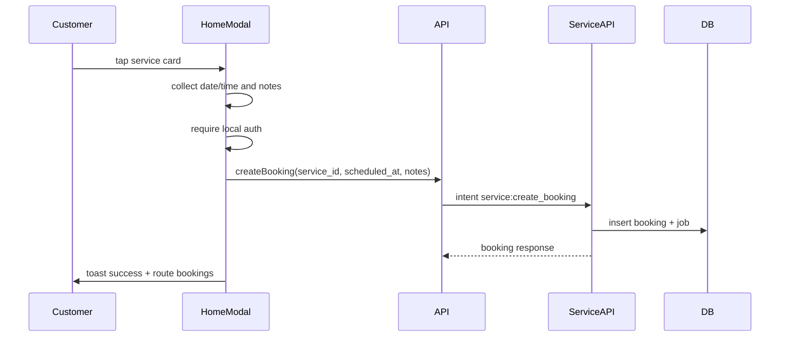

# Customer Runtime Flow

Generated: 2026-05-12T04:54:00Z

---

## 1. Runtime Shell

Customer runtime is an HTML/JS SPA using hash routing. Core modules are loaded from `app/index.php` and include config, API, auth, router, UI, and page modules.

Evidence: `wtg  live/app/index.php:44`, `wtg  live/app/js/router.js:18`.

Confidence: High.

---

## 2. Route Model

| Route key | Page module | Public? | Auth behavior | Evidence |
|---|---|---|---|---|
| `home` | `pages/home.js` | Yes | Loads products/services for guest or user | `wtg  live/app/js/router.js:20`, `wtg  live/app/js/router.js:30` |
| `login` | `pages/login.js` | Yes | Redirects to home if already logged in | `wtg  live/app/js/router.js:20`, `wtg  live/app/js/router.js:70` |
| `orders` | `pages/orders.js` | No | Requires local auth, polls via refresh | `wtg  live/app/pages/orders.js:6`, `wtg  live/app/js/router.js:30` |
| `bookings` | `pages/bookings.js` | No | Requires local auth, polls via refresh | `wtg  live/app/pages/bookings.js:6`, `wtg  live/app/js/router.js:30` |
| `account` | `pages/account.js` | No | Requires local auth | `wtg  live/app/pages/account.js:11` |

Uncertainty: `PUBLIC_PAGES` includes `register`, `services`, `products`, and `search`, but no page modules for these keys are registered in `PAGES`.

Evidence: `wtg  live/app/js/router.js:20`, `wtg  live/app/js/router.js:30`.

Confidence: High.

---

## 3. Customer State Persistence

Customer auth/session state is stored in localStorage:

- `wtg_token`
- `wtg_refresh_token`
- `wtg_user`
- `wtg_session`

Evidence: `wtg  live/app/js/config.js:30`, `wtg  live/app/js/auth.js:7`.

Logout clears these keys and routes to login.

Evidence: `wtg  live/app/js/auth.js:26`.

Runtime dependency: browser storage. If localStorage is cleared, the app treats the user as logged out.

User impact: session persistence survives page reload but depends entirely on client storage.

Mobile impact: mobile browser storage policies may clear state under low storage/private browsing.

Scale implication: local token persistence avoids server session storage but pushes recovery/revalidation complexity to API behavior.

Confidence: High.

---

## 4. Home Runtime Flow

Evidence: `wtg  live/app/js/router.js:49`, `wtg  live/app/pages/home.js:98`, `wtg  live/app/js/api.js:81`.

Confidence: High for frontend; Medium for pipeline internals.

---

## 5. Order Runtime Flow

Evidence: `wtg  live/app/pages/home.js:108`, `wtg  live/app/pages/home.js:148`, `wtg  live/app/pages/home.js:164`, `wtg  live/app/pages/home.js:174`, `wtg  live/app/js/api.js:123`.

Connected systems: customer app, cart service, order service, inventory, delivery dispatch.

Runtime dependency: auth token, cart API, order API, product inventory.

User impact: ordering is a single-product modal but uses persistent cart behind the scenes.

Mobile impact: modal action is compact, but manual address text entry may be friction-heavy.

Future scale implication: add-to-cart and create-order are sequential API calls; partial failure can leave cart state changed.

Confidence: High.

---

## 6. Booking Runtime Flow

Evidence: `wtg  live/app/pages/home.js:191`, `wtg  live/app/pages/home.js:216`, `wtg  live/app/pages/home.js:230`, `wtg  live/body/service-engine/api/services/index.php:204`.

Connected systems: customer app, service engine, bookings, jobs, vendors.

Runtime dependency: auth token, service availability, valid future date/time.

Mobile impact: `datetime-local` provides native mobile picker where supported.

Confidence: High.

---

## 7. Polling / Refresh Runtime

Orders and bookings are pollable pages. Router starts a 12-second interval for `orders` and `bookings`, and refreshes again when the browser tab becomes visible.

Evidence: `wtg  live/app/js/router.js:31`, `wtg  live/app/js/router.js:110`, `wtg  live/app/js/router.js:134`, `wtg  live/app/js/config.js:36`.

User impact: customer status pages update without manual refresh.

Mobile impact: polling is skipped when document is hidden but resumes on visibility; mobile tab suspension may delay updates.

Scale implication: every active orders/bookings page polls every 12 seconds, creating backend load that grows linearly with active sessions.

Confidence: High.

---

## 8. Error and Retry Runtime

The API wrapper returns normalized `{ ok, error, data }` responses. Page load failures render `UI.errorState()` with retry buttons. Action failures show toast messages.

Evidence: `wtg  live/app/js/api.js:28`, `wtg  live/app/js/ui.js:74`, `wtg  live/app/pages/home.js:286`, `wtg  live/app/pages/orders.js:57`.

Retry behavior:

- Home product/service section retry buttons call reload methods.
- Orders/bookings load retry calls page `_load()`.
- Order/booking action retry requires the customer to press confirm again.

Confidence: High.

