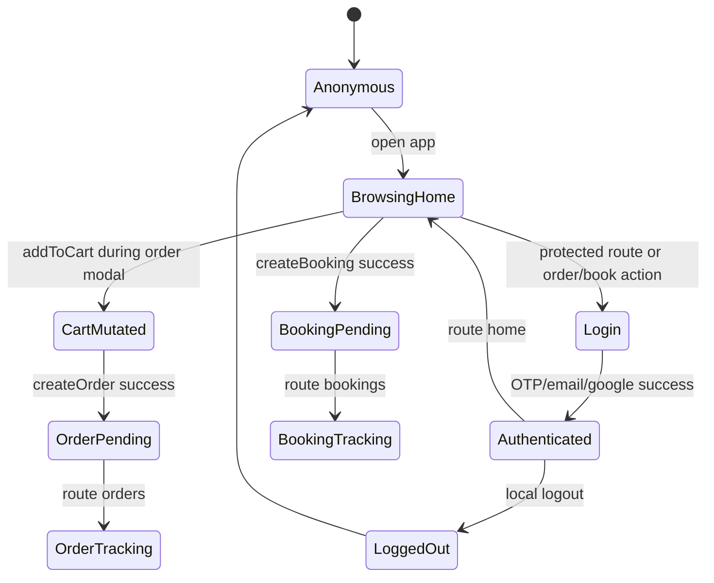

# Customer State Map

Generated: 2026-05-12T04:54:00Z

---

## 1. Customer State Domains

| State domain | Storage location | Mutated by | Evidence | Confidence |
|---|---|---|---|---|
| Auth session | Browser localStorage | Login/register/OTP/Google/logout | `wtg  live/app/js/auth.js:7` | High |
| User profile display | Browser localStorage user object | Auth response only in traced SPA | `wtg  live/app/pages/account.js:13` | High |
| Product browse list | In-memory DOM/page state | Home `_loadProducts()` | `wtg  live/app/pages/home.js:275` | High |
| Service browse list | In-memory DOM/page state | Home `_loadServices()` | `wtg  live/app/pages/home.js:270` | High |
| Active order modal | JS closure `_currentProduct` | Product card open/close | `wtg  live/app/pages/home.js:104` | High |
| Active booking modal | JS closure `_currentService` | Service card open/close | `wtg  live/app/pages/home.js:104` | High |
| Cart | Database `cart` | Cart API add/update/remove/clear | `wtg  live/body/shopping-engine/api/cart/CartService.php:140` | High |
| Orders | Database `orders`, `order_items` | OrderService + vendor/admin updates | `wtg  live/body/shopping-engine/api/orders/OrderService.php:165` | High |
| Bookings | Database `bookings`, `jobs` | Service request + vendor/admin job status | `wtg  live/body/service-engine/api/services/index.php:204` | High |
| Alerts | Database `alerts`; optional frontend poller | AlertEngine/alerts JS | `wtg  live/database-structure.sql:50`, `wtg  live/assets/js/alerts.js:19` | Medium |

---

## 2. State Transition Map

Evidence: `wtg  live/app/js/router.js:64`, `wtg  live/app/pages/login.js:250`, `wtg  live/app/pages/home.js:164`, `wtg  live/app/pages/home.js:174`, `wtg  live/app/pages/home.js:230`.

---

## 3. Order State Transitions

Backend customer order placement creates parent and vendor sub-orders with status `pending`. Vendor sub-orders transition through vendor actions:

- `pending` → `confirmed` or `cancelled`
- `confirmed` → `processing` or `cancelled`
- `processing` → `shipped` or `cancelled`
- `shipped` → `delivered`

Evidence: `wtg  live/body/shopping-engine/api/orders/OrderService.php:174`, `wtg  live/body/shopping-engine/api/orders/OrderService.php:463`.

Customer cancel can cancel parent order only when status is `pending` or `confirmed`.

Evidence: `wtg  live/body/shopping-engine/api/orders/OrderService.php:337`.

Customer UI does not expose cancel action in traced orders page.

Evidence: `wtg  live/app/pages/orders.js:90`.

Confidence: High.

---

## 4. Booking State Transitions

Service booking creation inserts booking status `pending` and linked job status `open`.

Evidence: `wtg  live/body/service-engine/api/services/index.php:257`, `wtg  live/body/service-engine/api/services/index.php:290`.

Job status update maps:

- `assigned` → booking `confirmed`
- `in_progress` → booking `in_progress`
- `completed` → booking `completed`
- `cancelled` → booking `cancelled`

Evidence: `wtg  live/body/service-engine/api/services/index.php:448`.

Customer UI filters upcoming statuses as `pending`, `confirmed`, `in_progress`; done statuses as `completed`, `cancelled`.

Evidence: `wtg  live/app/pages/bookings.js:44`.

Confidence: High.

---

## 5. Notification State

Home notification button currently only shows “Notifications coming soon!” toast.

Evidence: `wtg  live/app/pages/home.js:20`.

A standalone `AlertSystem` exists and polls `/api/alerts/fetch.php`, but it uses `localStorage.getItem('token')`, not the customer `wtg_token` key, and no customer app initialization was traced.

Evidence: `wtg  live/assets/js/alerts.js:19`, `wtg  live/assets/js/alerts.js:274`, `wtg  live/assets/js/alerts.js:280`, `wtg  live/app/js/config.js:31`.

Confidence: High.

User impact: customer notification UI appears non-operational in traced SPA.

---

## 6. Uncertain / Hidden State Behavior

- `addresses` table exists but customer checkout does not use saved addresses.
- `followers` table exists and feeds personalization, but customer follow/favorite UI was not traced.
- `cart.session_id` exists but CartController requires auth and does not use session cart.
- `API.getProfile()` exists but no matching visible customer profile API flow was traced.

Evidence: `wtg  live/database-structure.sql:30`, `wtg  live/database-structure.sql:452`, `wtg  live/database-structure.sql:363`, `wtg  live/app/js/api.js:135`.

