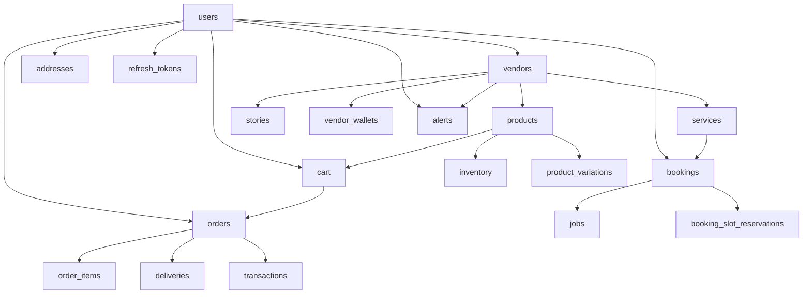

# Phase 06 — Database Schema Map

Generated: 2026-05-12T16:20:00Z

Scope: documentation-only intelligence extraction for the active `wtg  live/` project. No schema, migration, query, relation, or runtime contract was modified.

## Evidence Base

Primary traced sources:

- `wtg  live/database-structure.sql` — baseline dump containing table definitions, indexes, auto-increments, and foreign key constraints.
- `wtg  live/migrations/*.sql` — post-dump schema changes, especially service/vendor/category/auth alignment changes.
- Runtime traces across `heart/api/admin/index.php`, `body/shopping-engine/api/orders/OrderService.php`, `body/shopping-engine/api/cart/CartService.php`, `body/shopping-engine/api/products/ProductController.php`, `body/service-engine/api/services/index.php`, `cron/auto_assign.php`, payment/refund APIs, alerts, content, auth, and brain models.

Confidence levels:

- High: table/column/index/constraint exists in traced SQL dump or migration.
- Medium: runtime contract traced in service/controller SQL but not guaranteed to match production if migrations are partially applied.
- Low: legacy/admin-only query references tables/columns not present in traced schema.

## Actual Baseline Tables from SQL Dump

| Domain | Tables | Contract Reality | Confidence |
|---|---|---|---|
| Identity/auth | `users`, `otps`, `refresh_tokens`, `token_blacklist`, `rate_limits` | `users` is root identity table; refresh/blacklist are token/session support; OTP keyed by `phone`. | High |
| Vendor | `vendors`, `vendor_availability_slots`, `vendor_wallets`, `followers`, `stories` | Vendor is a profile owned by one user; availability, wallet, followers, and stories attach to vendor. | High for baseline, Medium for `vendors.type` due migration drift |
| Customer/address | `addresses` | Address belongs to user; product checkout does not use address rows, service booking optionally does. | High |
| Commerce | `categories`, `products`, `product_variations`, `inventory`, `cart`, `orders`, `order_items`, `deliveries`, `transactions`, `wallet_transactions`, `warehouses`, `driver_wallets` | Product flow is vendor-owned products + inventory + cart + parent/child orders + order items + delivery + transaction/wallet support. | High |
| Service booking/jobs | `services`, `bookings`, `booking_slot_reservations`, `jobs` | Service flow uses service rows, booking rows, optional slot reservations, linked job rows. | High baseline, Medium after migrations |
| Operations/settings | `app_settings`, `platform_settings`, `cms_banners`, `logs`, `alerts`, `auto_assignments`, `heart_request_log` | Settings/config, alerting, auto assignment, logs, and request tracking. | High |
| Brain | `brain_clients`, `brain_events`, `brain_decisions`, `brain_actions`, `brain_feedback`, `brain_habits`, `brain_improvements`, `brain_rate_limits`, `brain_rules`, `brain_suggestions`, `brain_user_profiles`, `brain_alerts` | Internal intelligence/rules/event subsystem. Runtime code references additional brain columns not present in baseline. | Medium |

## Root Entities and Ownership

### `users`

- Root identity table. Baseline fields include `id`, `uuid`, `name`, `phone`, `email`, `password`, `role`, `status`, `auth_type`, guest columns, timestamps, and `deleted_at`.
- Baseline `phone` is `NOT NULL`, but migrations make it nullable.
- Runtime auth creates email users with phone as empty/nullable, Google users with nullable phone, and guest users with null phone/email.
- Connected systems: auth, admin users, vendors, addresses, cart/orders/bookings, refresh tokens, deliveries/drivers, alerts.
- Operational impact: any identity-column tightening can break email, Google, and guest auth flows.
- Scale implications: `users.phone`, `users.email`, `users.role` indexed; admin list by `deleted_at`, `role`, `status`, created sort has partial indexing only.
- Maintainability impact: identity behavior is split across DB dump, migrations, and multiple auth controllers.
- Confidence: High.

### `vendors`

- Baseline uses `vendor_type`; later migrations rename/standardize to `type`.
- Runtime code overwhelmingly expects `vendors.type`, plus additional migrated columns such as `deleted_at`, `description`, `logo_url`, `total_reviews`, and sometimes `address_id`.
- `vendors.user_id` is unique and FK to `users.id`, creating one vendor profile per user.
- Connected systems: vendor application, admin approval, products/services, bookings/jobs, orders, alerts, stories, auto assignment, analytics.
- Operational impact: if production still has `vendor_type`, most vendor/admin APIs fail; if production only has `type`, baseline dump is stale.
- Scale implications: indexed by type/status but geo assignment also filters by `lat/lng` without a spatial/geohash index.
- Maintainability impact: high schema-contract drift hotspot.
- Confidence: High for drift, High for ownership.

### `products` + `inventory`

- Products are vendor-owned and optionally categorized. Inventory is a separate one-to-one-ish row by unique `inventory.product_id`.
- Runtime product creation inserts a product and immediately inserts inventory.
- Runtime checkout uses inventory `quantity - reserved`; delivery deducts physical quantity and releases reserved quantity.
- Product variations carry separate `stock_quantity` that is not integrated into order checkout inventory reservation.
- Connected systems: customer browsing, vendor product management, cart, order checkout, analytics, admin products.
- Operational impact: product rows without inventory are invisible/unusable in cart/product service joins; variation stock can diverge from base inventory.
- Scale implications: product search has fulltext index, product listing joins inventory; high-read/high-write around inventory.
- Maintainability impact: two stock systems (`inventory` and `product_variations.stock_quantity`) create hidden coupling.
- Confidence: High.

### `orders` + `order_items`

- `orders` stores both parent customer orders and vendor sub-orders using `parent_order_id`.
- Parent order has `vendor_id = NULL`; sub-orders have `parent_order_id` and `vendor_id`.
- `order_items` attach to vendor sub-orders, not parent orders, in traced checkout.
- `shipping_address` is JSON snapshot, not FK to `addresses`.
- Connected systems: customer order history, vendor order list, admin order list/detail, payment, delivery, refunds, inventory, auto assignment.
- Operational impact: parent/child status aggregation is not traced; admin direct status updates can bypass inventory release and child synchronization.
- Scale implications: `orders` is high-write/high-read; rate-limit query needs composite assumptions but only separate indexes are visible.
- Maintainability impact: parent and child rows in same table require every query to remember `parent_order_id` semantics.
- Confidence: High.

### `services` + `bookings` + `jobs`

- Baseline `services` is minimal; migrations add `slug`, descriptions, feature/rating/duration/deleted columns.
- Runtime service create/list/update/delete uses migrated columns.
- Service booking creates `bookings` then a linked `jobs` row.
- Separate `BookingController` creates bookings with fewer required fields than schema declares, creating potential runtime/schema contradiction.
- Connected systems: customer service booking, vendor service management, vendor jobs, auto assignment, slot reservations, transactions.
- Operational impact: migration incompleteness can break service CRUD; booking insertion path divergence can fail or create partial rows.
- Scale implications: booking/job lists filter by vendor/user/status/date but indexes are limited.
- Maintainability impact: multiple booking creation paths with different contracts.
- Confidence: High for main service flow, Medium for alternate controller.

### `deliveries`

- Baseline columns use `driver_id`; admin/delivery code also references `rider_id` in several paths.
- Baseline statuses are `pending`, `assigned`, `picked`, `delivered`, `cancelled`; runtime/admin code also uses `picked_up`, `in_transit`, `failed`, and status-to-order mapping.
- Connected systems: order dispatch, admin assignment, delivery API, SwiftDeliver integration, driver wallet.
- Operational impact: `rider_id` queries/updates likely fail against baseline schema; status vocabularies can reject values or produce inconsistent order state.
- Scale implications: delivery tracking joins orders/users and status filters need consistent indexes.
- Maintainability impact: driver/rider naming drift is severe.
- Confidence: High.

## Contract Map by Table Family

## Notable Soft-Delete Reality

| Table | Baseline `deleted_at`? | Runtime uses soft delete? | Risk |
|---|---:|---:|---|
| `users` | Yes | Yes, admin/auth read filters use `deleted_at IS NULL` | Medium: no cascade behavior for soft-deleted users. |
| `products` | Yes | Yes, product delete archives and sets `deleted_at` | High: cart/orders still reference product; runtime handles via snapshots partly. |
| `services` | No baseline; migration adds | Yes, services list/edit/delete require it | High if migration missing. |
| `vendors` | No baseline; migration adds | Yes in service vendor resolution; not consistently in all vendor queries | High if migration missing or vendor inactive but role remains. |
| `orders`, `bookings`, `jobs` | No | No | Historical rows remain mutable; direct admin updates lack immutable audit. |

## Tables Referenced at Runtime but Not Present in Baseline Dump

| Runtime Reference | Where Observed | Impact | Confidence |
|---|---|---|---|
| `payments` | Admin order detail/payments endpoints | Likely hard failure on those admin endpoints unless production has table outside traced dump. | High |
| `merchants` | Admin products/merchants endpoints | Legacy commerce vocabulary; likely hard failure. | High |
| `riders` | Admin riders endpoint | Legacy delivery vocabulary; likely hard failure. | High |
| `system_config` | Admin system-config endpoint | Not in dump; endpoint likely fails unless out-of-band table exists. | High |
| `reviews` | Disabled comment in service analytics | Runtime intentionally avoids missing table. | High |
| `brain_ui_settings` | `UIBlockModel` | Brain UI setting reads likely fail unless table exists outside dump. | Medium |

## High-Risk Table Summary

| Table | Why High Risk | Connected Systems | Confidence |
|---|---|---|---|
| `vendors` | `vendor_type` vs `type`, soft-delete migration, role coupling | Auth, admin, vendor panel, product/service/order/job | High |
| `orders` | Parent/child rows, direct admin mutation, payment/delivery coupling | Customer, vendor, admin, payment, delivery, inventory | High |
| `inventory` | Reservation ledger is mutable counters without audit rows | Cart, checkout, delivery, vendor products | High |
| `bookings` | Multiple creation paths, slot reservation optionality, job mirror | Service booking, jobs, auto assignment, payments | High |
| `deliveries` | `driver_id` vs `rider_id`, status vocabulary drift | Admin, delivery API, SwiftDeliver | High |
| `transactions` | Polymorphic `reference_type/reference_id` without FK to order/booking | Payments, refunds, analytics | High |
| `brain_events` | Runtime code references non-baseline columns in some legacy brain classes | Brain, analytics, feed ranking | Medium |

## Uncertainty Register

- Production migration state is not directly inspected; dump plus migrations imply possible drift.
- Whether `payments`, `merchants`, `riders`, `system_config`, `brain_ui_settings`, and extra brain columns exist in production is unverified.
- Whether `u904615152_worktogo_main (1).sql` at workspace root contains a newer schema was not exhaustively compared in this phase.
- Whether migrations have been applied in order through `migrate.php` is unknown because `migrations_log` runtime data was not queried.
- Whether SwiftDeliver has independent delivery tables that map back into PHP `deliveries` is only partially traced.
