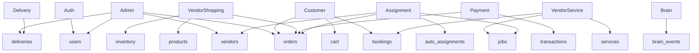

# Phase 06 — DB Dependency Map

Generated: 2026-05-12T16:20:00Z

## Module-to-Table Dependencies

| Module | Read Tables | Write Tables | Critical Contract |
|---|---|---|---|
| Auth | `users`, `refresh_tokens`, `token_blacklist`, `otps` | same | `users.phone/email/auth_type/role/status`, token hashes. |
| Customer app | `products`, `services`, `cart`, `orders`, `bookings`, `alerts` | `cart`, `orders`, `bookings` | Auth user ID, COD checkout, parent orders, service request. |
| Vendor shopping | `vendors`, `products`, `inventory`, `product_variations`, `orders`, `order_items`, `transactions`, `brain_events` | `products`, `inventory`, `product_variations`, `orders` statuses | `vendors.type/status`, product inventory, child orders. |
| Vendor service | `vendors`, `services`, `bookings`, `jobs`, `transactions`, `followers`, `vendor_availability_slots`, `booking_slot_reservations` | `services`, `bookings`, `jobs`, slots | `services` migrated fields, booking/job lifecycle. |
| Admin | `users`, `vendors`, `services`, `orders`, `deliveries`, `transactions`, `wallet_transactions`, `logs`, plus legacy missing tables | Many direct updates | High privilege direct mutation. |
| Payment/refund | `orders`, `bookings`, `transactions`, `users` | `transactions`, `orders`, `bookings`, ledger tables | Polymorphic transaction references. |
| Delivery | `orders`, `deliveries`, `users`, `driver_wallets` | `deliveries`, `orders` | `driver_id` vs `rider_id`, status values. |
| Assignment cron | `platform_settings`, `auto_assignments`, `jobs`, `bookings`, `orders`, `addresses`, `vendors`, `alerts` | `auto_assignments`, `jobs`, `orders`, `alerts` | entity polymorphism and vendor geo. |
| Brain | `brain_*`, `app_settings`, `followers`, `vendors`, `brain_events` | `brain_*` | client_id/event/rule contracts; legacy column drift. |

## What Breaks If Key Tables Change

| Change | Breakage |
|---|---|
| Rename `vendors.type` | Vendor APIs, admin approval, product/service vendor filters, frontend vendor type compatibility. |
| Tighten `users.phone` | Email, Google, guest auth; vendor application phone update behavior. |
| Remove `orders.parent_order_id` | Customer history, vendor order list, checkout split, item lookup, cancellation. |
| Rename `deliveries.driver_id` only | Admin assignment/dashboard and schema FK break unless all `rider_id` references reconciled. |
| Remove `inventory.reserved` | Cart availability, checkout reservation, cancellation/delivery release. |
| Remove `services.deleted_at` | Service listing/search/update/delete filters fail. |
| Split `transactions` | RefundController, payment APIs, vendor analytics, admin failed payment counts must all migrate. |

## Dependency Diagram

## Future Inspection Needed

- Production `INFORMATION_SCHEMA` dump with table/column/index/constraint list.
- Runtime route hit logs to distinguish active admin endpoints from dead legacy routes.
- Row-level orphan checks for polymorphic tables.
- EXPLAIN plans for order, booking, transaction, alert, and auto-assignment queries.
