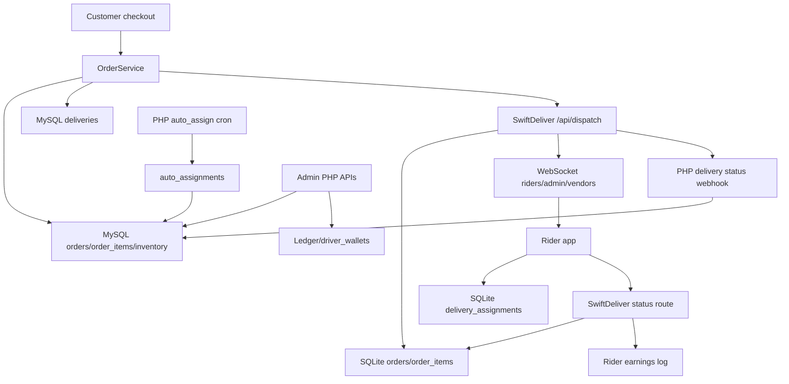

# Phase 08 — Delivery Dependency Map

## System Dependency Graph

## Runtime Dependencies by Component

| Component | Depends on | Breaks if changed | Evidence |
|---|---|---|---|
| `OrderService::dispatchToDelivery()` | env URL/secret, `deliveries`, curl, logger | checkout dispatch, delivery row creation | `wtg  live/body/shopping-engine/api/orders/OrderService.php:965` |
| Heart delivery API | AuthMiddleware, DeliveryPricingEngine, Logger, `deliveries`, `orders` | quote/dispatch/status webhook | `wtg  live/heart/api/delivery/index.php:7` |
| Admin delivery assignment | `LedgerEngine`, `driver_wallets`, `deliveries`, `orders` | manual driver assignment | `wtg  live/heart/api/admin/index.php:552` |
| PHP auto assignment | cron scheduler, MySQL locks, `vendors.lat/lng`, `auto_assignments` | vendor/provider assignment | `wtg  live/cron/auto_assign.php:11` |
| SwiftDeliver dispatch | bearer secret, SQLite orders, settings, geocode, WebSocket clients | rider network intake | `swiftdeliver-main/server.ts:910` |
| SwiftDeliver tracking | `tracking_token`, latest assignment, rider coords | customer tracking page | `swiftdeliver-main/server.ts:479` |
| SwiftDeliver WebSocket | JWT, in-memory clients | real-time rider/admin/vendor updates | `swiftdeliver-main/server.ts:218` |
| SwiftDeliver rider status | rider JWT, rider table, pending orders query | online/offline/location | `swiftdeliver-main/server.ts:769` |
| SwiftDeliver order status | assignment table, rider table, notifications, WooCommerce sync | pickup/delivery/failure | `swiftdeliver-main/server.ts:1125` |

## Table Dependency Matrix

| Table | Owners/writers | Readers | High-risk columns |
|---|---|---|---|
| MySQL `orders` | `OrderService`, admin routes, PHP delivery webhook, vendor status | customer/vendor/admin/ledger/delivery | `status`, `delivery_id`, `vendor_id`, `parent_order_id`, `shipping_address`, `delivery_status` |
| MySQL `deliveries` | PHP dispatch, admin assign, PHP webhook | admin order/delivery, ledger | `driver_id`/`rider_id`, `status`, `order_id` |
| MySQL `auto_assignments` | cron, assignment accept | cron/accept | `entity_type`, `entity_id`, `vendor_id`, `status` |
| MySQL `vendors` | admin/vendor operations | assignment/order/service | `is_online`, `lat`, `lng`, `status`, `vendor_type/type` |
| MySQL `driver_wallets` | ledger/admin assignment | admin stats/blocking | `driver_id`, `cash_in_hand`, `collection_limit` |
| SQLite `orders` | SwiftDeliver dispatch/manual order/status | tracking/admin/rider/vendor | `woocommerce_order_id`, `status`, `lat`, `lng`, `tracking_token`, `vendor_ready` |
| SQLite `delivery_assignments` | rider accept/admin reassign/status | order list/tracking/broadcast | `order_id`, `rider_id`, `status` |
| SQLite `riders` | admin/rider status/WebSocket/status updates | assignment/tracking/stats | `status`, `lat`, `lng`, `total_earnings` |

## What Breaks If Delivery Logic Changes

1. Changing WorkToGo `orders.status` mapping can break customer orders, admin metrics, vendor panels, refunds, ledger, and SwiftDeliver webhook assumptions.
2. Changing `deliveries.status` enum can break PHP status route, webhook, admin filters, and schema inserts.
3. Changing SwiftDeliver `orders.status` can break rider dashboard, tracking, admin stats, WebSocket event consumers, and PHP sync assumptions.
4. Changing rider IDs or identity mapping can break assignment, tracking, earnings, and WorkToGo webhook identity interpretation.
5. Changing address/geocoding payload can alter assignment distance, rider broadcast, pricing, tracking, and multi-city fallback.
6. Changing dispatch endpoint auth can block all automatic delivery creation.

## Hidden Couplings

- PHP dispatch and Node dispatch share `SWIFTDELIVER_SECRET` but do not share schema.
- SwiftDeliver `woocommerce_order_id` stores WorkToGo order ID, not necessarily WooCommerce.
- WorkToGo delivery webhook status `assigned` maps to order `processing` even before rider acceptance.
- WorkToGo parent order ID is dispatched even though vendor sub-orders contain actual vendor ownership.
- Driver/rider financial logic in MySQL depends on `orders.delivery_id` joining `deliveries.driver_id`.
- Vendor readiness in SwiftDeliver depends on SwiftDeliver vendor ID, not proven to equal WorkToGo vendor ID.

## Maintainability Impact

Delivery behavior is distributed across PHP controllers, order service, cron, Node Express routes, SQLite schema, MySQL schema, WebSocket handling, and frontend clients. Safe evolution requires tracing every runtime dependency above before modifying any delivery rule.

