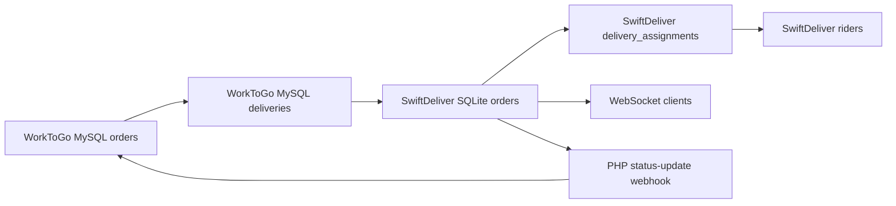

# Phase 08 — Delivery Runtime Flow

## Runtime Entry Points

### WorkToGo PHP

| Entry | Actor | Handler | Main effect | Evidence |
|---|---|---|---|---|
| `GET /api/delivery/quote` | delivery/admin | Heart delivery API | Calculates pricing from pickup/drop coordinates | `wtg  live/heart/api/delivery/index.php:12` |
| `POST /api/delivery/dispatch` | delivery/admin | Heart delivery API | Creates delivery row and sends to SwiftDeliver | `wtg  live/heart/api/delivery/index.php:36` |
| `PATCH /api/delivery/{id}/status` | delivery/admin | Heart delivery API | Updates delivery status by `driver_id` and mirrors order | `wtg  live/heart/api/delivery/index.php:91` |
| `POST /api/delivery/status-update` | SwiftDeliver webhook | Heart delivery API | Updates delivery/order status from Node | `wtg  live/heart/api/delivery/index.php:115` |
| `POST /api/admin/deliveries/assign` | admin | Admin API | Manual MySQL driver assignment | `wtg  live/heart/api/admin/index.php:552` |
| `GET /api/admin/deliveries` | admin | Admin API | List deliveries | `wtg  live/heart/api/admin/index.php:695` |
| `GET /api/admin/riders` | admin | Admin API | List riders from `riders` table | `wtg  live/heart/api/admin/index.php:804` |

### SwiftDeliver Node

| Entry | Actor | Handler | Main effect | Evidence |
|---|---|---|---|---|
| `POST /api/dispatch` | WorkToGo PHP | Express route | Create local order and broadcast to riders | `swiftdeliver-main/server.ts:910` |
| `GET /api/track/:token` | customer/public | Express route | Tracking read | `swiftdeliver-main/server.ts:479` |
| WebSocket `/ws` | riders/admin/vendor | WS server | Real-time events/location | `swiftdeliver-main/server.ts:218` |
| `POST /api/riders/status` | rider | Express route | Online/offline/busy + location + pending order broadcast | `swiftdeliver-main/server.ts:769` |
| `POST /api/orders/:id/rider-accept` | rider | Express route | Self-assign order | `swiftdeliver-main/server.ts:805` |
| `PUT /api/orders/:id/status` | rider/admin/vendor depending checks | Express route | Delivery status transitions | `swiftdeliver-main/server.ts:1125` |
| `POST /api/orders/:id/reassign` | admin | Express route | Manual rider reassignment | `swiftdeliver-main/server.ts:1219` |

## Runtime State Propagation

Critical observation: the feedback loop from SwiftDeliver status changes to PHP is only clearly traced at initial `/api/dispatch`, not every later `PUT /api/orders/:id/status` transition. PHP's webhook endpoint can accept `picked`, `delivered`, `cancelled`, and `failed`, but Node's traced status route does not call `notifyPhpWebhook()` after these state changes.

Evidence:
- PHP webhook supports `assigned`, `picked`, `delivered`, `cancelled`, `failed` (`wtg  live/heart/api/delivery/index.php:134`).
- Node `notifyPhpWebhook()` exists (`swiftdeliver-main/server.ts:149`).
- Node uses it in `/api/dispatch` only in traced code (`swiftdeliver-main/server.ts:1018`).
- Node status update route mutates local order and assignments but does not visibly call webhook (`swiftdeliver-main/server.ts:1125`).

Confidence: High for traced absence in status route; Medium for untraced future code paths.

## Runtime Dependencies

| Dependency | Used by | Failure impact | Confidence |
|---|---|---|---|
| `SWIFTDELIVER_URL` | PHP dispatch | no network dispatch when missing/placeholder | High |
| `SWIFTDELIVER_SECRET` | PHP->Node and Node->PHP auth | unauthorized dispatch/webhook | High |
| `PHP_BASE_URL` / `APP_URL` | Node webhook | PHP not updated if absent | High |
| Google Maps API key | SwiftDeliver geocoding | fallback to city center/default offsets | High |
| SQLite `/data` volume | SwiftDeliver persistence | delivery network data loss if not persisted | High |
| MySQL `deliveries` schema | PHP delivery/admin | rider/driver column mismatch failures | High |
| WebSocket connection | real-time rider/admin UI | state becomes polling/manual only | High |

## Offline/Reconnect Behavior

Traced behavior:
- WebSocket server sends `PING` every 25 seconds (`swiftdeliver-main/server.ts:257`).
- Riders can send `RIDER_UPDATE` or `LOCATION_UPDATE`; server updates rider lat/lng and broadcasts to admins (`swiftdeliver-main/server.ts:243`).
- When rider sets status online, server sends up to 5 pending unassigned orders (`swiftdeliver-main/server.ts:776`).

Uncertain behavior:
- Exact frontend reconnection policy was not fully traced in this phase.
- Whether mobile background location updates continue after tab sleep is uncertain.
- Whether missed `AVAILABLE_ORDER` events are replayed beyond online-status trigger is only partially traced.

Operational impact: mobile WebSocket disconnects can make rider location stale and order availability event delivery unreliable.
Scale implications: reconnect storms can trigger repeated pending order broadcasts.
Maintainability impact: realtime behavior is embedded in the Node server instead of a durable event stream.
Confidence: Medium.

