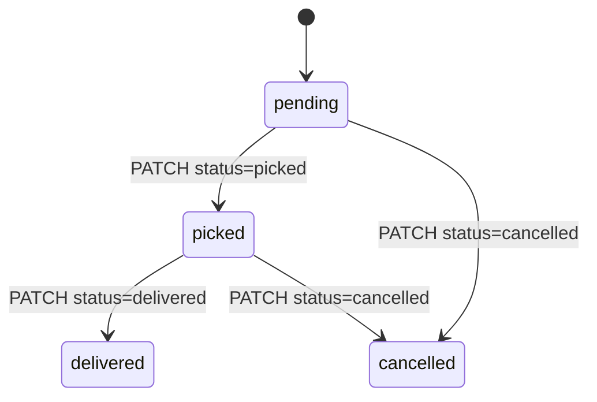
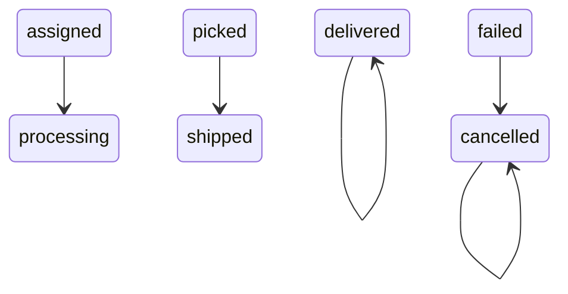
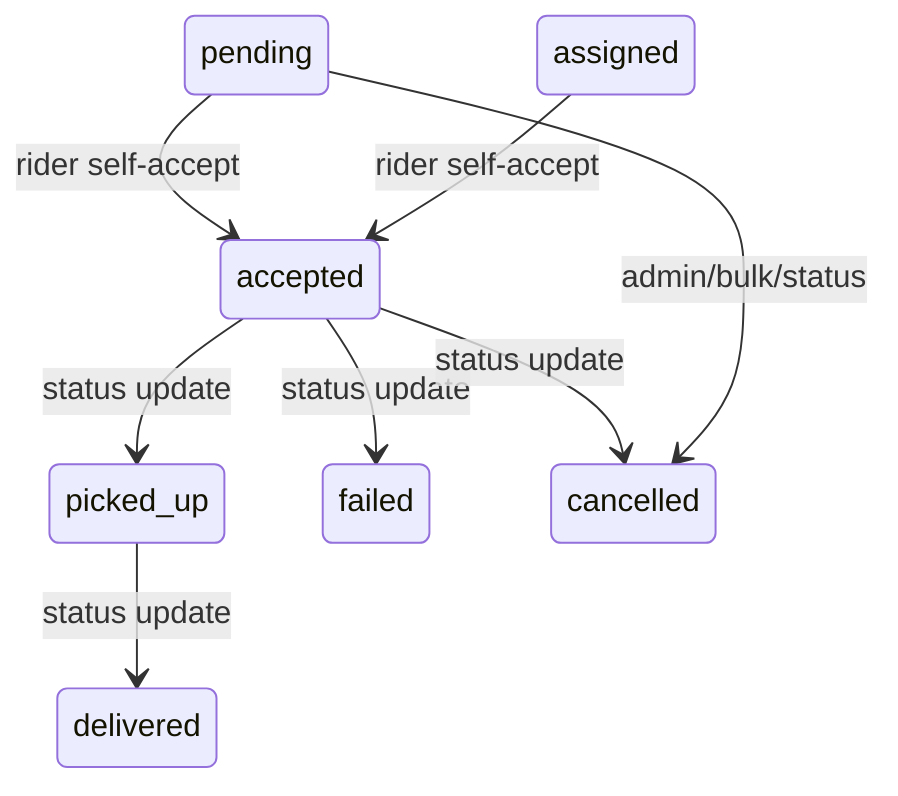

# Phase 08 — Delivery State Analysis

## State Vocabularies

### WorkToGo `orders.status`

Baseline: `pending`, `confirmed`, `processing`, `shipped`, `delivered`, `cancelled`, `refunded`.
Evidence: schema (`wtg  live/database-structure.sql:535`).

### WorkToGo `orders.delivery_status`

Free varchar default `pending`; vendor status update writes `dispatched` and `delivered`.
Evidence: schema (`wtg  live/database-structure.sql:550`); vendor update writes (`wtg  live/body/shopping-engine/api/orders/OrderService.php:487`, `wtg  live/body/shopping-engine/api/orders/OrderService.php:490`).

### WorkToGo `deliveries.status`

Baseline enum: `pending`, `assigned`, `picked`, `delivered`, `cancelled`.
Evidence: schema (`wtg  live/database-structure.sql:420`).

PHP webhook additionally allows `failed`, which is not in baseline enum.
Evidence: webhook allowed statuses (`wtg  live/heart/api/delivery/index.php:134`).

### SwiftDeliver `orders.status`

Default `pending`; type includes `pending`, `assigned`, `accepted`, `picked_up`, `delivered`, `cancelled`, `failed`.
Evidence: schema default (`swiftdeliver-main/src/db/database.ts:102`); TypeScript status type (`swiftdeliver-main/src/types/index.ts:1`); status route valid values (`swiftdeliver-main/server.ts:1130`).

### SwiftDeliver `delivery_assignments.status`

Default `pending`; runtime uses `accepted`, `completed`, `failed`, `cancelled`.
Evidence: schema (`swiftdeliver-main/src/db/database.ts:139`); accept insert (`swiftdeliver-main/server.ts:832`); delivered update (`swiftdeliver-main/server.ts:1153`).

## State Transition Maps

### WorkToGo PHP delivery status route

Traced caveat: route does not validate current state before updating; it only validates requested status and `driver_id` match.
Evidence: update query (`wtg  live/heart/api/delivery/index.php:101`).

### WorkToGo webhook mirror

Evidence: status mapping (`wtg  live/heart/api/delivery/index.php:149`).

Risk: `failed` maps to `orders.status=cancelled`, losing failure specificity in WorkToGo order state.
Confidence: High.

### SwiftDeliver order lifecycle

Evidence: rider-accept accepts `pending` or `assigned` (`swiftdeliver-main/server.ts:820`); status route valid statuses (`swiftdeliver-main/server.ts:1130`).

Traced caveat: status route validates allowed target status but does not enforce transition graph.
Evidence: no current-state transition table in status route (`swiftdeliver-main/server.ts:1125`).
Confidence: High.

## Delivery/Order Divergence Points

| Divergence | Where | Why | Operational impact | Confidence |
|---|---|---|---|---|
| PHP dispatch sets WorkToGo order `processing` before SwiftDeliver success | `wtg  live/heart/api/delivery/index.php:47` | status mutated before external call result | order may look processing even if dispatch fails | High |
| Node dispatch webhooks `assigned` before rider accepts | `swiftdeliver-main/server.ts:1018` | network broadcast treated as assignment | WorkToGo order processing without rider | High |
| Node delivered may not update PHP | `swiftdeliver-main/server.ts:1125` | no traced webhook call in status route | WorkToGo may remain processing/shipped | High |
| PHP webhook allows `failed`; schema may not | `wtg  live/heart/api/delivery/index.php:134`, `wtg  live/database-structure.sql:424` | enum drift | SQL error or status loss | High |
| Vendor marks sub-order shipped/delivered independently | `wtg  live/body/shopping-engine/api/orders/OrderService.php:487` | vendor fulfillment status separate from delivery network | delivery/order status mismatch | High |
| Admin order status directly updates `orders.status` | `wtg  live/heart/api/admin/index.php:634` | lifecycle bypass | no delivery/inventory side effects | High |

## Cancellation Behavior

### Customer cancellation
Customer parent order cancellation only allows `pending` or `confirmed`, releases inventory and cancels vendor sub-orders.
Evidence: cancellable statuses (`wtg  live/body/shopping-engine/api/orders/OrderService.php:356`); release stock and cancel parent/sub-orders (`wtg  live/body/shopping-engine/api/orders/OrderService.php:380`, `wtg  live/body/shopping-engine/api/orders/OrderService.php:391`, `wtg  live/body/shopping-engine/api/orders/OrderService.php:400`).

Untraced gap: cancellation does not visibly cancel SwiftDeliver order/delivery network entry.
Confidence: High for absence in traced cancel function; Medium for other untraced hooks.

### Admin cancellation
Admin directly sets order cancelled.
Evidence: admin cancel route (`wtg  live/heart/api/admin/index.php:648`).
Operational impact: bypasses inventory release and SwiftDeliver cancellation in traced route.
Confidence: High.

### SwiftDeliver cancellation
SwiftDeliver status route marks local assignment cancelled, frees rider, notifies rider/admin/vendor.
Evidence: cancellation block (`swiftdeliver-main/server.ts:1178`).
Untraced gap: no PHP webhook call observed after cancellation in status route.
Confidence: High.

## State Consistency Risk Summary

Root cause: multiple state machines are present without a canonical source of truth.

Connected systems: `orders`, `deliveries`, SwiftDeliver `orders`, `delivery_assignments`, vendor sub-orders, inventory, ledger, notifications.

Operational impact: customers/admins/vendors/riders may see different truth.
Scale impact: escalations and SLA analytics will be unreliable across cities.
Maintainability impact: adding a new status requires changes in PHP enum/schema/API, Node status list, TypeScript type, UI maps, webhook mapping, admin filters, and vendor/customer views.
Future risk: real-time tracking and fulfillment coordination can break silently.
Confidence: High.

