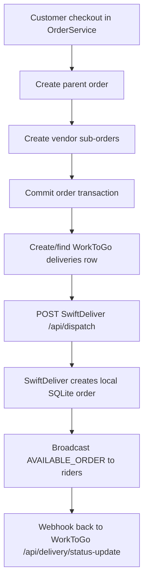
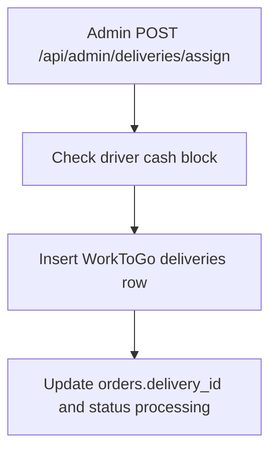
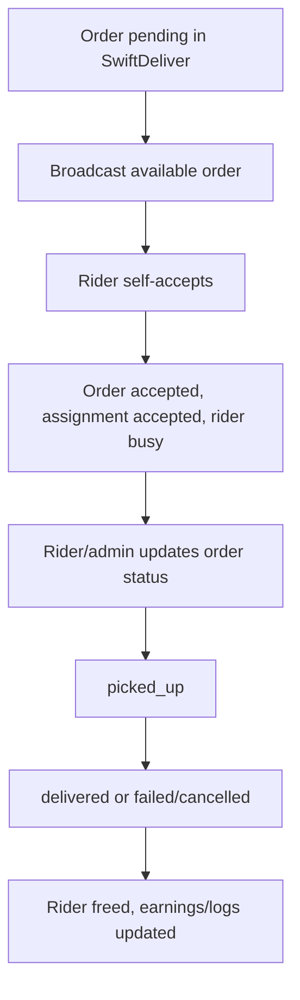

# Phase 08 — Delivery System Map

Scope: documentation-only intelligence extraction for the active WorkToGo project. No delivery architecture, dispatch logic, assignment behavior, location handling, or operational rules were modified.

## Executive Reality

WorkToGo delivery is not one unified delivery system. It is a split operational model made of:

1. WorkToGo PHP delivery/order tables and APIs.
2. SwiftDeliver Node/Railway delivery network with its own SQLite schema, riders, orders, assignments, WebSocket state, tracking, and status lifecycle.
3. Legacy/manual admin assignment routes in WorkToGo that use `driver_id`.
4. Vendor/service auto-assignment cron that assigns vendors/providers, not riders, but shares operational language with delivery.
5. Order/vendor fulfillment status transitions that update delivery-like fields without necessarily updating the `deliveries` row or SwiftDeliver.

Confidence: High for traced code paths; Medium for production behavior because external deployment configuration and live DB state were not executed.

## Primary Delivery Lifecycles

### A. Product checkout to SwiftDeliver dispatch

Flow:

Evidence:
- `OrderService::create()` creates parent and vendor sub-orders, commits, then calls `dispatchToDelivery()` (`wtg  live/body/shopping-engine/api/orders/OrderService.php:165`, `wtg  live/body/shopping-engine/api/orders/OrderService.php:303`, `wtg  live/body/shopping-engine/api/orders/OrderService.php:308`).
- `dispatchToDelivery()` creates a `deliveries` row if missing and calls SwiftDeliver `/api/dispatch` (`wtg  live/body/shopping-engine/api/orders/OrderService.php:965`, `wtg  live/body/shopping-engine/api/orders/OrderService.php:977`, `wtg  live/body/shopping-engine/api/orders/OrderService.php:993`).
- SwiftDeliver `/api/dispatch` validates bearer secret, inserts a local SQLite order, broadcasts to riders/admin, then calls PHP webhook with status `assigned` (`swiftdeliver-main/server.ts:910`, `swiftdeliver-main/server.ts:979`, `swiftdeliver-main/server.ts:1015`, `swiftdeliver-main/server.ts:1018`).

Connected systems: shopping orders, inventory reservation, WorkToGo `deliveries`, SwiftDeliver SQLite `orders`, WebSockets, PHP webhook, alerts/logging.

Runtime dependency: `SWIFTDELIVER_URL`, `SWIFTDELIVER_SECRET`, PHP reachability from Node via `PHP_BASE_URL` or `APP_URL`, SQLite volume persistence, rider WebSocket availability.

Operational impact: checkout can succeed even if dispatch fails because dispatch exceptions are logged as non-fatal after order commit.

Scale implications: every checkout can generate cross-system writes plus webhook; data consistency depends on both systems being available and configured.

Maintainability impact: delivery truth is split across two databases and status vocabularies.

Confidence: High.

### B. Manual WorkToGo admin delivery assignment

Flow:

Evidence:
- Admin route inserts `deliveries(order_id, driver_id, status, assigned_at)` and updates `orders.delivery_id` (`wtg  live/heart/api/admin/index.php:552`, `wtg  live/heart/api/admin/index.php:562`, `wtg  live/heart/api/admin/index.php:567`, `wtg  live/heart/api/admin/index.php:571`).
- Driver cash blocking uses `LedgerEngine::isDriverBlocked()` (`wtg  live/core/helpers/LedgerEngine.php:270`).

Connected systems: admin API, `deliveries`, `orders`, `driver_wallets`, ledger.

Runtime dependency: authenticated admin, driver wallet availability, schema column `driver_id`.

Operational impact: manual assignment bypasses SwiftDeliver and does not visibly notify the Node rider app.

Scale implications: operations may fork between manual WorkToGo delivery rows and SwiftDeliver delivery network.

Maintainability impact: manual path uses `driver_id`, while other admin listing paths use `rider_id`, creating schema vocabulary drift.

Confidence: High for code path; Medium for actual admin UI usage.

### C. SwiftDeliver rider marketplace lifecycle

Flow:

Evidence:
- Online riders receive available orders from `autoAssignRider()` (`swiftdeliver-main/server.ts:303`, `swiftdeliver-main/server.ts:324`, `swiftdeliver-main/server.ts:335`).
- Rider self-accept deletes prior assignments, inserts `accepted`, updates order to `accepted`, rider to `busy`, and broadcasts events (`swiftdeliver-main/server.ts:805`, `swiftdeliver-main/server.ts:831`, `swiftdeliver-main/server.ts:839`, `swiftdeliver-main/server.ts:846`).
- Status updates handle `picked_up`, `delivered`, `failed`, and `cancelled` (`swiftdeliver-main/server.ts:1125`, `swiftdeliver-main/server.ts:1149`, `swiftdeliver-main/server.ts:1152`, `swiftdeliver-main/server.ts:1167`, `swiftdeliver-main/server.ts:1178`).

Connected systems: SwiftDeliver riders, delivery assignments, WebSocket, notifications, WooCommerce sync, PHP webhook only at dispatch in the traced code.

Runtime dependency: WebSocket auth, rider online status, SQLite write availability.

Operational impact: real rider allocation is broadcast/self-accept, not true nearest auto-assignment.

Scale implications: broadcasting to all or all-in-radius riders grows with rider count and city size.

Maintainability impact: PHP delivery status may not receive all later rider state changes because traced Node status update route does not call `notifyPhpWebhook()` on each status mutation.

Confidence: High.

## Real Delivery Ownership Map

| Domain | Primary table/source | Actor | Reality |
|---|---|---|---|
| WorkToGo order truth | `orders` MySQL | customer/vendor/admin/PHP webhook | Parent/child shopping orders plus status mirror from delivery webhook |
| WorkToGo delivery row | `deliveries` MySQL | PHP dispatch/admin/manual status/webhook | Stores order delivery relationship but schema uses `driver_id`; webhook writes `rider_id` in code despite baseline schema mismatch |
| SwiftDeliver delivery order | `orders` SQLite | Node dispatch/admin/vendor/rider | Real rider-facing order lifecycle and tracking token |
| Rider assignment | `delivery_assignments` SQLite | rider/admin/background jobs | Rider self-accept or admin reassign |
| Vendor/provider assignment | `auto_assignments` MySQL | cron/vendor acceptance | Separate vendor assignment model for orders/jobs, not rider assignment |
| Location truth | address JSON, vendor lat/lng, rider lat/lng, city settings | PHP/Node/clients | Fragmented and fallback-heavy |

## Important Contradictions

### 1. `driver_id` vs `rider_id`

WHERE: WorkToGo baseline `deliveries` table defines `driver_id`, while PHP webhook/admin listing query references `rider_id`.

Evidence: `deliveries.driver_id` in schema (`wtg  live/database-structure.sql:420`); webhook updates `rider_id` (`wtg  live/heart/api/delivery/index.php:141`); admin delivery list joins `d.rider_id` (`wtg  live/heart/api/admin/index.php:678`, `wtg  live/heart/api/admin/index.php:719`).

WHY/root cause: multiple delivery vocabularies were introduced without a single schema contract.

Connected systems: admin delivery list, delivery webhook, manual assignment, ledger, schema migrations.

Operational impact: status updates/listing can fail or silently omit rider data if production schema lacks `rider_id`.

Scale impact: multi-city operations cannot rely on a stable driver/rider assignment contract.

Maintainability impact: any delivery change must inspect both terms across code and DB.

Future risk: migration or dashboard work can break delivery visibility.

Confidence: High.

### 2. WorkToGo parent order vs vendor sub-orders vs delivery dispatch

WHERE: checkout dispatches parent order after creating vendor sub-orders.

Evidence: parent order creation at `OrderService::create()` (`wtg  live/body/shopping-engine/api/orders/OrderService.php:165`); vendor sub-orders (`wtg  live/body/shopping-engine/api/orders/OrderService.php:220`); dispatch parent ID (`wtg  live/body/shopping-engine/api/orders/OrderService.php:308`).

WHY/root cause: order splitting and delivery dispatch are coupled at parent level while fulfillment happens at child/vendor level.

Connected systems: shopping cart, inventory, vendor order status, SwiftDeliver dispatch.

Operational impact: multi-vendor parent delivery can represent multiple vendor pickups as a single delivery without explicit coordination logic.

Scale impact: batching/pickup routing across vendors becomes dangerous without canonical parent-child delivery planning.

Maintainability impact: changing delivery dispatch can break multi-vendor order assumptions.

Future risk: multi-city/multi-vendor delivery will diverge unless parent-child delivery semantics are clarified.

Confidence: High.

### 3. SwiftDeliver `assigned` does not mean rider assigned

WHERE: `/api/dispatch` broadcasts available order and webhooks `assigned` back to PHP before any rider accepts.

Evidence: SwiftDeliver broadcasts available order (`swiftdeliver-main/server.ts:1015`) then webhook status `assigned` (`swiftdeliver-main/server.ts:1018`); rider acceptance happens later in `/api/orders/:id/rider-accept` (`swiftdeliver-main/server.ts:805`).

WHY/root cause: dispatch acceptance into the delivery network is mapped to WorkToGo delivery assigned status.

Connected systems: PHP `deliveries`, PHP `orders`, customer/admin status views, Node rider app.

Operational impact: customers/admins can see `processing` even when no rider has accepted.

Scale impact: dispatch SLA metrics become misleading in high-load cities.

Maintainability impact: status names mean different things in different systems.

Future risk: automated escalation may trigger too late because status is already advanced.

Confidence: High.

## Uncertainty Register

| Area | Uncertainty | Reason | Confidence |
|---|---|---|---|
| Production `deliveries` schema | Whether a later migration added `rider_id` | Baseline schema lacks it; code uses it | Medium |
| Actual SwiftDeliver payload richness | Whether WorkToGo passes customer address/items/vendor_id in production | Current PHP dispatch passes only IDs in traced paths | Medium |
| Mobile rider behavior | Exact UI reconnect/location send interval | UI files not fully traced in this phase | Medium |
| Real cron cadence | Whether PHP auto assignment cron is scheduled in production | Cron file exists; scheduler not traced | Medium |
| Payment webhook dispatch | Whether online payment path is used in live customer flow | customer checkout currently COD-only in OrderService | Medium |

