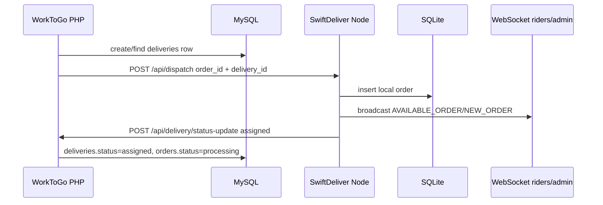

# Phase 08 — Dispatch Lifecycle Map

## Dispatch Models Found

WorkToGo has three operationally different dispatch/assignment models:

1. **SwiftDeliver rider dispatch** — PHP calls Node `/api/dispatch`; Node creates delivery-network order and broadcasts to riders.
2. **WorkToGo admin manual driver assignment** — admin directly inserts into MySQL `deliveries` and updates `orders.delivery_id`.
3. **WorkToGo vendor/provider auto-assignment** — cron assigns orders/jobs to vendors/providers via `auto_assignments`.

These models are not the same system and should not be treated as interchangeable.

## Dispatch Model 1 — PHP to SwiftDeliver

### Runtime flow

Evidence:
- PHP dispatch creates/finds delivery row and calls SwiftDeliver (`wtg  live/body/shopping-engine/api/orders/OrderService.php:977`, `wtg  live/body/shopping-engine/api/orders/OrderService.php:993`).
- Delivery endpoint can also dispatch manually to SwiftDeliver (`wtg  live/heart/api/delivery/index.php:36`, `wtg  live/heart/api/delivery/index.php:63`).
- SwiftDeliver validates bearer secret (`swiftdeliver-main/server.ts:912`) and creates order (`swiftdeliver-main/server.ts:979`).
- SwiftDeliver notifies PHP webhook with status `assigned` (`swiftdeliver-main/server.ts:1018`).

Runtime dependency: secret alignment, HTTP reachability, configured URLs, Node process, SQLite database, PHP webhook secret.

Operational impact: dispatch creates two order representations. If the callback fails, SwiftDeliver may have an order while WorkToGo remains pending.

Scale implications: cross-system eventual consistency becomes a bottleneck under multi-city load.

Maintainability impact: no single transaction covers MySQL order, MySQL delivery, SQLite order, WebSocket broadcast, and PHP callback.

Confidence: High.

## Dispatch Model 2 — Admin manual assignment

Admin assignment flow inserts a MySQL delivery row directly and does not call SwiftDeliver in the traced route.

Evidence:
- Route: `POST /api/admin/deliveries/assign` (`wtg  live/heart/api/admin/index.php:552`).
- Driver cash limit check (`wtg  live/heart/api/admin/index.php:562`).
- Insert `deliveries` and update `orders.delivery_id` (`wtg  live/heart/api/admin/index.php:567`, `wtg  live/heart/api/admin/index.php:571`).

Connected systems: admin panel, ledger, MySQL `deliveries`, MySQL `orders`.

Operational impact: manual assignments may be invisible to SwiftDeliver rider apps.

Scale implications: high operational risk if admins manually assign in one system while riders operate in another.

Maintainability impact: duplicate dispatch concepts require code readers to identify which path owns a delivery.

Confidence: High.

## Dispatch Model 3 — Vendor/provider auto-assignment cron

This is not rider dispatch. It assigns an `order` or `job` to a vendor/provider using nearest active online vendor.

Evidence:
- Cron loads `auto_assign_enabled`, `auto_assign_timeout`, and `vendor_search_radius` but does not apply radius in the vendor selection query (`wtg  live/cron/auto_assign.php:18`, `wtg  live/cron/auto_assign.php:134`).
- Orders/jobs selected for assignment (`wtg  live/cron/auto_assign.php:61`).
- Nearest vendor query orders by computed distance but has no city/vendor_type/category filter (`wtg  live/cron/auto_assign.php:134`, `wtg  live/cron/auto_assign.php:146`).
- Acceptance updates order/job vendor and status (`wtg  live/api/assignments/accept.php:96`, `wtg  live/api/assignments/accept.php:115`).

Runtime dependency: scheduled cron, MySQL transaction and row locks, vendor lat/lng values, vendor online status.

Operational impact: vendor assignment can compete conceptually with pre-created vendor sub-orders and service job ownership.

Scale implications: nearest vendor across all active online vendors becomes dangerous across cities.

Maintainability impact: code loads radius setting but ignores it, creating false configuration confidence.

Confidence: High.

## Dispatch Failure/Recovery Behavior

| Failure | Traced behavior | Operational risk | Confidence |
|---|---|---|---|
| SwiftDeliver URL missing | dispatch skipped and order remains committed | delivery may never reach riders | High |
| SwiftDeliver HTTP failure | logged as non-fatal in `OrderService` | order exists without delivery network entry | High |
| PHP webhook failure from Node | Node logs only | SwiftDeliver order can progress independently | High |
| No online riders in Node | admin notification only | pending order waits for rider online/retry | High |
| Pending Node order unassigned | background retry broadcasts after 2 minutes | repeated broadcast load | High |
| Rider assignment timeout | background frees rider and re-broadcasts | status may remain confusing | High |
| No vendor found in PHP cron | order/job cancelled | no staged escalation or manual queue | High |

## Major Finding — Dispatch State Is Not Transactional

WHERE: order commit and delivery dispatch are separated; Node dispatch and PHP webhook are also separated.

WHY: external HTTP dispatch is invoked after DB commit and errors are logged as non-fatal.
ROOT CAUSE: no outbox/queue/reconciliation table was traced.
CONNECTED SYSTEMS: `OrderService`, `deliveries`, SwiftDeliver `/api/dispatch`, webhook, alerts/logs.
OPERATIONAL IMPACT: orders can be paid/created but never rider-visible.
SCALE IMPACT: multi-city dispatch gaps multiply because retries/reconciliation are not centralized.
MAINTAINABILITY IMPACT: developers must reason about distributed side effects from logs rather than a canonical state machine.
FUTURE RISK: safe evolution requires a dispatch ledger or reconciliation process before changing behavior.
Confidence: High.

