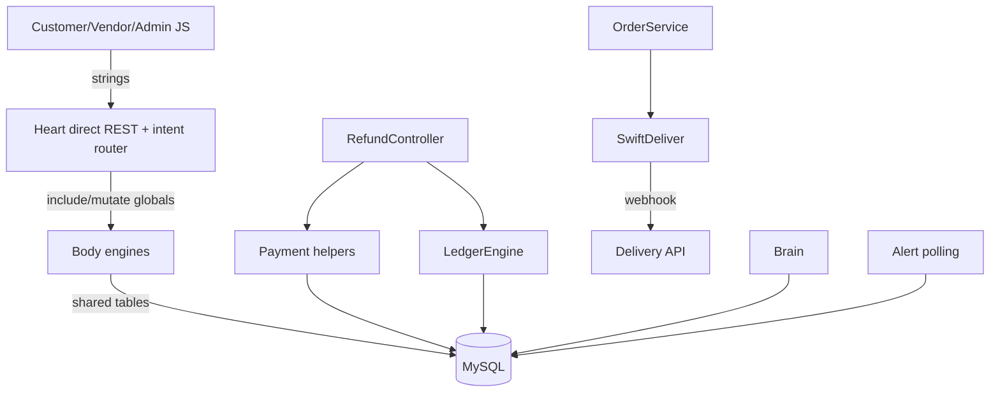

# Phase 11 — Hidden Coupling Analysis

## Coupling Map

## Hidden Couplings

### 1. Intent strings couple frontend, Heart router, and engine switches

- WHERE: Customer/vendor JS sends string intents; AppRouter maps strings to engine names; engine entrypoints switch on strings.
- WHY: Lightweight intent bus.
- ROOT CAUSE: No typed/shared contract or generated client.
- CONNECTED SYSTEMS: customer SPA, vendor SPA, Heart, shopping/service engines.
- OPERATIONAL IMPACT: Typo or drift creates generic fallback responses rather than clear compile-time failure.
- MAINTAINABILITY IMPACT: Feature names must be updated in multiple places manually.
- SCALE IMPACT: More modules multiply string drift.
- FUTURE RISK: API maintainability collapses as feature count grows.
- Evidence: `wtg  live/app/js/api.js:81-139`, `wtg  live/vendor/shared/api.js:51-99`, `wtg  live/heart/router.php:195-247`, `wtg  live/body/shopping-engine/index.php:20-65`, `wtg  live/body/service-engine/index.php:29-72`.
- Runtime dependency: exact string matching.
- Confidence: High.

### 2. Internal engine includes mutate global request state

- WHERE: `EngineLoader::callInternal()` sets `$_SERVER['REQUEST_METHOD']`, `GLOBALS['HEART_PAYLOAD']`, and internal headers before requiring engine files; service engine also mutates `REQUEST_URI`/`REQUEST_METHOD` before requiring direct REST router.
- WHY: Reuse direct REST controllers for internal Heart calls.
- ROOT CAUSE: Runtime integration through globals instead of explicit interfaces.
- CONNECTED SYSTEMS: Heart pipeline, shopping engine, service engine, auth, response helpers.
- OPERATIONAL IMPACT: A request-state bug can leak between internal includes in one request.
- MAINTAINABILITY IMPACT: Controllers depend on implicit globals, making testing difficult.
- SCALE IMPACT: Multi-engine internal dispatch has hidden side effects.
- FUTURE RISK: Runtime mutation dangers grow as engines are added.
- Evidence: `wtg  live/heart/pipeline/EngineLoader.php:82-143`, `wtg  live/body/service-engine/index.php:31-64`.
- Runtime dependency: PHP superglobals and include order.
- Confidence: High.

### 3. Database schema is a cross-module API

- WHERE: Orders table is written by order service, admin API, delivery webhook, payment webhook, refund/ledger, cron auto assignment, and service/payment paths.
- WHY: Shared database is the integration boundary.
- ROOT CAUSE: Modules directly read/write each other's tables.
- CONNECTED SYSTEMS: orders, deliveries, transactions, wallet_transactions, jobs, bookings, alerts.
- OPERATIONAL IMPACT: One schema change can break many modules.
- MAINTAINABILITY IMPACT: No module owns the table contracts cleanly.
- SCALE IMPACT: Shared hot tables become contention and migration bottlenecks.
- FUTURE RISK: Database refactors become increasingly risky.
- Evidence: `wtg  live/body/shopping-engine/api/orders/OrderService.php:168-287`, `wtg  live/heart/api/admin/index.php:634-655`, `wtg  live/heart/api/delivery/index.php:141-160`, `wtg  live/lib/PaymentService.php:186-237`, `wtg  live/core/helpers/LedgerEngine.php:39-267`, `wtg  live/cron/auto_assign.php:61-78`.
- Runtime dependency: DB schema stability.
- Confidence: High.

### 4. Admin operations are coupled to live production tables

- WHERE: Admin dashboard and list/actions query and mutate live tables directly.
- WHY: Admin is operational control panel.
- ROOT CAUSE: No admin read model or command abstraction.
- CONNECTED SYSTEMS: all operational domains.
- OPERATIONAL IMPACT: Admin usage affects production DB load and state directly.
- MAINTAINABILITY IMPACT: Admin UI cannot evolve independently from schema.
- SCALE IMPACT: Admin becomes less stable as data volume grows.
- FUTURE RISK: Need admin domain decomposition/read models.
- Evidence: `wtg  live/heart/api/admin/index.php:17-203`, `wtg  live/heart/api/admin/index.php:441-892`.
- Runtime dependency: live MySQL.
- Confidence: High.

## Coupling Uncertainty

- Exact DB foreign keys and constraints were not fully remapped in Phase 11.
- Some frontend pages may call direct REST endpoints not reread here.
- Brain model/table coupling requires deeper Brain model inspection for full debt mapping.

