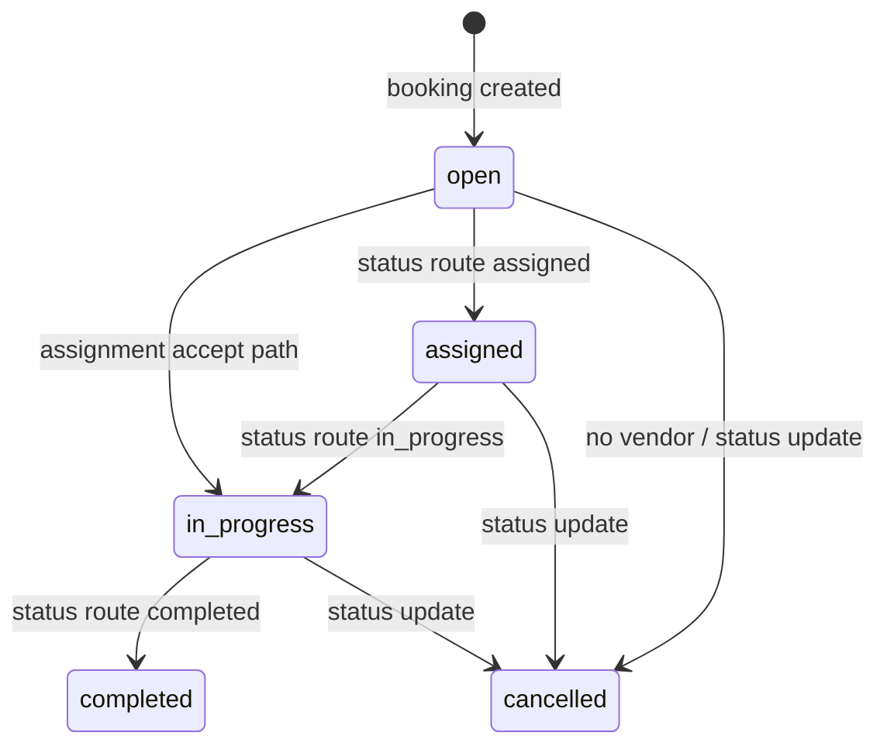

# Phase 07 — Job Lifecycle Analysis

Generated: 2026-05-12T16:40:00Z

## Job Lifecycle Sources

| Source | Job Mutation | Booking Mutation | Confidence |
|---|---|---|---|
| Main service request | Insert `jobs.status='open'` | Insert `bookings.status='pending'` | High |
| `/api/jobs/{id}/status` | Update to `assigned`, `in_progress`, `completed`, `cancelled` | Mirrors `assigned->confirmed`, `in_progress`, `completed`, `cancelled` | High |
| `cron/auto_assign.php` | Sets lock; cancels job if no vendor | No booking mirror traced | High |
| `api/assignments/accept.php` | Sets `in_progress`, changes `vendor_id`, clears lock | No booking mirror traced | High |
| `/api/vendor/jobs` | Reads jobs joined to bookings/services/users | None | High |

## Direct Job Status Route

Allowed statuses are `assigned`, `in_progress`, `completed`, and `cancelled`. The route requires `vendor_service` or admin, checks vendor ownership for service vendors, updates job timestamps for start/complete, and mirrors linked booking status.

Note: the status endpoint validates target status only; it does not enforce a strict transition matrix.

## Major Job Lifecycle Risks

### No strict transition guard

- WHERE: `/api/jobs/{id}/status` validates target status only.
- WHY: no transition matrix is implemented.
- ROOT CAUSE: simple status update endpoint.
- CONNECTED SYSTEMS: vendor jobs, bookings, customer bookings, analytics.
- OPERATIONAL IMPACT: a job can jump between states out of order.
- SCALE IMPACT: inconsistent completion/cancellation metrics.
- MAINTAINABILITY IMPACT: SLA/status rules require later retrofit.
- FUTURE RISK: field milestones like arrived/started/verified become unsafe.
- Confidence: High.

### Assignment accept changes provider and status at once

- WHERE: `api/assignments/accept.php` updates `jobs.vendor_id` and `status='in_progress'`.
- WHY: assignment is vendor-driven and writes directly to job.
- ROOT CAUSE: assignment and job lifecycle are coupled without service-state coordinator.
- CONNECTED SYSTEMS: assignments, jobs, bookings, vendor ownership, alerts.
- OPERATIONAL IMPACT: original service owner can be replaced after booking creation.
- SCALE IMPACT: accountability and payout routing become ambiguous.
- MAINTAINABILITY IMPACT: job owner vs assigned provider semantics are unclear.
- FUTURE RISK: subcontractor/partner assignment cannot be reasoned about safely.
- Confidence: High.

## Completion Logic

Completion is traced only through `/api/jobs/{id}/status` with `completed`. It sets `jobs.completed_at` if empty and updates linked `bookings.status` to `completed`. No customer confirmation, admin verification, payout, review prompt, warranty, or completion proof was traced.

## Operational Escalation Flow

Traced mechanisms include assignment timeout, broken lock recovery, no-vendor cancellation, and system alerts on Heart uncaught exceptions. Not traced: admin escalation queue, accepted-job no-progress monitor, customer/provider chat, SLA breach detection, or refund/compensation automation.

## Uncertainty Reporting

- Whether job completion triggers settlement/ledger/payout is not traced.
- Whether provider dashboard uses direct job REST endpoints or intent wrappers in production is uncertain.
