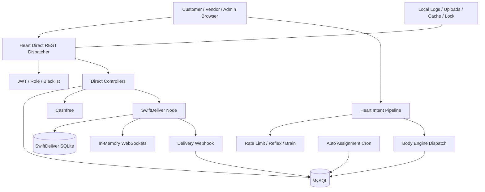

# Phase 12 — Master WorkToGo System Brain

Generated: 2026-05-14T06:36:00Z

Scope: final documentation-only consolidation from [`WTG-SYSTEM-BRAIN/`](WTG-SYSTEM-BRAIN/) and active project [`wtg  live/`](wtg%20%20live/). No runtime behavior, architecture, infrastructure, flows, or modules were modified.

---

## 1. Executive System Truth

WorkToGo is a multi-sided local commerce, service, vendor, admin, and delivery platform implemented primarily as a synchronous PHP/MySQL application with biological subsystem naming:

| Layer | Reality | Primary Role | Stability |
|---|---|---|---|
| Heart | Gateway plus orchestration layer | Routes direct REST and intent-pipeline requests | Medium, but overloaded |
| Body | Business engines | Shopping, service, content, video domains | Mixed |
| Brain | Optional intelligence/rules/personalization layer | Events, decisions, ranking, fallback behavior | Medium, optional |
| Core | Shared helpers | Database, auth, response, payment, ledger, logging, validation | Stable in small helpers, risky in broad helpers |
| Frontends | Customer/vendor/admin browser clients | SPA/static/PHP panels using multiple API clients | Mixed, contract drift risk |
| SwiftDeliver | External Node delivery runtime | Rider dispatch, WebSockets, local delivery state | Useful but separate truth layer |

The canonical production reality is not a clean service architecture. It is a DB-centered synchronous platform where multiple generations of route models, response models, event models, financial flows, booking flows, and delivery flows coexist. The strongest parts are small cohesive modules. The weakest parts are domains where money, state transitions, external callbacks, admin overrides, and cross-module tables overlap.

Primary evidence sources: [`architecture-overview.md`](WTG-SYSTEM-BRAIN/architecture-overview.md), [`phase-10-security-performance-scalability-intelligence.md`](WTG-SYSTEM-BRAIN/phase-10-security-performance-scalability-intelligence.md), [`phase-11-production-stability-technical-debt-intelligence.md`](WTG-SYSTEM-BRAIN/phase-11-production-stability-technical-debt-intelligence.md), [`state-synchronization-map.md`](WTG-SYSTEM-BRAIN/state-synchronization-map.md), [`cross-module-db-coupling.md`](WTG-SYSTEM-BRAIN/cross-module-db-coupling.md).

---

## 2. What WorkToGo Really Is

WorkToGo is best understood as five operational systems sharing one production nervous system:

1. Customer marketplace: browse products/services, place COD orders, request services, view history.
2. Vendor/provider operations: receive/manage orders/jobs, maintain products/services/profile, react to polling notifications.
3. Admin operations center: broad superuser panel over users, vendors, services, orders, deliveries, refunds, settings, logs, and dashboards.
4. Financial/payment layer: Cashfree online path, COD path, transactions, refunds, ledger/wallet concepts, and fragmented reconciliation logic.
5. Delivery/assignment layer: PHP/MySQL order delivery rows, auto-assignment cron, manual assignment, and SwiftDeliver Node/SQLite/WebSocket runtime.

The hidden sixth system is synchronization: order state, booking state, payment state, delivery state, frontend session state, alerts, Brain events, and external delivery events all attempt to mirror reality without a single event bus or canonical transition engine.

---

## 3. Canonical Architecture DNA

Architectural truths:

- There are two active PHP API models: direct REST and Heart intent pipeline.
- Direct REST bypasses Brain, Reflex cache, priority resolution, and pipeline response shaping.
- Intent pipeline engine calls may be internal PHP includes or external HTTP/cURL calls.
- MySQL is the real shared operational substrate.
- Local filesystem acts as infrastructure for logs, uploads, cache fallback, and cron locking.
- External state exists in SwiftDeliver and Cashfree but is only partially mirrored into WorkToGo.
- Admin is not a separate bounded domain; it directly reaches across operational tables.

---

## 4. Stable Systems

| System | Why Stable | Caveat |
|---|---|---|
| JWT helper | Focused encode/decode behavior | Token claim freshness depends on surrounding auth model |
| Product catalog read path | Cohesive service/controller separation | Admin/schema drift can still affect product tables |
| Cart service | Bounded cart responsibility | Checkout uses cart as part of larger high-risk transaction chain |
| Reflex cache abstraction | Driver interface is clear | File fallback and optional Redis/APCu affect production behavior |
| Cashfree signature verification | HMAC/timestamp verification exists | Event ledger and failure replay are incomplete |

---

## 5. Dangerous Systems

| Zone | Danger | Root Pattern |
|---|---|---|
| Payment/refund/ledger | Financial correctness spread across helpers/controllers/services | Domain responsibility fragmentation |
| Service booking/job/slot | Duplicate booking models and status drift | Legacy/current flow coexistence |
| Admin API | One broad superuser file controls many domains | Operational monolith |
| Vendor API contract | Frontend intents drift from backend registry/engine switches | String-contract drift |
| Delivery synchronization | PHP/MySQL and SwiftDeliver SQLite/WebSocket states diverge | Multiple truth layers |
| Runtime routing | Direct REST and intent pipeline coexist | Split orchestration reality |
| Local filesystem infrastructure | Logs/cache/uploads/locks are node-local | Shared-hosting substrate |
| DB schema ownership | Shared tables are cross-module APIs | Direct SQL coupling |

---

## 6. System-Wide Root Cause Patterns

1. Shared DB as integration bus: modules coordinate by directly reading/writing shared tables.
2. String-based contracts: routes, intents, statuses, event names, roles, and schema vocabulary are repeated manually.
3. Multiple generations coexisting: legacy/current booking, payment, admin, vendor, and delivery concepts overlap.
4. Synchronous side effects: external dispatch, payment, refund, Brain, admin, and engine work occurs inside request lifecycles.
5. Missing durable event layer: alerts, Brain events, webhooks, cron, polling, and WebSocket events are separate systems.
6. Local infrastructure assumptions: filesystem and optional PHP extensions shape runtime behavior.
7. Admin bypass pressure: admin can mutate operational state directly, sometimes bypassing domain lifecycle side effects.

---

## 7. What Breaks First at Scale

| Order | Break Point | Why |
|---:|---|---|
| 1 | MySQL | Auth blacklist, polling, admin aggregates, checkout locks, payment webhooks, cron, alerts converge on DB |
| 2 | PHP workers | Synchronous cURL, lock waits, external delays, and engine fanout consume workers |
| 3 | Polling realtime | Customer/vendor/admin/alert polling creates linear read amplification |
| 4 | Local filesystem | Logs/uploads/cache/cron lock diverge or saturate in multi-node/runtime growth |
| 5 | Human operations | Admin/manual/log-based recovery cannot keep up with incident volume |
| 6 | API contracts | More features multiply frontend/backend drift |

---

## 8. Competing Sources of Truth

| Domain | Competing Truths | Result |
|---|---|---|
| Orders | Parent order, vendor child orders, delivery rows, SwiftDeliver orders | Parent/child/delivery divergence |
| Services | Bookings, jobs, slots/reservations, auto_assignments | Booking/job/slot ambiguity |
| Payment | Orders, transactions, Cashfree webhook, COD internal confirmation, refund/ledger helpers | Reconciliation uncertainty |
| Delivery | MySQL deliveries, SwiftDeliver SQLite, WebSockets, webhook mirror, admin overrides | Status drift and replay risk |
| Auth/vendor state | JWT role claims, users.role, vendors.status/type, frontend localStorage user | Stale access and role drift |
| Events | Alerts, Brain events, payment webhooks, delivery webhooks, vendor polling, SwiftDeliver WS | Missed/duplicated/non-durable events |

---

## 9. Systems That Must Never Be Changed Carelessly

- Heart route ordering and direct REST fallbacks.
- Auth/JWT middleware behavior and admin bypass semantics.
- Orders table status fields, parent/child order relationships, and inventory reservation logic.
- Payment webhook, transaction insertion, refund, and ledger paths.
- Service booking/job/slot status transitions.
- Vendor approval flow linking vendors and users roles.
- Delivery webhook/status update semantics and SwiftDeliver dispatch assumptions.
- Admin direct mutation endpoints.
- Migration files and baseline schema vocabulary.
- Local filesystem paths for logs/uploads/cache/cron locks until infrastructure is replaced deliberately.

---

## 10. Safest Stabilization Order

1. Freeze and document canonical API/intent/status contracts.
2. Map financial domain ownership and reconciliation truth before changing money logic.
3. Normalize service booking/job/slot lifecycle intelligence before adding service scale features.
4. Define admin operational boundaries and side-effect expectations before decomposing admin.
5. Document deployment/config/filesystem assumptions and production runtime dependencies.
6. Introduce future durable event/outbox design only after state ownership is clear.
7. Build DB schema ownership map and migration safety process before schema evolution.

---

## 11. Safest Scaling Order

1. Stabilize contracts and status vocabularies.
2. Reduce polling risk through read models or future push architecture planning.
3. Make payment/delivery side effects durable and replayable.
4. Move logs/cache/uploads/cron locks away from node-local assumptions.
5. Partition operational queries by city/zone/vendor domain.
6. Add queue/outbox semantics for external integration calls.
7. Introduce horizontal runtime only after filesystem, cron, cache, WebSocket, and callback idempotency assumptions are resolved.

---

## 12. True Production Maturity

WorkToGo appears suitable for controlled small-scale launch only if operational staff understand its fragility and monitor DB, payment, delivery, cron, and admin flows closely. It is not yet mature for high-volume multi-city production, large mobile traffic, or aggressive feature expansion without hardening.

Overall production readiness score: 46 / 100.

Detailed scoring is maintained in [`final-production-readiness-score.md`](WTG-SYSTEM-BRAIN/final-production-readiness-score.md).

