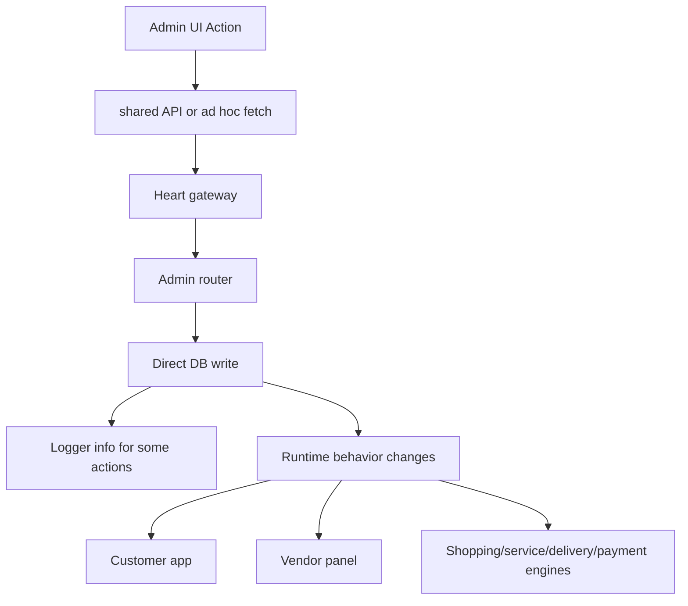

# Operational Control Map

Generated: 2026-05-12T08:15:00Z

---

## 1. Control Domains

| Domain | Admin control | Direct DB impact | Connected systems | Evidence | Confidence |
|---|---|---|---|---|---|
| Users | List, detail, status, role, block/unblock | `users.status`, `users.role` | Auth, JWT lifecycle, all apps | `wtg  live/heart/api/admin/index.php:375`, `wtg  live/heart/api/admin/index.php:441`, `wtg  live/heart/api/admin/index.php:607` | High |
| Vendors | Approve/reject/activate/deactivate | `vendors.status`, `users.role` | Vendor panel, customer vendor apply, service/shopping engines | `wtg  live/heart/api/admin/index.php:480`, `wtg  live/heart/api/admin/index.php:503`, `wtg  live/heart/api/admin/index.php:513` | High |
| Orders | List/detail/status/cancel | `orders.status` | Customer tracking, vendor fulfillment, inventory, refunds, delivery | `wtg  live/heart/api/admin/index.php:336`, `wtg  live/heart/api/admin/index.php:634`, `wtg  live/heart/api/admin/index.php:648` | High |
| Delivery | List/assign | `deliveries`, `orders.delivery_id`, `orders.status` | Drivers, LedgerEngine cash block, SwiftDeliver assumptions | `wtg  live/heart/api/admin/index.php:552`, `wtg  live/heart/api/admin/index.php:698` | Medium-high |
| Catalogue | Product delete; product/service list | `products.status`, `products.deleted_at` | Customer browsing, vendor inventory | `wtg  live/heart/api/admin/index.php:625`, `wtg  live/heart/api/admin/index.php:736`, `wtg  live/heart/api/admin/index.php:302` | Medium-high |
| Payments/refunds | Payment list, refund approve/reject/list | `transactions`, `orders.payment_status`, ledger refund | Cashfree, refunds, admin finance | `wtg  live/heart/api/admin/index.php:767`, `wtg  live/core/controllers/RefundController.php:176` | Medium |
| System | app_settings, system_config, log purge | `app_settings`, `system_config`, log files | Brain/feed settings, delivery pricing, platform config | `wtg  live/heart/api/admin/index.php:359`, `wtg  live/heart/api/admin/index.php:857`, `wtg  live/heart/api/admin/index.php:588` | Medium |

---

## 2. Operational Decision Propagation

Important propagation gaps:

- Role changes require relogin because JWT/local user state is not automatically refreshed.
- Order admin status changes do not trigger inventory reservation release, vendor child order reconciliation, delivery dispatch, or payment side effects in the traced route.
- Vendor deactivation does not revoke user role or token in traced paths.
- Product delete has backend route, but product status toggle route is missing.

Evidence: `wtg  live/heart/api/admin/index.php:491`, `wtg  live/vendor/shared/auth.js:70`, `wtg  live/heart/api/admin/index.php:642`, `wtg  live/body/shopping-engine/api/orders/OrderService.php:337`, `wtg  live/heart/api/admin/index.php:529`, `wtg  live/heart/api/admin/index.php:625`, `wtg  live/admin/products.html:142`.

---

## 3. Operational Event Propagation and Auditability

Admin router writes Logger entries for selected actions: user update/block/unblock, vendor approve/reject/status, product delete, order status/cancel, log purge, system config update.

Evidence: `wtg  live/heart/api/admin/index.php:475`, `wtg  live/heart/api/admin/index.php:496`, `wtg  live/heart/api/admin/index.php:509`, `wtg  live/heart/api/admin/index.php:531`, `wtg  live/heart/api/admin/index.php:630`, `wtg  live/heart/api/admin/index.php:644`, `wtg  live/heart/api/admin/index.php:653`, `wtg  live/heart/api/admin/index.php:603`, `wtg  live/heart/api/admin/index.php:886`.

Audit weakness: log purge endpoint can remove old log files, and critical moderation/order actions do not use immutable audit tables or structured operation records in traced paths.

Evidence: `wtg  live/heart/api/admin/index.php:588`, `wtg  live/heart/api/admin/index.php:596`.

---

## 4. Mobile Admin/Vendor Operational Behavior

Admin pages include viewport meta and shared responsive CSS, but operational controls are desktop-table oriented: sidebar shell, dense tables, modals, and manual text inputs. No dedicated mobile admin app was traced.

Evidence: `wtg  live/admin/orders.html:4`, `wtg  live/admin/vendors.html:4`, `wtg  live/admin/delivery.html:4`, `wtg  live/admin/shared/shell.js:54`.

Vendor panel has role-specific navigation and uses localStorage role gating. Its mobile readiness was not deeply CSS-audited in Phase 05, but operational access depends on local user role rather than live status.

Evidence: `wtg  live/vendor/shared/shell.js:38`, `wtg  live/vendor/shared/shell.js:82`, `wtg  live/vendor/shared/auth.js:61`.

Confidence: Medium.

