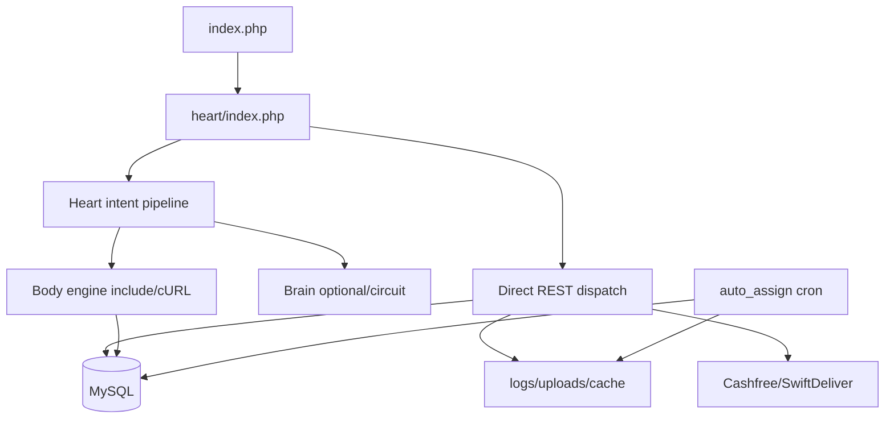

# Phase 11 — Production Stability Analysis

## Stability Summary

WorkToGo production stability depends on PHP request workers, MySQL, local filesystem, environment secrets, external Cashfree/SwiftDeliver services, and consistent route contracts. The system can operate at small scale, but stability under production pressure is weakened by synchronous external calls, duplicated runtime paths, local file assumptions, and fragile operational recovery.

## Production Stability Map

## Major Stability Findings

### 1. Request lifecycle is synchronous across critical paths

- WHERE: Heart pipeline synchronously calls Brain and engines; checkout synchronously commits and dispatches; admin calls compute live aggregates; payment/refund paths call gateway APIs in request flow.
- WHY: Runtime is built around request-response PHP execution.
- ROOT CAUSE: No traced durable queue/outbox/background worker for most side effects.
- CONNECTED SYSTEMS: Heart, Brain, Body engines, orders, payment, delivery, admin.
- OPERATIONAL IMPACT: Slow downstreams consume PHP workers and cause user-visible timeouts.
- MAINTAINABILITY IMPACT: Engineers must reason about side effects inside request handlers.
- SCALE IMPACT: Worker saturation occurs before external dependency failure is isolated.
- FUTURE RISK: Production pressure turns downstream slowness into whole-app instability.
- Evidence: `wtg  live/heart/router.php:153-177`, `wtg  live/heart/pipeline/BrainConnector.php:213-279`, `wtg  live/heart/pipeline/EngineLoader.php:145-215`, `wtg  live/body/shopping-engine/api/orders/OrderService.php:303-309`, `wtg  live/core/controllers/RefundController.php:230-296`.
- Runtime dependency: PHP workers, curl, DB, external service latency.
- Confidence: High.

### 2. MySQL is the production stability center of gravity

- WHERE: Auth blacklist, admin dashboards, order/cart/service flows, webhooks, alerts, cron assignment, refunds, ledgers all rely on DB.
- WHY: Shared relational DB holds most application state.
- ROOT CAUSE: No read model, queue, or cache consistently abstracts hot operational state.
- CONNECTED SYSTEMS: all major modules.
- OPERATIONAL IMPACT: DB degradation disables auth and business operations.
- MAINTAINABILITY IMPACT: Schema changes are high-risk because many modules couple to tables directly.
- SCALE IMPACT: DB becomes first production bottleneck.
- FUTURE RISK: DB schema evolution will slow feature delivery.
- Evidence: `wtg  live/core/helpers/Database.php:10-54`, `wtg  live/heart/middleware/AuthMiddleware.php:77-95`, `wtg  live/heart/api/admin/index.php:17-203`, `wtg  live/cron/auto_assign.php:32-182`.
- Runtime dependency: MySQL connection and schema consistency.
- Confidence: High.

### 3. Local filesystem is a hidden production dependency

- WHERE: `.htaccess` sets PHP error log, `Logger` writes local daily logs, Reflex file cache stores under logs, story upload writes to local upload directory, cron lock uses local file.
- WHY: Hostinger/shared-hosting-compatible runtime.
- ROOT CAUSE: Filesystem used as infrastructure service.
- CONNECTED SYSTEMS: logging, media, caching, cron safety.
- OPERATIONAL IMPACT: Disk permissions/capacity can break logs, uploads, cache, and cron locking.
- MAINTAINABILITY IMPACT: Developers must remember invisible local state.
- SCALE IMPACT: Horizontal scaling produces divergent cache/media/log/lock state.
- FUTURE RISK: Disaster recovery is incomplete if local files are not backed up.
- Evidence: `wtg  live/.htaccess:72-80`, `wtg  live/core/helpers/Logger.php:27-50`, `wtg  live/heart/pipeline/ReflexEngine.php:113-117`, `wtg  live/body/content-engine/api/StoryController.php:24-64`, `wtg  live/cron/auto_assign.php:11-15`.
- Runtime dependency: local disk.
- Confidence: High.

### 4. Migration/deployment endpoints create operational fragility

- WHERE: `deploy-hook.php` and `migrate.php` parse `.env`, validate `MIGRATE_SECRET`, scan SQL files, execute SQL, and log applied files.
- WHY: Web/CLI migration path is available for deployment.
- ROOT CAUSE: Migration execution is integrated into app filesystem and secret query flow.
- CONNECTED SYSTEMS: deployment, DB schema, `migrations_log`, `heart/index.php` system routes.
- OPERATIONAL IMPACT: Bad migration can fail production route or expose detailed file/line in migration response.
- MAINTAINABILITY IMPACT: SQL migrations are applied by filename order with limited transactional orchestration.
- SCALE IMPACT: Multi-node deploys require careful coordination.
- FUTURE RISK: Schema drift grows if migrations are manually patched outside log.
- Evidence: `wtg  live/heart/index.php:163-170`, `wtg  live/deploy-hook.php:21-32`, `wtg  live/migrate.php:44-102`, `wtg  live/migrate.php:104-114`.
- Runtime dependency: `.env`, migration files, DB permissions.
- Confidence: High.

## What Fails First Under Production Pressure

1. MySQL latency affects auth, polling, admin, checkout, webhooks, cron.
2. PHP workers saturate due to synchronous cURL/DB lock waits.
3. Route/intent drift breaks frontend workflows and increases support/debug time.
4. Local disk assumptions fail under uploads/log/cache growth or horizontal scaling.
5. Manual admin/cron recovery becomes overloaded because no durable event replay is traced.

## Production Stability Uncertainties

- Actual PHP-FPM worker limits and hosting resource caps are not traced.
- Whether migrations are run through web routes, CLI, or hosting panel is uncertain.
- Actual backup/restore and log shipping are unknown.
- Actual monitoring/alerting for gateway, dispatch, cron, and DB failures is not traced.

