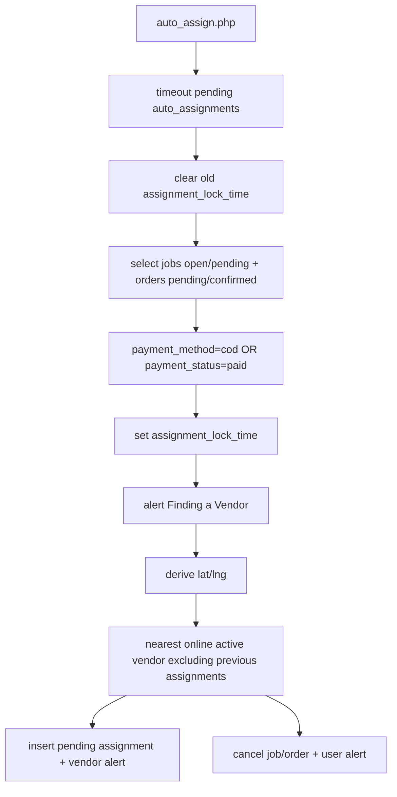

# Phase 07 — Provider Assignment Analysis

Generated: 2026-05-12T16:40:00Z

## Assignment Models Present

WorkToGo has two provider assignment concepts:

1. Direct vendor assignment at booking creation: main service booking copies `services.vendor_id` into `bookings.vendor_id` and `jobs.vendor_id`.
2. Auto assignment cron: scans `jobs` and `orders`, creates `auto_assignments` invitations to nearby online active vendors, and relies on vendor acceptance.

These models coexist and can conflict.

## Auto Assignment Behavior

## Manual Acceptance Behavior

Vendor acceptance locks the matching `auto_assignments` row, checks entity status, ensures no accepted assignment exists, marks assignment accepted, then updates the job/order. For jobs it sets `jobs.status='in_progress'`, sets `vendor_id`, clears `assignment_lock_time`, and inserts alerts.

## Major Assignment Conflict Findings

### Jobs are already vendor-owned before auto assignment

- WHERE: main booking creation sets `jobs.vendor_id = services.vendor_id`; cron can later assign nearest vendor.
- WHY: direct service-provider model and assignment marketplace model both exist.
- ROOT CAUSE: no single provider assignment strategy.
- CONNECTED SYSTEMS: service booking, jobs, vendor job list, auto assignment, alerts.
- OPERATIONAL IMPACT: a job created for Vendor A can be offered to Vendor B.
- SCALE IMPACT: provider ownership disputes grow with vendor density.
- MAINTAINABILITY IMPACT: unclear whether `jobs.vendor_id` means owner, candidate, or assignee.
- FUTURE RISK: pooled marketplace and payout/accountability logic cannot be safe.
- Confidence: High.

### Vendor search ignores service capability/type

- WHERE: cron vendor search filters only `is_online=1` and `status='active'`.
- WHY: no join to services/categories or vendor type.
- ROOT CAUSE: generic assignment engine shared by jobs and orders.
- CONNECTED SYSTEMS: service jobs, shopping orders, vendors, alerts.
- OPERATIONAL IMPACT: unrelated vendor can receive a service job.
- SCALE IMPACT: incorrect dispatch grows with service diversity.
- MAINTAINABILITY IMPACT: skills/categories/verification require assignment rewrite.
- FUTURE RISK: Urban Company-style matching is unsupported.
- Confidence: High.

### Location fallback to zero coordinates

- WHERE: cron derives job location from `jobs -> bookings -> addresses` and defaults to `0,0`.
- WHY: main booking UI does not send `address_id` or coordinates.
- ROOT CAUSE: booking location is optional and not normalized.
- CONNECTED SYSTEMS: booking, addresses, assignment, vendors.
- OPERATIONAL IMPACT: vendor matching can be nonsensical.
- SCALE IMPACT: city expansion makes bad geo assignment severe.
- MAINTAINABILITY IMPACT: future ETA/radius pricing must handle missing location.
- FUTURE RISK: routing and service-area enforcement fail.
- Confidence: High.

## Retry/Recovery Behavior

| Mechanism | Traced Behavior | Risk | Confidence |
|---|---|---|---|
| File lock | Prevents concurrent cron cycles. | Advisory process-level safety only. | High |
| Timeout | Pending assignments become `timeout`; entity lock cleared. | No customer/vendor timeout notification traced. | High |
| Retry | Next cron excludes previous vendors. | No max-attempt policy except exhausting vendors. | High |
| No vendor | Cancels job/order and alerts user. | For jobs, booking not mirrored to cancelled. | High |

## Uncertainty Reporting

- Actual cron schedule/frequency is not traced.
- Whether assignment is intended for vendor-owned service jobs is ambiguous.
- Admin manual job assignment endpoint was not traced.
