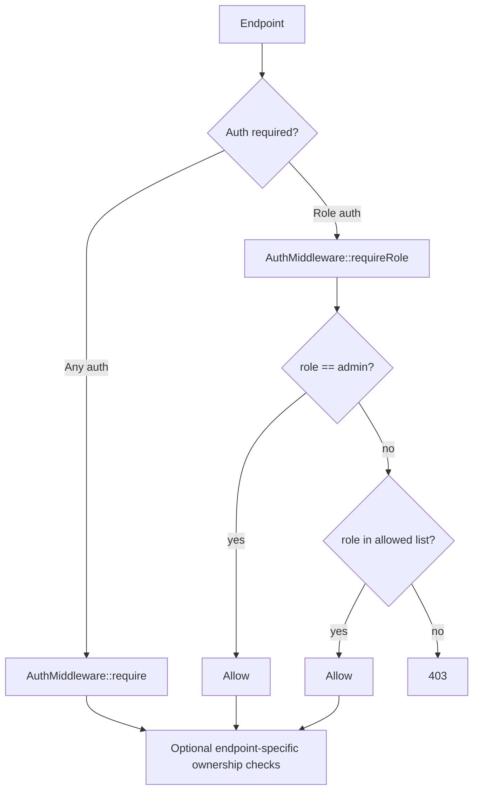

# Role and Permission Map

Generated: 2026-05-12T04:40:00Z

---

## 1. Role Hierarchy Reality

There is no formal permissions table or policy engine. Authorization is role-string based and implemented in code through `AuthMiddleware::requireRole()` plus resource ownership checks.

Evidence: `wtg  live/heart/middleware/AuthMiddleware.php:28`, `wtg  live/database-structure.sql:786`.

Confidence: High.

---

## 2. Role Definitions

| Role | Meaning in code | Major access surfaces | Evidence | Confidence |
|---|---|---|---|---|
| `customer` | Default user/customer role | Customer orders/bookings, cart, service booking | `wtg  live/config/app.php:15`, `wtg  live/body/shopping-engine/api/orders/OrderController.php:29` | High |
| `vendor_service` | Service vendor role | Service jobs/bookings, service analytics, service creation | `wtg  live/body/service-engine/api/services/index.php:72`, `wtg  live/body/service-engine/api/VendorAnalyticsController.php:17` | High |
| `vendor_shopping` | Shopping vendor role | Products, shopping vendor orders, shopping analytics | `wtg  live/body/shopping-engine/api/products/ProductController.php:53`, `wtg  live/body/shopping-engine/api/VendorAnalyticsController.php:17` | High |
| `admin` | Platform admin | All `/api/admin/*`, refund admin, admin bypass in middleware | `wtg  live/heart/api/admin/index.php:12`, `wtg  live/heart/middleware/AuthMiddleware.php:32` | High |
| `delivery` | Delivery user/driver | Delivery routes not deeply traced in this phase | `wtg  live/config/app.php:19`, `wtg  live/heart/index.php:201` | Medium |

---

## 3. Admin Bypass

`AuthMiddleware::requireRole()` always returns success for `ROLE_ADMIN` before checking the provided allowed roles.

Evidence: `wtg  live/heart/middleware/AuthMiddleware.php:32`.

Confidence: High.

Connected modules: all endpoints using `requireRole()`.

Runtime dependency: JWT role claim.

Scale implication: admin blast radius is global. Any leaked admin token can cross all role checks using this helper.

Security implication: admin access must be treated as full platform superuser access.

---

## 4. RBAC Implementation Pattern

Evidence: `wtg  live/heart/middleware/AuthMiddleware.php:13`, `wtg  live/heart/middleware/AuthMiddleware.php:28`.

---

## 5. Permission and Ownership Enforcement

| Domain | Protection style | Evidence | Confidence |
|---|---|---|---|
| Customer orders | `requireRole(customer, admin)` + service uses user ID | `wtg  live/body/shopping-engine/api/orders/OrderController.php:27` | High |
| Shopping vendor products | `requireRole(vendor_shopping, admin)` + vendor resolved from user | `wtg  live/body/shopping-engine/api/products/ProductController.php:53` | High |
| Shopping vendor orders | only `se_require_auth()` then vendor resolved from user; no role check | `wtg  live/body/shopping-engine/api/orders/OrderController.php:100` | High |
| Service vendor jobs | `requireRole(vendor_service, admin)` + vendor ownership | `wtg  live/body/service-engine/api/services/index.php:409` | High |
| Service vendor jobs list | `requireRole(vendor_service, admin)` | `wtg  live/body/service-engine/api/vendors/index.php:194` | High |
| Vendor analytics | `requireRole(vendor_service/vendor_shopping, admin)` + active vendor lookup | `wtg  live/body/service-engine/api/VendorAnalyticsController.php:17`, `wtg  live/body/shopping-engine/api/VendorAnalyticsController.php:17` | High |
| Alerts | any auth, then role can come from request parameter and is normalized for vendor | `wtg  live/api/alerts/fetch.php:19` | Medium |

---

## 6. Role Transition Flow

Vendor approval updates `vendors.status='active'` and changes the linked `users.role` to `vendor_service` or `vendor_shopping` based on vendor type.

Evidence: `wtg  live/heart/api/admin/index.php:480`.

Confidence: High.

User impact: existing JWTs continue carrying old role until relogin/refresh. Vendor UI explicitly warns customer-role users to logout and login again.

Evidence: `wtg  live/vendor/shared/auth.js:70`.

Scale implication: role changes are not immediately propagated across active tokens.

---

## 7. Permission Risks

### Risk: role claim trust without DB role recheck
Where: `AuthMiddleware::resolveToken()` validates JWT signature and claim presence but does not re-query `users.status` or `users.role` for each request.

Why: JWT is treated as authority until expiry/blacklist.

Root cause: stateless JWT model plus role embedded in token.

Connected systems: all protected APIs.

User impact: recently demoted/suspended users may retain access until token expiry unless token is blacklisted or refresh fails.

Scale impact: immediate permission revocation is hard across distributed clients.

Security impact: stale elevated tokens are high risk.

Future risk: permission drift as roles evolve.

Evidence: `wtg  live/heart/middleware/AuthMiddleware.php:65`, `wtg  live/heart/api/auth/refresh.php:52`.

Confidence: High.

### Risk: vendor order endpoints lack explicit vendor role check
Where: `vendorOrders()` and `vendorUpdateStatus()` call `se_require_auth()` rather than `requireRole(vendor_shopping, admin)`.

Why: ownership is enforced by resolving an active vendor row, but role is not checked.

Root cause: mixed helper usage.

Connected systems: shopping vendor order management.

Security impact: any authenticated user linked to an active vendor row can access regardless of role claim.

Evidence: `wtg  live/body/shopping-engine/api/orders/OrderController.php:100`.

Confidence: High.

