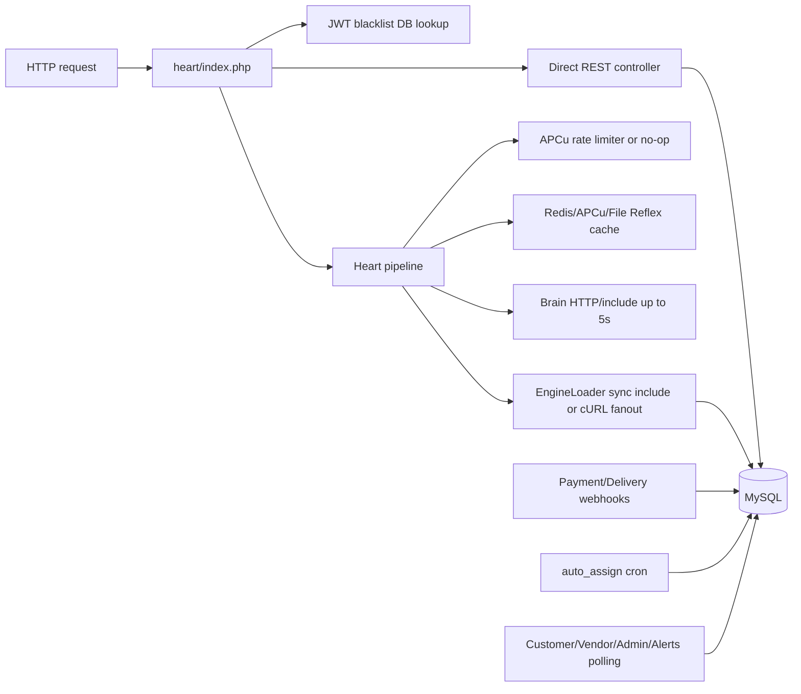

# Phase 10 — Runtime Bottleneck Analysis

Scope: traced runtime bottlenecks across PHP request lifecycle, Heart pipeline, DB access, webhooks, polling, cron, file cache, and external integrations. No optimization was performed.

## Runtime Bottleneck Map

## Findings

### R1 — Auth DB lookup is on every protected request

- WHERE: `AuthMiddleware::resolveToken()` calls `getDB()` and queries `token_blacklist` for every valid bearer token.
- WHY: Logout revocation requires blacklist enforcement.
- ROOT CAUSE: Stateless JWT plus DB blacklist hybrid.
- CONNECTED SYSTEMS: All protected customer/vendor/admin/delivery/service/shopping/alerts endpoints.
- SECURITY IMPACT: Fail-secure DB failure returns 503 for auth service.
- PERFORMANCE IMPACT: Adds one DB query per protected request before business logic.
- SCALE IMPACT: Auth throughput scales with DB and token blacklist index health.
- FUTURE RISK: Polling-heavy pages multiply blacklist reads.
- Evidence: `wtg  live/heart/middleware/AuthMiddleware.php:77-95`.
- Confidence: High.

### R2 — Heart pipeline is synchronous fanout with bounded but additive latency

- WHERE: Heart router parses JSON, rate-limits, builds context, checks Reflex, calls Brain, dispatches engines, resolves priority, writes cache, then responds.
- WHY: Orchestration is request-response, not async queue-driven.
- ROOT CAUSE: Runtime pipeline centralizes decisioning and engine fanout synchronously.
- CONNECTED SYSTEMS: Brain, shopping/service/delivery/video engines, Reflex cache, DB-backed engine handlers.
- SECURITY IMPACT: More moving parts per request increase attack surface for internal headers and request mutation.
- PERFORMANCE IMPACT: Brain can add up to 5 seconds; engine calls up to 4-6 seconds; internal includes execute in same PHP worker.
- SCALE IMPACT: PHP worker occupancy becomes the first boundary under slow downstreams.
- FUTURE RISK: Multi-engine intents degrade with the slowest participating downstream.
- Evidence: `wtg  live/heart/router.php:117-177`, `wtg  live/heart/pipeline/BrainConnector.php:26-28`, `wtg  live/heart/pipeline/EngineLoader.php:22-32`, `wtg  live/heart/pipeline/EngineLoader.php:164-215`.
- Confidence: High.

### R3 — APCu-dependent rate limiting and circuit breaking degrade when APCu is unavailable

- WHERE: Heart rate limiter returns without limiting if `apcu_add` is unavailable; Brain circuit breaker returns false/open-state impossible without APCu.
- WHY: APCu used as lightweight per-process memory.
- ROOT CAUSE: No DB/Redis fallback for these controls in traced code.
- CONNECTED SYSTEMS: Heart pipeline rate limiting, Brain failure protection.
- SECURITY IMPACT: Abuse throttling may disappear on hosts without APCu.
- PERFORMANCE IMPACT: Without circuit breaker, every Brain-enabled request attempts slow Brain during outages.
- SCALE IMPACT: Horizontal multi-node APCu would be per-node, not cluster-wide.
- FUTURE RISK: Growth on multiple PHP workers/nodes creates inconsistent limit/circuit behavior.
- Evidence: `wtg  live/heart/router.php:291-333`, `wtg  live/heart/pipeline/BrainConnector.php:117-155`.
- Confidence: High.

### R4 — File cache fallback can become disk I/O bottleneck

- WHERE: Reflex chooses Redis, then APCu, then file cache under `logs/reflex_cache`; file cache scans all `.cache` files for prefix deletion.
- WHY: Hostinger shared-host compatibility fallback.
- ROOT CAUSE: Cache abstraction degrades to local filesystem.
- CONNECTED SYSTEMS: Heart pipeline cacheable intents, logs directory, disk.
- SECURITY IMPACT: JSON cache avoids unserialize risk, but local files contain cached response payloads.
- PERFORMANCE IMPACT: Cache reads/writes use file I/O; invalidation scans O(N) files.
- SCALE IMPACT: File cache is not shared across nodes and becomes slow with many keys.
- FUTURE RISK: Multi-city/high-query traffic creates cache directory growth and stale cross-node behavior.
- Evidence: `wtg  live/heart/pipeline/ReflexEngine.php:97-117`, `wtg  live/heart/pipeline/ReflexEngine.php:261-350`.
- Confidence: High.

### R5 — Admin dashboard and list endpoints run aggregate/count/order queries across hot tables

- WHERE: Admin dashboard queries counts/sums/stuck orders/top vendors/most cancelled items/COD totals; list endpoints count then page orders/vendors/users/services/payments.
- WHY: Admin UI needs operational summary.
- ROOT CAUSE: On-demand dashboard computation in request path.
- CONNECTED SYSTEMS: orders, wallet_transactions, vendor_wallets, users, driver_wallets, order_items, vendors, payments.
- SECURITY IMPACT: Admin-only, but any admin user can trigger expensive reads.
- PERFORMANCE IMPACT: Aggregations and joins can become slow as tables grow.
- SCALE IMPACT: DB read load becomes first bottleneck for admin observability.
- FUTURE RISK: Operational dashboards may fail exactly during incidents/spikes.
- Evidence: `wtg  live/heart/api/admin/index.php:17-203`, `wtg  live/heart/api/admin/index.php:336-356`, `wtg  live/heart/api/admin/index.php:767-801`.
- Confidence: High.

### R6 — Order creation is write-heavy and transaction-heavy

- WHERE: Checkout loads cart, begins transaction, locks inventory rows with `FOR UPDATE`, inserts parent order, vendor suborders, order items, updates inventory reserved, updates product sold count, clears cart, commits, then emits side effects and delivery dispatch.
- WHY: Multi-vendor checkout and stock consistency.
- ROOT CAUSE: Multiple relational writes in one request.
- CONNECTED SYSTEMS: cart, products, inventory, orders, order_items, alerts/EventEngine, delivery dispatch.
- SECURITY IMPACT: Abuse creates expensive write amplification.
- PERFORMANCE IMPACT: Hot inventory rows lock under concurrent checkout.
- SCALE IMPACT: Popular products become contention hotspots.
- FUTURE RISK: Multi-vendor carts increase transaction duration and lock breadth.
- Evidence: `wtg  live/body/shopping-engine/api/orders/OrderService.php:111-309`, `wtg  live/body/shopping-engine/api/orders/OrderService.php:799-813`.
- Confidence: High.

## What Fails First Under Growth

1. MySQL becomes the first shared bottleneck due to auth blacklist reads, polling reads, order writes, admin aggregates, and webhook mutations.
2. PHP workers become saturated by synchronous external calls to Brain, engines, Cashfree creation, and SwiftDeliver dispatch.
3. File/local cache assumptions break under multi-node or high-key growth.
4. Polling endpoints create linear read load as users/vendors/admins grow.
5. Inventory and slot rows become lock-contention points during flash demand.

