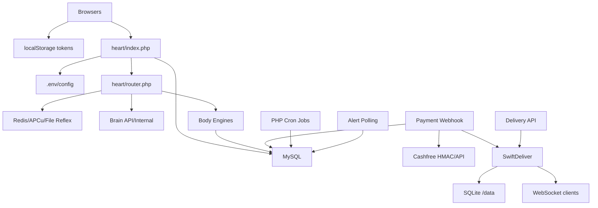

# Phase 09 — Runtime Dependency Map

## Runtime Dependency Graph

## Critical Dependencies

| Dependency | Used by | Failure effect | Evidence |
|---|---|---|---|
| MySQL DB | almost all PHP APIs | total runtime failure or partial errors | `wtg  live/heart/index.php:91` |
| `.env` / config | bootstrap, payment, engines, Brain, delivery | wrong URLs/secrets disable integrations | `wtg  live/heart/index.php:62` |
| cURL | Brain, engines, Cashfree, SwiftDeliver, integration webhooks | external communication fails | `wtg  live/heart/pipeline/EngineLoader.php:240`, `wtg  live/lib/CashfreeClient.php:67` |
| APCu | Heart rate limiter, Brain circuit | limits/circuit degrade when absent | `wtg  live/heart/router.php:291`, `wtg  live/heart/pipeline/BrainConnector.php:117` |
| Redis/APCu/file cache | Reflex cache | cache performance and consistency differ | `wtg  live/heart/pipeline/ReflexEngine.php:97` |
| localStorage | customer/vendor/admin auth/session | stale sessions, key drift | `wtg  live/app/js/auth.js:7`, `wtg  live/vendor/shared/auth.js:8`, `wtg  live/admin/shared/auth.js:41` |
| Cashfree secret/time | payment webhook | webhook rejection or replay risk | `wtg  live/lib/WebhookVerifier.php:39` |
| SwiftDeliver URL/secret | delivery dispatch/sync | delivery network unavailable or unauthorized | `wtg  live/heart/api/delivery/index.php:43`, `swiftdeliver-main/server.ts:912` |
| Node process memory | SwiftDeliver WS | realtime loss on restart/scale | `swiftdeliver-main/server.ts:221` |
| SQLite `/data` volume | SwiftDeliver state | delivery data loss if not persisted | `swiftdeliver-main/src/db/database.ts:10` |

## Auth Coupling

Auth tokens are propagated differently:

- Customer API reads `CONFIG.TOKEN_KEY` and attaches bearer token (`wtg  live/app/js/api.js:10`).
- Heart EngineLoader passes `Authorization` header to external engines (`wtg  live/heart/pipeline/EngineLoader.php:250`).
- Internal engine include attempts to preserve auth header via `$_SERVER` (`wtg  live/heart/pipeline/EngineLoader.php:111`).
- Admin API reads admin token key (`wtg  live/admin/shared/api.js:13`).
- AlertSystem hardcodes `localStorage.getItem('token')` (`wtg  live/assets/js/alerts.js:279`).

Operational impact: auth success depends on the client surface and route path.
Scale implications: stale tokens produce repeated 401/logout flows under polling.
Maintainability impact: token-key changes must update all clients.
Confidence: High.

## What Breaks If Runtime Logic Changes

1. Changing `heart/index.php` dispatch order can shadow routes, especially `/api/admin/refund` vs `/api/admin` and payment/direct routes.
2. Changing `AppRouter` intent names breaks customer SPA intent calls.
3. Changing engine payload shape breaks internal/external engine handlers.
4. Changing Reflex cache key/TTL can cause stale list/status data.
5. Changing auth header propagation breaks engine ownership checks.
6. Changing payment webhook response codes changes Cashfree retry behavior.
7. Changing SwiftDeliver webhook status mapping changes WorkToGo order synchronization.
8. Changing alert timestamp logic can drop or duplicate alerts.
9. Changing vendor polling intervals affects DB load and perceived realtime.

## Hidden Runtime Assumptions

- APCu may not exist; rate limiting/circuit breaker degrade silently.
- Delivery engine URL is optional/empty by default.
- Internal include engines can depend on mutated `$_SERVER` and `GLOBALS['HEART_PAYLOAD']`.
- File cache fallback assumes writable `logs/reflex_cache`.
- Browser pages remain open for polling-based realtime.
- External webhooks rely on server clock accuracy.
- Admin operations depend on schema fields that may drift.

