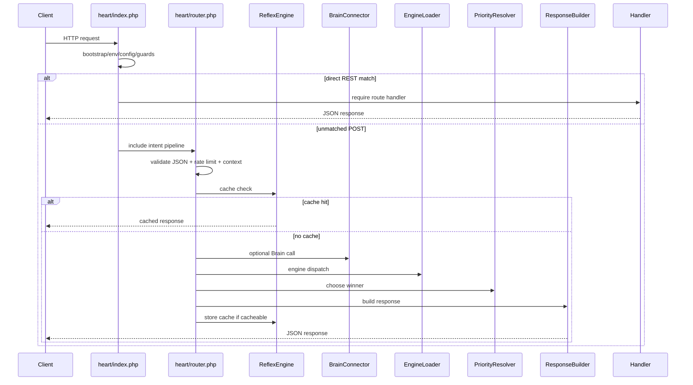

# Phase 09 — Runtime Orchestration Map

## Heart Runtime Request Lifecycle

Evidence:
- Bootstrap and direct dispatch in `heart/index.php` (`wtg  live/heart/index.php:62`, `wtg  live/heart/index.php:129`, `wtg  live/heart/index.php:149`).
- Pipeline parse/rate/context/route/cache/Brain/engine/priority/response in `heart/router.php` (`wtg  live/heart/router.php:96`, `wtg  live/heart/router.php:117`, `wtg  live/heart/router.php:121`, `wtg  live/heart/router.php:131`, `wtg  live/heart/router.php:144`, `wtg  live/heart/router.php:153`, `wtg  live/heart/router.php:156`, `wtg  live/heart/router.php:159`, `wtg  live/heart/router.php:162`).

## Engine Orchestration

`EngineLoader` dispatches to configured engines. Local paths are included internally; HTTP URLs are called with cURL; multiple HTTP engines use `curl_multi`.

Evidence:
- Internal include path (`wtg  live/heart/pipeline/EngineLoader.php:79`, `wtg  live/heart/pipeline/EngineLoader.php:125`).
- Single HTTP/local handling (`wtg  live/heart/pipeline/EngineLoader.php:145`).
- Parallel dispatch (`wtg  live/heart/pipeline/EngineLoader.php:164`).
- Request body and headers to engines (`wtg  live/heart/pipeline/EngineLoader.php:226`, `wtg  live/heart/pipeline/EngineLoader.php:242`).
- Timeouts (`wtg  live/heart/pipeline/EngineLoader.php:22`, `wtg  live/heart/pipeline/EngineLoader.php:256`).

Runtime dependency: `ENGINE_URLS` from `config/engines.php`, cURL extension, internal path validity, `HEART_INTERNAL_KEY`, request authorization propagation.

Operational impact: engine failures do not throw to the client directly; failed engines are skipped by priority resolution.
Scale implications: multi-engine intents can increase request latency to slowest configured engine timeout.
Maintainability impact: internal includes mutate `$_SERVER`, `GLOBALS['HEART_PAYLOAD']`, and can carry side effects across included code.
Confidence: High.

## Brain Orchestration

Brain is optional and circuit-broken. If route `brain=false`, Brain is skipped. If configured and route allows it, Heart calls Brain once without retry.

Evidence:
- Skip when route Brain false (`wtg  live/heart/pipeline/BrainConnector.php:44`).
- Brain URL check (`wtg  live/heart/pipeline/BrainConnector.php:49`).
- Circuit open check (`wtg  live/heart/pipeline/BrainConnector.php:58`).
- One call, no retry loop (`wtg  live/heart/pipeline/BrainConnector.php:66`).
- Circuit uses APCu (`wtg  live/heart/pipeline/BrainConnector.php:117`).
- Internal Brain include and HTTP call paths (`wtg  live/heart/pipeline/BrainConnector.php:163`, `wtg  live/heart/pipeline/BrainConnector.php:213`).

Operational impact: Brain outages should degrade to fallback but Brain-derived personalization/actions may be absent.
Scale implications: without APCu, circuit breaker is effectively disabled and each request attempts Brain.
Maintainability impact: routes must explicitly set `brain`; route mistakes can add runtime dependency unexpectedly.
Confidence: High.

## Priority Orchestration

Priority order is Reflex > Brain > Engine > Default, but engine candidates with failed `ok=false` are ignored.

Evidence: weights and selection (`wtg  live/heart/pipeline/PriorityResolver.php:22`, `wtg  live/heart/pipeline/PriorityResolver.php:80`, `wtg  live/heart/pipeline/PriorityResolver.php:96`, `wtg  live/heart/pipeline/PriorityResolver.php:104`).

Operational impact: a Brain result with sufficient confidence can beat engine output even when an engine has real data, depending on response shape/weights.
Scale implications: more sources increase conflict risk, but conflict only logs.
Maintainability impact: response winner logic is centralized but depends on every engine returning expected `relevance` and `ok` contract.
Confidence: High.

## Direct REST Orchestration

Direct REST handlers bypass Heart intent orchestration, Reflex cache, Brain decisioning, and `PriorityResolver`.

Evidence: REST branches exit before pipeline include (`wtg  live/heart/index.php:179`, `wtg  live/heart/index.php:184`, `wtg  live/heart/index.php:197`, `wtg  live/heart/index.php:209`).

Operational impact: direct REST calls and intent calls can have different auth, validation, caching, and side effects.
Scale implications: load patterns are route-specific; Heart pipeline caching does not help direct REST pages.
Maintainability impact: runtime behavior must be traced route-by-route.
Confidence: High.

## Runtime Transaction Boundaries

| Flow | Transaction boundary | External side effects inside/outside | Evidence | Risk |
|---|---|---|---|---|
| Product order create | DB transaction for order/cart/inventory, then commit | event hook and delivery dispatch after commit | `wtg  live/body/shopping-engine/api/orders/OrderService.php:141`, `wtg  live/body/shopping-engine/api/orders/OrderService.php:303`, `wtg  live/body/shopping-engine/api/orders/OrderService.php:305` | dispatch can fail after commit |
| Payment webhook | DB transaction updates order/transaction, commit; SwiftDeliver dispatch after commit | external dispatch outside transaction | `wtg  live/lib/PaymentService.php:183`, `wtg  live/lib/PaymentService.php:285`, `wtg  live/lib/PaymentService.php:287` | paid order can fail dispatch |
| Auto assignment cron | one transaction across timeout recovery and new assignments | alert inserts inside transaction | `wtg  live/cron/auto_assign.php:32`, `wtg  live/cron/auto_assign.php:182` | large locks under load |
| Assignment accept | DB transaction around assignment/entity/alerts | no external webhook | `wtg  live/api/assignments/accept.php:29`, `wtg  live/api/assignments/accept.php:140` | user/vendor alerts rollback with assignment |
| Service booking | DB transaction around booking/job/payment creation | no durable event queue traced | `wtg  live/body/service-engine/api/services/index.php:253`, `wtg  live/body/service-engine/api/services/index.php:308` | sync gaps after commit |
| Ledger process | DB transaction with FOR UPDATE checks | wallet transaction writes | `wtg  live/core/helpers/LedgerEngine.php:42`, `wtg  live/core/helpers/LedgerEngine.php:131` | no async queue traced |

## Major Orchestration Finding — Runtime is synchronous plus best-effort side effects

WHERE: order/payment/delivery/webhook flows.
WHY: external calls are done inline or after commit; no durable outbox/queue was traced.
ROOT CAUSE: runtime orchestration relies on HTTP calls, includes, polling, logs, and cron rather than a central event bus.
CONNECTED SYSTEMS: shopping, service, delivery, payment, alerts, Brain, SwiftDeliver.
OPERATIONAL IMPACT: state can diverge after successful user-visible operations.
SCALE IMPACT: high-volume operations can overload PHP workers, cURL timeouts, DB locks, and polling loops.
MAINTAINABILITY IMPACT: developers must understand each synchronous boundary before changing behavior.
FUTURE RISK: adding realtime/async features without outbox/idempotency can duplicate side effects.
Confidence: High.

