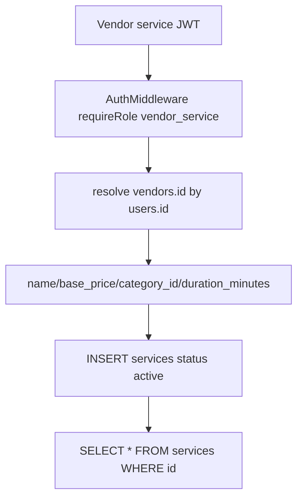

# Phase 07 — Service Engine Map

Generated: 2026-05-12T16:40:00Z

Scope: documentation-only intelligence extraction for the active `wtg  live/` project. No service architecture, booking logic, assignment logic, scheduling behavior, pricing, workflow, or runtime behavior was modified.

## Evidence Base

Primary traced sources: `wtg  live/body/service-engine/index.php`, `wtg  live/body/service-engine/api/services/index.php`, `wtg  live/body/service-engine/api/vendors/index.php`, `wtg  live/body/service-engine/api/SlotController.php`, `wtg  live/body/service-engine/api/BookingController.php`, `wtg  live/cron/auto_assign.php`, `wtg  live/api/assignments/accept.php`, `wtg  live/heart/index.php`, `wtg  live/heart/router.php`, customer app files, and vendor panel files.

## Service Engine Runtime Shape

WorkToGo service operations are split across three access styles:

1. Heart intent pipeline: customer app calls `service:list_services`, `service:create_booking`, and `service:list_bookings` via intent requests.
2. Direct REST routes: `/api/services`, `/api/service/request`, `/api/service/bookings`, `/api/jobs/{id}/status`, `/api/vendor/jobs`, `/api/vendor/availability`, `/api/booking/check-slot` are dispatched by `heart/index.php`.
3. Cron/manual operational paths: `cron/auto_assign.php` creates pending `auto_assignments`; `api/assignments/accept.php` accepts job/order assignments.

## Core Service Entities

| Entity | Table | Runtime Role | Key Ownership | Confidence |
|---|---|---|---|---|
| Service vendor/provider | `vendors` | Provider account with `type='service'` and active/pending status. | One vendor profile per user. | High |
| Service category | `categories` | `services.category_id` points to category; listing can filter by category slug. | Shared catalog taxonomy. | High |
| Service | `services` | Vendor-created offering with price, duration, status, descriptions, soft delete. | Owned by `vendors.id`. | High |
| Booking | `bookings` | Customer service request, scheduled time, payment status, vendor/service/customer links. | User + vendor + service. | High |
| Job | `jobs` | Operational work item linked to booking; provider works jobs. | Vendor + user + optional booking. | High |
| Weekly availability | `vendor_availability_slots` | Vendor-defined day/time capacity. | Vendor. | Medium |
| Slot reservation | `booking_slot_reservations` | Date/time reservation per booking. | Booking + vendor. | Medium |
| Assignment attempt | `auto_assignments` | Cron-generated vendor assignment invitation. | Polymorphic job/order target + vendor. | High |
| Alert | `alerts` | User/vendor operational notifications. | User or vendor. | High |

## Service Category Structure

- Baseline schema has `categories.id`, `parent_id`, `name`, `slug`, `type`, `status`; migrations add `image_url`, `module`, `is_active`, and `sort_order`.
- Service list filtering uses `s.category_id = (SELECT id FROM categories WHERE slug = :cat LIMIT 1)` when category query param exists.
- Service detail joins `categories c ON c.id = s.category_id` for `category_name`.
- Category type/module filtering is not enforced by the service list query.

Important issue:

- WHERE: service list/detail category usage.
- WHY: category filtering is slug-based but not scoped to `type='service'` or `module='service'`.
- ROOT CAUSE: shared categories table and simple lookup subquery.
- CONNECTED SYSTEMS: customer service browsing, search, vendor service creation, admin services.
- OPERATIONAL IMPACT: category drift can misclassify or hide services.
- SCALE IMPACT: Urban Company-style taxonomy with nested categories, city-specific categories, and bundles will outgrow this linkage.
- MAINTAINABILITY IMPACT: future category changes require cross-module coordination.
- FUTURE RISK: service/product category collisions.
- Confidence: High.

## Service Creation Lifecycle

Runtime facts:

- Only `vendor_service` can create services in the main service controller.
- Vendor ID is resolved from authenticated user, not request body.
- Created services are immediately `active`.
- No traced per-service approval/moderation workflow exists.
- Runtime depends on migrated columns such as `description`, `duration_minutes`, and `updated_at`.

## Provider Relationship Risk

- WHERE: provider resolution in service CRUD, vendor jobs, analytics, and slot controller.
- WHY: different files use different filters: `deleted_at IS NULL`, `status != 'rejected'`, or `status='active'`.
- ROOT CAUSE: vendor lifecycle rules are duplicated across controllers.
- CONNECTED SYSTEMS: service CRUD, vendor job list, availability setup, analytics, vendor moderation.
- OPERATIONAL IMPACT: pending/inactive vendors may pass some paths but fail others.
- SCALE IMPACT: provider state inconsistency grows with vendor base.
- MAINTAINABILITY IMPACT: every vendor state change must update multiple controllers.
- FUTURE RISK: suspension, vacation mode, verification, and city activation cannot be safely layered.
- Confidence: High.

## Booking-to-Job Core Design

The main service booking path creates `bookings` and `jobs` in one transaction. Booking is customer-facing commercial request; job is provider-facing operational work item. `bookings.status` starts `pending`; `jobs.status` starts `open`. Synchronization occurs only through the traced job status endpoint, not through every job mutation path.

## Uncertainty Register

- Whether vendor frontend intents for `vendor:get_job` and `vendor:update_job_status` are handled by a service engine handler is uncertain.
- Whether `BookingController` is actively routed is uncertain.
- Whether online service payments create matching `transactions` rows is not traced.
