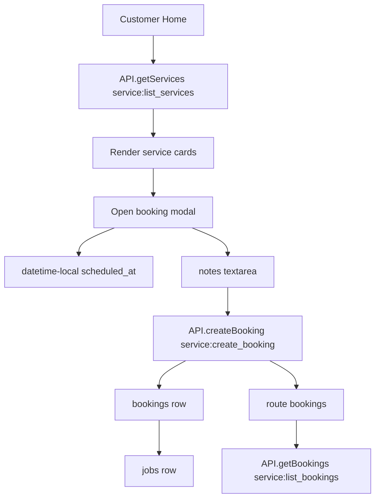
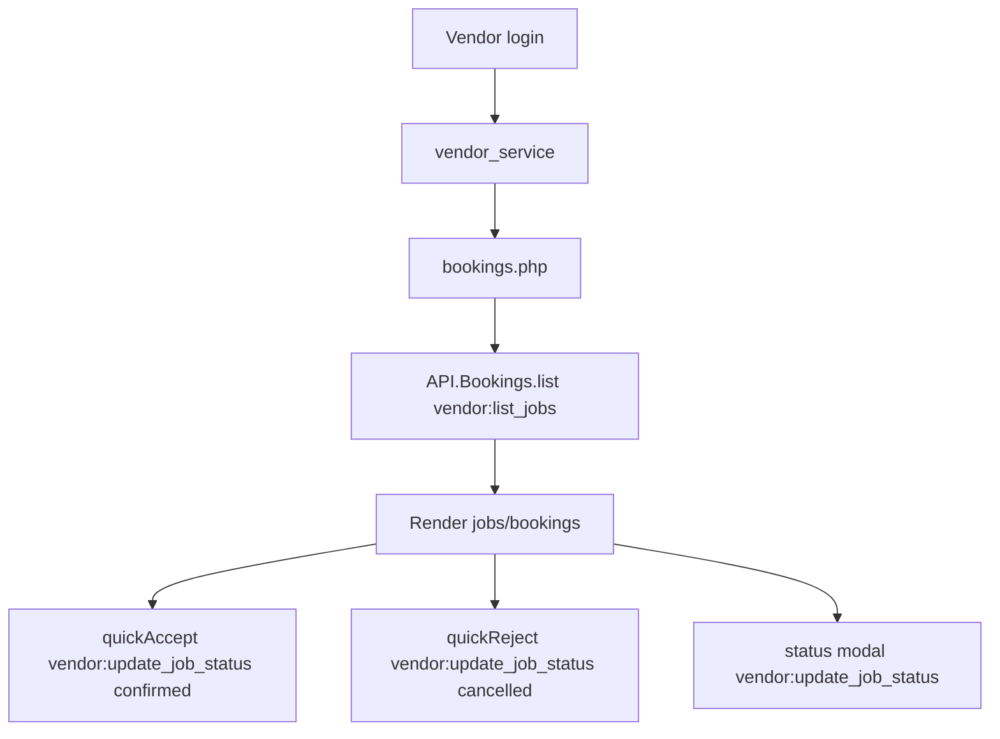

# Phase 07 — Service Runtime Flow

Generated: 2026-05-12T16:40:00Z

## Route and Intent Entry Points

| Entry | Frontend Source | Backend Dispatch | Handler | Confidence |
|---|---|---|---|---|
| `service:list_services` | Customer Home | Heart AppRouter -> service engine internal | `GET /api/services` | High |
| `service:create_booking` | Customer booking modal | Heart AppRouter -> service engine internal | `POST /api/service/request` | High |
| `service:list_bookings` | Customer bookings page | AppRouter route exists | Missing service-engine switch case; engine has `service:vendor_bookings` | High drift |
| `/api/service/bookings` | Direct REST | `heart/index.php` | Role-scoped booking list | High |
| `/api/jobs/{id}/status` | Direct REST | `heart/index.php` | Job status update + booking mirror | High |
| `/api/vendor/jobs` | Direct REST | `heart/index.php` | Vendor job list | High |
| `/api/vendor/availability` | Direct REST | `heart/index.php` | Availability setup | High |
| `/api/booking/check-slot` | Direct REST | `heart/index.php` | Single slot check | High |

## Customer Runtime Flow

Runtime observations:

- Customer booking UI does not expose provider availability slots.
- Customer booking UI does not require saved address or geo coordinates.
- Customer bookings page may be affected by the `service:list_bookings` vs `service:vendor_bookings` dispatcher mismatch.

## Vendor Runtime Flow

Runtime observations:

- UI title says Jobs but variables call them bookings.
- UI filters include `accepted` and `rejected`, while backend uses `assigned` and `cancelled`.
- UI uses polling realtime every 8 seconds.
- Direct REST endpoints exist, but vendor shared API uses intents.

## Runtime Drift Findings

### Customer bookings intent mismatch

- WHERE: customer `API.getBookings()` sends `service:list_bookings`; service engine supports `service:vendor_bookings`.
- WHY: AppRouter and service-engine dispatcher names diverged.
- ROOT CAUSE: duplicated route registry.
- CONNECTED SYSTEMS: customer bookings page, Heart pipeline, service engine.
- OPERATIONAL IMPACT: customer bookings can return default empty service-engine response instead of bookings.
- SCALE IMPACT: customers cannot reliably view service status.
- MAINTAINABILITY IMPACT: intent names must be reconciled across router/frontend/engine.
- FUTURE RISK: additional service status/recommendation intents can silently no-op.
- Confidence: High.

### Vendor job intents may be unmapped

- WHERE: vendor shared API uses `vendor:list_jobs`, `vendor:get_job`, `vendor:update_job_status`; service engine internal dispatcher lacks those cases.
- WHY: vendor frontend uses intent pipeline while direct REST endpoints exist.
- ROOT CAUSE: two API styles without mapping parity.
- CONNECTED SYSTEMS: vendor bookings page, service engine, Heart pipeline.
- OPERATIONAL IMPACT: provider job list/status actions can fail through intent path.
- SCALE IMPACT: provider operations break under real use.
- MAINTAINABILITY IMPACT: mobile/vendor clients need canonical route map.
- FUTURE RISK: provider app inherits broken operations.
- Confidence: Medium-High.

## Runtime Failure Handling

| Failure | Handling | Gap | Confidence |
|---|---|---|---|
| Invalid scheduled_at | Validation error. | Timezone behavior implicit. | High |
| Missing active service | Not found. | Service deleted after modal open fails cleanly. | High |
| Booking/job insert exception | Transaction rollback + generic 500. | No customer alert. | High |
| Online payment failure | Partially traced. | No robust transaction/refund flow traced. | Medium |
| Job status invalid | Validation error. | Frontend may send invalid statuses. | High |
| No vendor assignment | Job cancelled + user alert. | Booking not mirrored. | High |

## Uncertainty Reporting

- Exact Heart response wrapping for default service engine case was not executed live.
- Direct REST route usage by production frontend may differ from currently traced intent wrappers.
