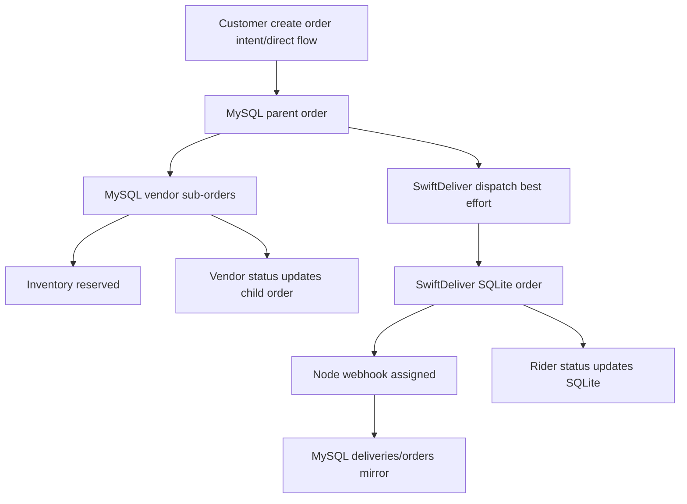

# Phase 09 — State Synchronization Map

## Synchronization Domains

| Domain | State source(s) | Sync mechanism | Risk | Confidence |
|---|---|---|---|---|
| Customer order state | MySQL `orders`; vendor sub-orders; SwiftDeliver SQLite | direct DB writes, webhook mirror, polling | divergence between parent/child/delivery | High |
| Booking/job state | MySQL `bookings`, `jobs` | service API transaction, job status mirror | booking/job divergence | High |
| Payment state | MySQL `orders`, `transactions` | Cashfree webhook | partial dispatch after payment | High |
| Delivery state | MySQL `deliveries`, SwiftDeliver `orders`, `delivery_assignments` | dispatch HTTP + webhook + WS | cross-system drift | High |
| Alerts state | MySQL `alerts` | insert + polling + mark seen | polling delay/missed popup | High |
| Brain state | `brain_events`, decisions, profiles, habits | Brain API events/decisions | separate from operational state | High |
| Frontend session | localStorage token/user | login/logout/manual clear | stale role/status | High |

## Order Synchronization Flow

Synchronization gaps:
- Parent order aggregation from child vendor orders is not traced.
- SwiftDeliver status changes are not fully mirrored back to PHP in traced Node status route.
- Vendor fulfillment and rider delivery completion update different systems.

Evidence: parent/child order creation (`wtg  live/body/shopping-engine/api/orders/OrderService.php:165`, `wtg  live/body/shopping-engine/api/orders/OrderService.php:220`); dispatch after commit (`wtg  live/body/shopping-engine/api/orders/OrderService.php:308`); Node dispatch (`swiftdeliver-main/server.ts:910`); Node status route (`swiftdeliver-main/server.ts:1125`).

## Payment Synchronization Flow

Payment webhook is authoritative for online payment, while COD is confirmed internally.

Evidence:
- Return page explicitly does not trust return URL (`wtg  live/api/payment/return.php:9`).
- Webhook verifies and processes payment (`wtg  live/api/payment/webhook.php:43`).
- PaymentService idempotently skips already-paid orders (`wtg  live/lib/PaymentService.php:209`).
- COD confirmation sets payment method/status/order status (`wtg  live/lib/PaymentService.php:128`).

Operational impact: frontend polling payment status is needed for online flow; COD bypasses external gateway.
Scale implications: webhook DB transactions and optional delivery dispatch can become bottlenecks.
Maintainability impact: payment state must be traced through both `PaymentService` and `OrderService` COD paths.
Confidence: High.

## Alert Synchronization Flow

Alert producers insert rows. Frontend clients poll and send `lastTs`; server returns records newer than `lastTs` and a `server_ts` for next poll.

Evidence: AlertEngine fetch since timestamp (`wtg  live/api/alerts/AlertEngine.php:120`); frontend advances timestamp (`wtg  live/assets/js/alerts.js:214`).

Risk: if client advances to server time and an alert row is inserted with timestamp equal to or before that exact value due to DB/server timing, the `created_at > :last_ts` condition can miss it.
Confidence: Medium.

## Frontend Polling/Reconnect Synchronization

Customer orders/bookings pages poll every configured interval and refresh on tab visibility.
Evidence: router polling (`wtg  live/app/js/router.js:108`, `wtg  live/app/js/router.js:134`).

Vendor realtime uses local `_knownIds` and polling.
Evidence: known-ID detection (`wtg  live/vendor/shared/realtime.js:226`).

SwiftDeliver uses WebSocket ping plus REST status/list APIs.
Evidence: ping (`swiftdeliver-main/server.ts:257`); WebSocket location updates (`swiftdeliver-main/server.ts:243`).

Operational impact: some state sync is polling eventually, some is realtime but non-durable.
Scale implications: active tabs generate recurring reads; WebSocket memory does not scale horizontally without pub/sub.
Maintainability impact: synchronization logic lives in multiple frontend modules.
Confidence: High.

## Major Synchronization Risks

### Out-of-order state updates

WHERE: delivery webhook and Node status routes.
WHY: no monotonic transition guard or event timestamp ordering was traced.
ROOT CAUSE: direct status updates write target status without transition machine.
CONNECTED SYSTEMS: MySQL orders/deliveries, SQLite orders/assignments, admin/customer/rider UI.
OPERATIONAL IMPACT: stale webhook can overwrite newer state.
SCALE IMPACT: retries and network delays increase probability.
MAINTAINABILITY IMPACT: state changes need canonical transition enforcement.
FUTURE RISK: realtime scaling can amplify out-of-order events.
Confidence: High.

### Duplicate execution risk

WHERE: delivery dispatch and payment dispatch.
WHY: dispatch endpoint dedupes on `woocommerce_order_id`, but PHP can attempt dispatch from order creation and payment webhook paths.
ROOT CAUSE: no single dispatch orchestration record was traced.
CONNECTED SYSTEMS: OrderService, PaymentService, deliveries, SwiftDeliver.
OPERATIONAL IMPACT: duplicate dispatch attempts are possible; Node may return existing order but PHP may not persist tracking.
SCALE IMPACT: unnecessary external calls under retries.
MAINTAINABILITY IMPACT: dispatch paths must be audited together.
Confidence: High.

