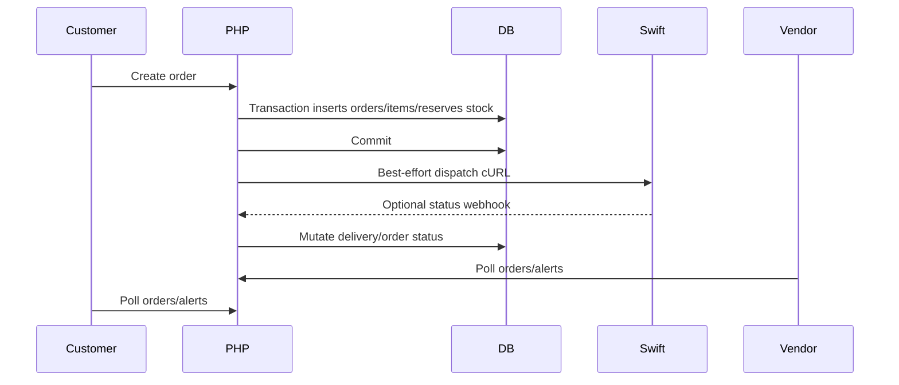

# Phase 10 — Synchronization + Realtime Scale Risks

## Synchronization Reality

WorkToGo synchronization is fragmented across polling, webhooks, cron, post-commit cURL, local cache, and direct DB state mutation. No durable queue, central outbox, replayable event stream, or global realtime bus was traced in the PHP runtime.

## Synchronization Paths

## Major Risks

### S1 — Post-commit side effects are not durable

- WHERE: Order creation commits DB, then emits event hook and dispatches to delivery; payment webhook commits DB then optionally dispatches to SwiftDeliver.
- WHY: Keep core order/payment commit separate from non-fatal downstreams.
- ROOT CAUSE: No traced outbox/retry table for side effects.
- CONNECTED SYSTEMS: orders, deliveries, SwiftDeliver, alerts/EventEngine, payment webhook.
- SECURITY IMPACT: Operational state can diverge without malicious input.
- PERFORMANCE IMPACT: cURL side effects still occupy request workers.
- SCALE IMPACT: Downstream failure produces backlog that is only logs/manual, not queue-managed.
- FUTURE RISK: Paid or placed orders may never dispatch unless manually recovered.
- Evidence: `wtg  live/body/shopping-engine/api/orders/OrderService.php:303-309`, `wtg  live/body/shopping-engine/api/orders/OrderService.php:938-1030`, `wtg  live/lib/PaymentService.php:285-340`.
- Confidence: High.

### S2 — Polling realtime has linear cost

- WHERE: AlertSystem polls on timer; customer orders/bookings polling was established in prior phases; vendor panels use polling patterns from prior runtime map.
- WHY: No traced PHP websocket/SSE realtime layer.
- ROOT CAUSE: Browser polling is simpler but DB-expensive.
- CONNECTED SYSTEMS: alerts, orders, bookings, vendors, admin dashboards.
- SECURITY IMPACT: Frequent auth requests expand token/blacklist load and attack surface.
- PERFORMANCE IMPACT: Active tabs create periodic queries regardless of changes.
- SCALE IMPACT: DB read load grows linearly with users/vendors/admins.
- FUTURE RISK: Mobile battery/network overhead and server read amplification.
- Evidence: `wtg  live/assets/js/alerts.js:57-64`, `wtg  live/api/alerts/fetch.php:19-58`, `WTG-SYSTEM-BRAIN/status-tracking.md:466-477`.
- Confidence: High.

### S3 — Parent/child order synchronization ambiguity

- WHERE: Checkout creates parent order and vendor sub-orders; vendor updates mutate child orders; delivery/status update paths mutate orders by IDs/delivery IDs.
- WHY: Multi-vendor fulfillment split.
- ROOT CAUSE: No traced parent aggregation logic in status transition methods.
- CONNECTED SYSTEMS: customer order list, vendor order list, admin orders, delivery dispatch, inventory.
- SECURITY IMPACT: Users/admins may see inconsistent state, causing manual overrides.
- PERFORMANCE IMPACT: Any future aggregation will add queries.
- SCALE IMPACT: More sub-orders per parent increases synchronization complexity.
- FUTURE RISK: Multi-vendor order state collapse under disputes/refunds/deliveries.
- Evidence: `wtg  live/body/shopping-engine/api/orders/OrderService.php:165-298`, `wtg  live/body/shopping-engine/api/orders/OrderService.php:429-549`, `WTG-SYSTEM-BRAIN/status-tracking.md:183-192`.
- Confidence: High.

### S4 — Delivery status can be updated by multiple paths

- WHERE: Delivery API has rider/admin status patch and SwiftDeliver webhook; order creation/payment webhook dispatch can create/use delivery rows.
- WHY: Supports internal delivery role and external delivery runtime.
- ROOT CAUSE: Multiple writers to `deliveries` and `orders.status`.
- CONNECTED SYSTEMS: delivery, orders, admin dashboard, customer tracking.
- SECURITY IMPACT: Conflicting writers can create unauthorized-looking state transitions if identities/secrets drift.
- PERFORMANCE IMPACT: Repeated updates trigger polling reads.
- SCALE IMPACT: Multiple delivery runtimes/providers will worsen conflict.
- FUTURE RISK: Need monotonic transition rules and event ledger before expansion.
- Evidence: `wtg  live/heart/api/delivery/index.php:91-110`, `wtg  live/heart/api/delivery/index.php:115-173`, `wtg  live/body/shopping-engine/api/orders/OrderService.php:965-1030`.
- Confidence: High.

## Synchronization Collapse Scenario

1. Customer places many COD orders.
2. Checkout commits orders and delivery rows; SwiftDeliver cURL fails intermittently.
3. No durable outbox captures failed dispatches.
4. Vendors/customers/admins poll and see pending/stuck states.
5. Admin dashboard stuck-order query grows expensive while operators refresh repeatedly.
6. Manual admin overrides mutate status, but external delivery callbacks later arrive out of order.
7. Order/delivery/customer/vendor views diverge.

