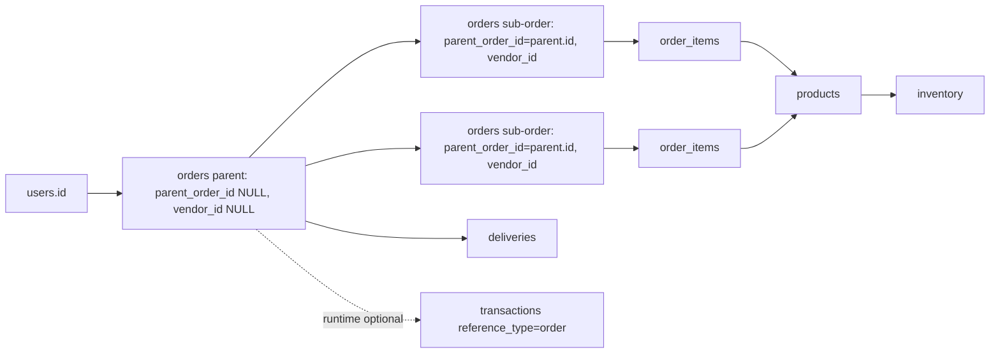
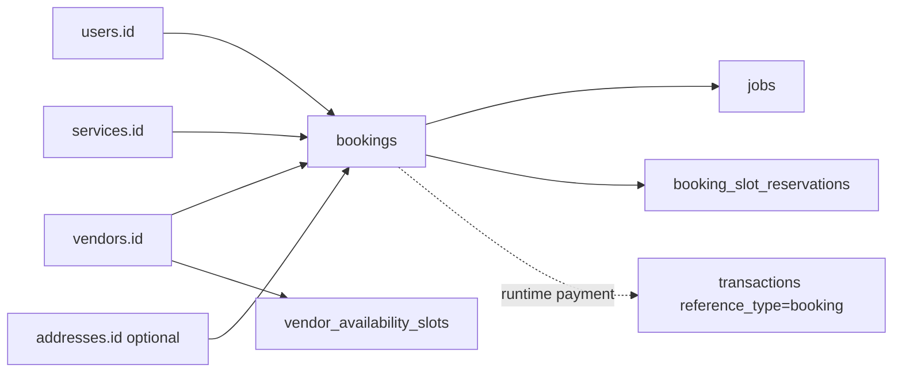
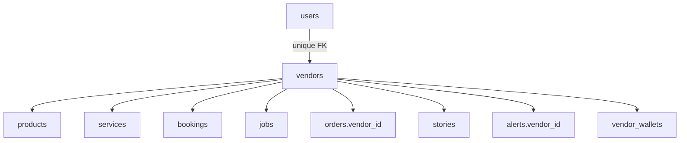

# Phase 06 — Table Relationship Map

Generated: 2026-05-12T16:20:00Z

## Foreign Keys Explicitly Traced in Baseline Schema

| Child Table | Column | Parent | Delete Behavior | Runtime Meaning | Confidence |
|---|---|---|---|---|---|
| `addresses` | `user_id` | `users.id` | CASCADE | User-owned saved address. | High |
| `alerts` | `user_id` | `users.id` | CASCADE | User alert target. | High |
| `alerts` | `vendor_id` | `vendors.id` | CASCADE | Vendor alert target. | High |
| `bookings` | `user_id` | `users.id` | restrict/default | Customer booking owner. | High |
| `bookings` | `vendor_id` | `vendors.id` | restrict/default | Service vendor owner. | High |
| `bookings` | `service_id` | `services.id` | restrict/default | Booked service. | High |
| `bookings` | `address_id` | `addresses.id` | restrict/default | Optional service address. | High |
| `booking_slot_reservations` | `booking_id` | `bookings.id` | CASCADE | One slot reservation per booking. | High |
| `booking_slot_reservations` | `vendor_id` | `vendors.id` | CASCADE | Vendor capacity dimension. | High |
| `cart` | `user_id` | `users.id` | CASCADE | Authenticated cart row owner; nullable in schema but FK constrained when present. | High |
| `cart` | `product_id` | `products.id` | CASCADE | Cart item product. | High |
| `categories` | `parent_id` | `categories.id` | SET NULL | Category hierarchy. | High |
| `deliveries` | `order_id` | `orders.id` | CASCADE | Delivery attached to order. | High |
| `deliveries` | `driver_id` | `users.id` | SET NULL | Delivery user/driver. | High |
| `driver_wallets` | `driver_id` | `users.id` | CASCADE | Driver wallet. | High |
| `followers` | `follower_user_id` | `users.id` | CASCADE | Polymorphic follow by user. | High |
| `inventory` | `product_id` | `products.id` | CASCADE | Stock row for product. | High |
| `inventory` | `warehouse_id` | `warehouses.id` | SET NULL | Optional warehouse stock. | High |
| `jobs` | `booking_id` | `bookings.id` | SET NULL | Service job linked to booking. | High |
| `jobs` | `vendor_id` | `vendors.id` | restrict/default | Assigned service vendor. | High |
| `jobs` | `user_id` | `users.id` | restrict/default | Customer/job owner. | High |
| `orders` | `user_id` | `users.id` | restrict/default | Customer order owner. | High |
| `orders` | `vendor_id` | `vendors.id` | restrict/default | Vendor sub-order owner; nullable for parent order. | High |
| `orders` | `parent_order_id` | `orders.id` | CASCADE | Parent/child order split. | High |
| `order_items` | `order_id` | `orders.id` | CASCADE | Items on vendor sub-orders. | High |
| `order_items` | `product_id` | `products.id` | restrict/default | Product reference plus snapshot. | High |
| `order_items` | `vendor_id` | `vendors.id` | restrict/default | Vendor snapshot/ownership. | High |
| `products` | `vendor_id` | `vendors.id` | CASCADE | Product owner. | High |
| `products` | `category_id` | `categories.id` | SET NULL | Product category. | High |
| `product_variations` | `product_id` | `products.id` | CASCADE | Variations under product. | High |
| `refresh_tokens` | `user_id` | `users.id` | CASCADE | Refresh token owner. | High |
| `services` | `vendor_id` | `vendors.id` | CASCADE | Service owner. | High |
| `services` | `category_id` | `categories.id` | SET NULL | Service category. | High |
| `stories` | `vendor_id` | `vendors.id` | CASCADE | Vendor story owner. | High |
| `transactions` | `user_id` | `users.id` | restrict/default | Paying/refunded user. | High |
| `vendors` | `user_id` | `users.id` | CASCADE | Vendor profile owner. | High |
| `vendor_availability_slots` | `vendor_id` | `vendors.id` | CASCADE | Weekly availability. | High |
| `vendor_wallets` | `vendor_id` | `vendors.id` | CASCADE | Vendor balance. | High |
| `warehouses` | `vendor_id` | `vendors.id` | CASCADE | Vendor warehouse. | High |
| `warehouses` | `address_id` | `addresses.id` | SET NULL | Warehouse address. | High |

## Runtime-Only / Assumed Relationships Without FK Protection

| Relationship | Evidence | Missing Protection | Impact | Confidence |
|---|---|---|---|---|
| `transactions.reference_id` -> `orders.id` or `bookings.id` by `reference_type` | Payment/refund/analytics join transactions to orders/bookings. | No FK possible with polymorphic column. | Orphaned or misclassified transactions can break refunds/revenue analytics. | High |
| `wallet_transactions.order_id` -> `orders.id` | Index exists but no FK constraint in dump. | No referential protection. | Ledger rows can survive deleted/corrupt orders. | High |
| `auto_assignments.entity_id` -> `orders.id` or `jobs.id` by `entity_type` | Cron and accept endpoint use polymorphic assignment. | No FK, no uniqueness for active assignment beyond runtime query. | Assignment rows can point to missing orders/jobs; duplicate ownership risk. | High |
| `followers.target_id` -> `vendors.id` when `target_type='vendor'` | Stories/feed/analytics count vendor followers. | Only follower user has FK; target is polymorphic and unrestricted. | Follows can point to non-existent vendors/stores/creators. | High |
| `alerts.ref_id` -> order/payment/status target by `ref_type` | Alerts inserted for orders/jobs/payments/status. | `ref_id` is polymorphic and not FK constrained. | Alert references can become stale or misleading. | High |
| `brain_* client_id` -> `brain_clients.id` | Models filter by `client_id`. | Most brain tables do not have FK constraints. | Brain rows can exist for deleted/invalid clients. | High |
| `brain_events.target_id/target_type` -> product/vendor | Some analytics/feed code references target columns; baseline table lacks them. | Schema mismatch; no FK. | Analytics queries can fail or silently fallback. | High |
| `orders.delivery_id` -> `deliveries.id` | Orders table has delivery_id, admin assignment updates it. | No FK in dump. | Delivery row and order pointer can drift. | High |
| `vendor.address_id` -> `addresses.id` | Migration adds `vendors.address_id`, no traced FK addition. | No FK if migration only adds column. | Vendor address can orphan or point to user-owned address inconsistently. | Medium |

## Relationship Diagrams

### Commerce Order Split

Risk: delivery dispatch is attached to the parent order, while vendor fulfillment statuses apply to sub-orders. No traced parent aggregation updates parent status after sub-order progress.

### Service Booking + Job

Risk: main service request creates booking + job but does not create slot reservation. Separate booking-slot controller can create reservations through a different booking path.

### Vendor Ownership

Risk: user role and vendor status are separate contracts. Admin approval changes both; deactivation changes only vendor status in traced code.

## Nullable Chain Risks

| Chain | Nullable Point | Runtime Consequence | Confidence |
|---|---|---|---|
| `orders.parent_order_id -> orders.vendor_id` | Parent has null `vendor_id`; sub-order has parent ID. | Any vendor/admin query that forgets parent/sub distinction misreads ownership. | High |
| `orders.delivery_id -> deliveries.id` | No FK and nullable. | Order can say processing while no valid delivery exists, or delivery exists but order pointer missing. | High |
| `bookings.address_id -> addresses.id` | Optional. | Service location can be missing; auto assignment job location query falls back poorly if no address. | High |
| `jobs.booking_id -> bookings.id` | Nullable with SET NULL. | Job can survive booking deletion without customer/service context. | Medium |
| `transactions.reference_id` | Polymorphic, no FK. | Refund/payment records can point to missing order/booking. | High |
| `cart.user_id` | Nullable but runtime cart uses authenticated user. | Session cart schema exists but runtime mostly user cart; uniqueness `(user_id, product_id)` does not protect nullable session rows the same way. | Medium |
| `product_variations.stock_quantity` vs `inventory.quantity/reserved` | Parallel stock values. | Checkout ignores variation stock; vendor can update variation stock without changing inventory. | High |

## Duplicate Ownership Risks

- Parent order and vendor sub-orders both store `user_id`, `payment_status`, `payment_method`, totals, and `shipping_address`. Runtime updates do not consistently propagate between them.
- `order_items.vendor_id` duplicates `orders.vendor_id` and `products.vendor_id`. It is useful as a snapshot but can drift if product ownership changes or bad writes occur.
- `bookings.vendor_id`, `services.vendor_id`, and `jobs.vendor_id` all represent service ownership; runtime creates them from service vendor, then updates jobs independently.
- `users.role` and `vendors.status/type` jointly define vendor permissions but are updated independently.
- `inventory.quantity` and `product_variations.stock_quantity` represent stock in separate tables.

## Uncertain / Partially Traced Relationships

- Whether `driver_wallets.driver_id` is used by active delivery flows beyond admin dashboard summaries.
- Whether `wallet_transactions.order_id` is actually written by LedgerEngine for all delivered/refunded orders.
- Whether `warehouses` participates in current inventory allocation; runtime inventory joins mostly use `product_id` only.
- Whether `booking_slot_reservations` is consistently used by frontend booking; main service request does not reserve slots.
- Whether Brain legacy classes using `brain_events.user_id/target_id/target_type` are active in production.
