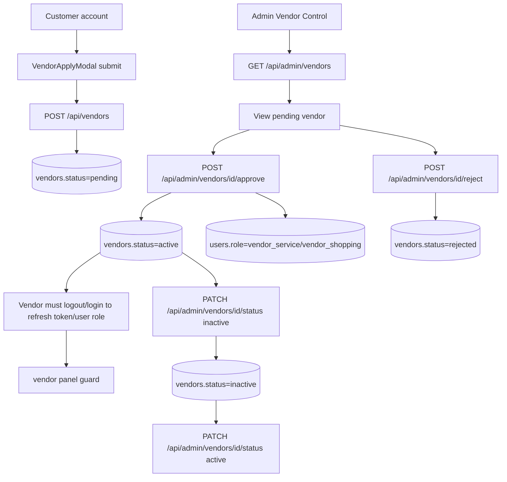

# Vendor Moderation Flow

Generated: 2026-05-12T08:15:00Z

---

## 1. Vendor Application Lifecycle

Evidence: `wtg  live/app/pages/vendor-apply-modal.js:45`, `wtg  live/app/pages/vendor-apply-modal.js:59`, `wtg  live/body/service-engine/api/vendors/index.php:42`, `wtg  live/body/service-engine/api/vendors/index.php:87`, `wtg  live/admin/vendors.html:119`, `wtg  live/admin/vendors.html:193`, `wtg  live/admin/vendors.html:207`, `wtg  live/admin/vendors.html:217`, `wtg  live/heart/api/admin/index.php:480`, `wtg  live/heart/api/admin/index.php:503`, `wtg  live/heart/api/admin/index.php:513`, `wtg  live/vendor/shared/auth.js:70`.

---

## 2. Application Entry and Duplicate Handling

Customers submit only business name and vendor type from the traced customer modal. Backend resolves phone from the user row, checks whether a vendor already exists for the user, creates a slug, and inserts a pending vendor.

Evidence: `wtg  live/app/pages/vendor-apply-modal.js:21`, `wtg  live/app/pages/vendor-apply-modal.js:45`, `wtg  live/body/service-engine/api/vendors/index.php:47`, `wtg  live/body/service-engine/api/vendors/index.php:60`, `wtg  live/body/service-engine/api/vendors/index.php:65`, `wtg  live/body/service-engine/api/vendors/index.php:89`.

Connected systems: customer account page/modal, AuthMiddleware, vendors table, users table, admin vendors page.

Runtime dependency: customer/admin/service-vendor role allowed by `POST /api/vendors`; JWT must resolve to a user.

Operational impact: users cannot create multiple vendor applications from the same account.

Scale implication: moderation queue is simple pending list with no application documents, review checklist, SLA, or structured reason fields traced.

Maintainability impact: application schema mismatch risk exists because production migrations standardized `vendors.type`, while base dump still shows `vendor_type`.

Confidence: High for current code path; Medium for deployed schema shape.

---

## 3. Admin Review Queue

Admin vendor page lists vendors with filters for type/status/search and displays a pending banner. Pending rows show Approve and Reject buttons; active rows show Deactivate; inactive rows show Activate.

Evidence: `wtg  live/admin/vendors.html:22`, `wtg  live/admin/vendors.html:35`, `wtg  live/admin/vendors.html:40`, `wtg  live/admin/vendors.html:130`, `wtg  live/admin/vendors.html:163`, `wtg  live/admin/vendors.html:166`, `wtg  live/admin/vendors.html:168`.

Backend listing supports status, type, search, pagination, and pending count.

Evidence: `wtg  live/heart/api/admin/index.php:235`, `wtg  live/heart/api/admin/index.php:246`, `wtg  live/heart/api/admin/index.php:251`, `wtg  live/heart/api/admin/index.php:256`, `wtg  live/heart/api/admin/index.php:267`.

---

## 4. Approval Authority

Approval performs two writes:

1. `vendors.status = active`.
2. `users.role = vendor_service` if vendor type is service, otherwise `vendor_shopping`.

Evidence: `wtg  live/heart/api/admin/index.php:480`, `wtg  live/heart/api/admin/index.php:486`, `wtg  live/heart/api/admin/index.php:491`.

Connected systems: vendors, users, JWT/session lifecycle, vendor panel guard, customer app vendor application status messaging.

Runtime dependency: admin JWT and vendor row having a type value.

Operational impact: approval changes account authority; future login can access vendor panel.

Scale implication: role mutation is manual and immediate; no separated approval audit or two-person review.

Maintainability impact: approval logic duplicates role derivation from vendor type and may break under schema drift.

Confidence: High.

---

## 5. Rejection and Restriction Behavior

Reject sets vendor status to `rejected` and logs reason in Logger context. It does not update the user's role, write a dedicated rejection reason column, or notify the user in the traced backend route.

Evidence: `wtg  live/heart/api/admin/index.php:503`, `wtg  live/heart/api/admin/index.php:507`, `wtg  live/heart/api/admin/index.php:509`.

Deactivate/activate changes only vendor status. Vendor panel access guard checks local user role, not vendor status. Backend vendor resolution in some service endpoints excludes rejected but not inactive vendors.

Evidence: `wtg  live/heart/api/admin/index.php:513`, `wtg  live/vendor/shared/auth.js:61`, `wtg  live/body/service-engine/api/vendors/index.php:28`, `wtg  live/body/service-engine/api/vendors/index.php:31`.

Operational impact: inactive vendors may retain vendor-role sessions and may pass some backend vendor ownership resolution unless specific endpoints filter active status.

Scale implication: deactivation is not a complete access revocation model.

Maintainability impact: vendor restrictions are distributed across status fields, local frontend role guards, and endpoint-specific vendor resolution.

Confidence: High for traced paths.

---

## 6. Vendor Panel Dependency on Approval

Vendor panel stores `wtg_vendor_token` and `wtg_vendor_user`. Its guard only checks local token presence and local user role (`vendor_service` or `vendor_shopping`); it does not revalidate server-side vendor status on page load.

Evidence: `wtg  live/vendor/shared/auth.js:8`, `wtg  live/vendor/shared/auth.js:28`, `wtg  live/vendor/shared/auth.js:61`, `wtg  live/vendor/shared/auth.js:78`.

Connected systems: auth JWT, localStorage, vendor routes, backend role middleware.

Runtime dependency: role claim/user object after relogin.

Operational impact: user must relogin after approval; deactivation may not clear existing local UI session.

Scale implication: support tickets likely when roles change but local sessions are stale.

Confidence: High.

---

## 7. Vendor Moderation Uncertainty

| Area | Uncertainty | Evidence boundary | Confidence |
|---|---|---|---|
| Rejection reason persistence | Reason logged, not stored on vendors table in traced route | `wtg  live/heart/api/admin/index.php:509` | High for non-persistence in route |
| Inactive vendor enforcement | Vendor panel guard does not check vendor status; service vendor resolver excludes rejected only | `wtg  live/vendor/shared/auth.js:78`, `wtg  live/body/service-engine/api/vendors/index.php:31` | High |
| Shopping vendor resolver behavior | Product/order vendor ownership paths not fully re-traced in Phase 05 | `wtg  live/body/shopping-engine/api/orders/OrderService.php` | Medium |
| Notification to applicant | Customer modal displays status on duplicate application response, but admin reject route does not create alert | `wtg  live/app/pages/vendor-apply-modal.js:70`, `wtg  live/heart/api/admin/index.php:503` | Medium-high |
| Schema column name | Runtime code uses `vendors.type`; base DB dump shows `vendor_type`; migrations align it | `wtg  live/database-structure.sql:813`, `wtg  live/migrations/2026_05_11_001_auth_vendor_contract_alignment.sql:29` | Medium |

