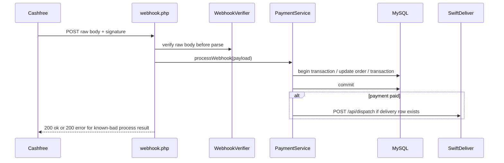
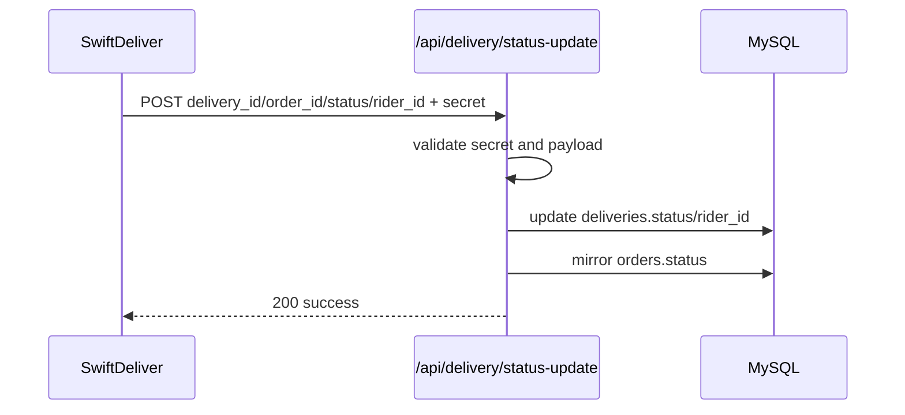

# Phase 09 — Webhook Runtime Analysis

## Webhooks Traced

| Webhook | Direction | Auth/verification | Main effect | Evidence | Confidence |
|---|---|---|---|---|---|
| Cashfree payment webhook | Cashfree → PHP | HMAC timestamp/signature | Payment status, transaction, optional dispatch, alerts | `wtg  live/api/payment/webhook.php:43`, `wtg  live/lib/PaymentService.php:170` | High |
| SwiftDeliver status webhook | Node → PHP | `X-Webhook-Secret` equals `SWIFTDELIVER_SECRET` | Updates `deliveries` and mirrors `orders.status` | `wtg  live/heart/api/delivery/index.php:115` | High |
| Brain IntegrationLayer webhook | Brain → external configured URL | optional token | Sends `decision.executed` action payload | `wtg  live/brain/engine/IntegrationLayer.php:219` | High |

## Cashfree Webhook Flow

Evidence:
- Raw body read before parsing (`wtg  live/api/payment/webhook.php:27`).
- Signature verification before DB (`wtg  live/api/payment/webhook.php:43`).
- Handled event filter (`wtg  live/api/payment/webhook.php:63`).
- DB unavailable returns 500 to allow retry (`wtg  live/api/payment/webhook.php:73`).
- PaymentService transaction and idempotency check (`wtg  live/lib/PaymentService.php:183`, `wtg  live/lib/PaymentService.php:209`).
- Transaction insert guarded by existing transaction check (`wtg  live/lib/PaymentService.php:244`).
- SwiftDeliver dispatch after commit (`wtg  live/lib/PaymentService.php:285`, `wtg  live/lib/PaymentService.php:287`).

Runtime dependency: Cashfree headers, server time within 5-minute window, DB connection, Cashfree order ID stored in order payment metadata, SwiftDeliver config for dispatch.
Operational impact: webhook is payment source of truth; return URL does not confirm payment.
Scale implications: webhook processing includes DB transaction and optional external HTTP dispatch, increasing webhook latency.
Maintainability impact: known-bad processing returns HTTP 200, requiring log monitoring for failures.
Confidence: High.

## SwiftDeliver Webhook Flow

Evidence:
- Webhook bypasses role auth (`wtg  live/heart/api/delivery/index.php:7`).
- Secret validation (`wtg  live/heart/api/delivery/index.php:119`).
- Allowed statuses (`wtg  live/heart/api/delivery/index.php:134`).
- Delivery update and order mirror (`wtg  live/heart/api/delivery/index.php:141`, `wtg  live/heart/api/delivery/index.php:149`).
- Node dispatch invokes webhook only at initial dispatch in traced code (`swiftdeliver-main/server.ts:1018`).

Runtime dependency: `SWIFTDELIVER_SECRET`, `PHP_BASE_URL`/`APP_URL`, schema matching `rider_id` or live equivalent.
Operational impact: PHP can reflect initial assignment, but later Node status updates may not sync if webhook is not called.
Scale implications: webhook failures cause cross-system divergence.
Maintainability impact: delivery status mapping is hardcoded and schema vocabulary differs.
Confidence: High.

## Brain External Webhook

Brain ActionEngine executes actions and then attempts non-blocking IntegrationLayer webhook.

Evidence:
- ActionEngine fires webhook in try/catch (`wtg  live/brain/engine/ActionEngine.php:99`).
- IntegrationLayer webhook only fires in live mode and configured endpoint (`wtg  live/brain/engine/IntegrationLayer.php:251`).
- Payload has event `decision.executed` (`wtg  live/brain/engine/IntegrationLayer.php:273`).

Runtime dependency: integration mode, configured endpoint/token, HTTP client timeout.
Operational impact: webhook failure is reflected in action result but does not necessarily block original event/pipeline.
Scale implications: live integrations add outbound HTTP calls per action.
Maintainability impact: Brain webhooks are separate from operational webhooks.
Confidence: High.

## Webhook Risk Findings

### Missing durable webhook idempotency ledger

WHERE: Cashfree has order/transaction idempotency checks; SwiftDeliver status webhook has no traced event-id idempotency table.
WHY: payload does not include unique webhook event ID in traced delivery callback.
ROOT CAUSE: webhook state is applied directly to tables.
CONNECTED SYSTEMS: payments, deliveries, orders, transactions.
OPERATIONAL IMPACT: duplicate delivery webhooks can repeatedly update status/timestamps; out-of-order events can regress state.
SCALE IMPACT: retry storms can create noisy writes and inconsistent state.
MAINTAINABILITY IMPACT: adding retries requires event IDs or monotonic state checks.
FUTURE RISK: webhook replay protection remains uneven between payment and delivery.
Confidence: High.

### Webhook failures are not centrally reconciled

WHERE: Cashfree returns 200 for processing failures; Node logs PHP webhook failures.
WHY: no central failed-webhook table/queue was traced.
ROOT CAUSE: logging replaces durable retry/reconciliation.
CONNECTED SYSTEMS: payment, delivery, logs, admin operations.
OPERATIONAL IMPACT: failures require log inspection.
SCALE IMPACT: operational blind spots increase under volume.
MAINTAINABILITY IMPACT: support cannot query a canonical failed-webhook queue.
FUTURE RISK: async reliability will be fragile without durable failure records.
Confidence: High.

